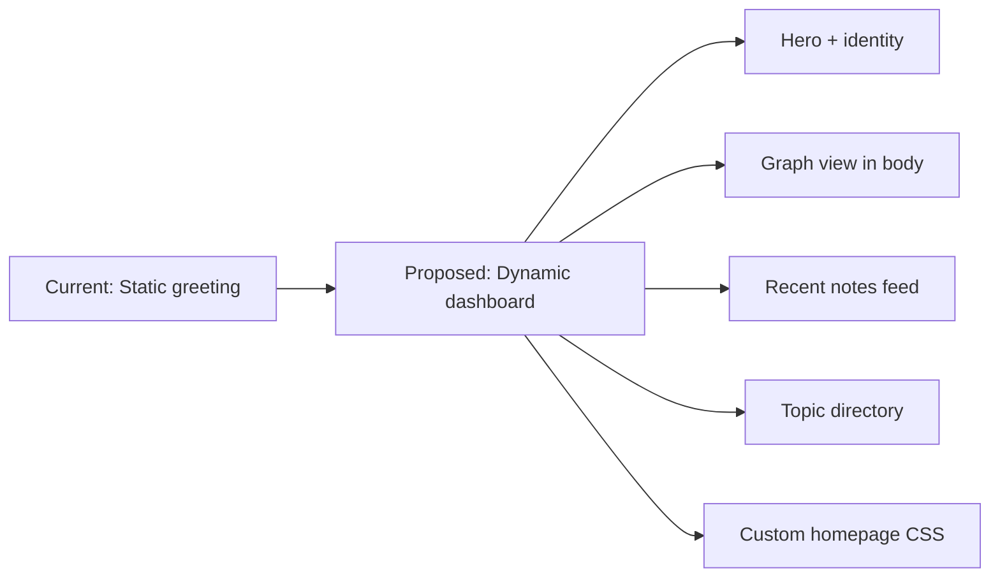

# Homepage Improvement Plan

> [!NOTE]
> Based on analysis of your actual project: **41 notes**, mostly AI/LLM book notes under `00.Fleeting Notes/AI-LLM/`, using **Catppuccin Macchiato** theme, Quartz with YAML config (`quartz.config.yaml`).

---

## Overview

Your current [index.md](file:///home/nimendra/Documents/Projects/obsidian-publish/content/index.md) is a plain 24-line greeting. The goal is to turn it into a **living dashboard** that shows off the graph, highlights recent activity, and gives visitors a real sense of what's inside.



---

## Phase 1 — Graph View on the Homepage

The graph plugin currently sits in the **right sidebar** on every page. We'll add a second instance that renders **in the page body** (`afterBody`) only on the index page.

### 1a. Add `is-index` condition ✅ (already done)

In [conditions.ts](file:///home/nimendra/Documents/Projects/obsidian-publish/quartz/plugins/loader/conditions.ts), we already added:
```typescript
"is-index": (props) => props.fileData.slug === "index",
```

### 1b. Add a homepage-only **global** graph in `quartz.config.yaml`

> [!IMPORTANT]
> The existing `@quartz-community/graph` entry (right sidebar, local graph) stays **untouched**. We add a **second** instance that renders only the global graph in the homepage body.

```yaml
# Homepage global graph — full vault map, only on index page
- source: "@quartz-community/graph"
  enabled: true
  options:
    globalGraph:
      drag: true
      zoom: true
      depth: -1           # show ALL connections
      scale: 0.9
      repelForce: 0.5
      centerForce: 0.3
      linkDistance: 30
      fontSize: 0.6
      opacityScale: 1
      showTags: true
      focusOnHover: true
      enableRadial: true
  layout:
    position: afterBody
    priority: 20
    condition: is-index
```

**Result:** Visitors land on the homepage → see your content → then a full interactive map of every note and connection in the vault. On all other pages, only the local graph appears in the right sidebar as before.

### 1c. Custom CSS to make the homepage graph larger

In [custom.scss](file:///home/nimendra/Documents/Projects/obsidian-publish/quartz/styles/custom.scss), add styles that make the graph taller when it's in the body (not the sidebar):

```scss
// ---------------------------------------------------------------------------
// Homepage graph — taller container when rendered in afterBody
// ---------------------------------------------------------------------------
.page-footer #graph-container {
  height: 400px;  // default sidebar is ~250px
  max-height: 50vh;
  border: 1px solid var(--lightgray);
  border-radius: 8px;
  margin-top: 1rem;
}
```

---

## Phase 2 — Enable Recent Notes on Homepage

The `@quartz-community/recent-notes` plugin is already installed but **disabled**. We turn it on, scoped to the homepage only.

### Changes to `quartz.config.yaml`

```yaml
- source: "@quartz-community/recent-notes"
  enabled: true
  options:
    title: "📝 Recently Updated"
    limit: 5
    showTags: false           # your notes use inline #tags, not frontmatter tags
    hideTagPages: true
    hideFolderPages: true
    linkToMore: false
  layout:
    position: afterBody
    priority: 10              # renders before the graph (priority 20)
    condition: is-index
```

This gives visitors a dynamic feed of your 5 most recently touched notes, right on the homepage.

---

## Phase 3 — Rewrite `content/index.md`

Replace the current plain greeting with a structured dashboard layout using Obsidian callouts and clear sections.

### Proposed new content

```markdown
---
title: Nimendra's Notes
---

# Hey 👋, I'm Nimendra

A self-learner exploring **Cloud & DevOps**, **Systems**, and **AI/LLM** — these are my working notes, published straight from my Obsidian vault.

> [!tip] How to navigate
> - Browse folders in the **Explorer** (left sidebar)
> - Use **Search** — `Ctrl/Alt + /`
> - Hover any [[wikilink]] for a **preview popup**
> - Press `Ctrl + G` for the **full interactive graph**

---

## 📚 What's Inside

> [!abstract] AI & LLMs
> Book notes and deep dives on language models, agents, RAG, fine-tuning, and inference optimization.
> 
> → [[1. Introduction to LLMs|Designing LLM Applications]] · [[Hands-on Large Language Models]] · [[An Illustrated Guide to AI Agents]]

> [!abstract] LLM Internals
> Caching strategies, tokenization, quantization, mixture of experts, and model weights.
> 
> → [[Prefix vs KV vs Prompt Caching]] · [[LLM quantization]] · [[Mixture of Experts (MoE)]]

---

## 🔗 Elsewhere

[GitHub](https://github.com/nmdra) ·
[Blog](https://blog.nimendra.online/) ·
[LinkedIn](https://www.linkedin.com/in/nimendra/) ·
[X](https://x.com/nimendra_) ·
[Bluesky](https://bsky.app/profile/nimendra.xyz) ·
[Resume](https://github.com/nmdra/Nimendra-CV/releases/latest/download/resume.pdf) ·
[Email](mailto:nimendraonline@gmail.com)

> [!note]- About broken links
> Some notes link to pages I haven't published yet. Those links still work — they just land on a 404.
```

### What changed and why
| Section | Before | After |
|---|---|---|
| Title | "Notes" | "Nimendra's Notes" — more personal, better for SEO |
| Intro | Generic bio | Focused on what the vault contains |
| Navigation | Bullet list of instructions | Callout box with keyboard shortcuts & popover tip |
| Content directory | None | Two callout blocks with direct wikilinks to key series |
| Social links | Flat list | Compact single line with all links |
| 404 disclaimer | Always visible blockquote | Collapsed callout (click to expand) |

---

## Phase 4 — Visual Polish via Custom CSS

All changes in [custom.scss](file:///home/nimendra/Documents/Projects/obsidian-publish/quartz/styles/custom.scss). No plugin or component code changes needed.

### 4a. Card Grid for Tag & Folder Pages (instead of bullet list)

**Problem:** Tag/folder pages render notes as flat `section-li` rows — date | title | tags in a spreadsheet-like grid.

**Solution:** Responsive card grid with hover effects.

```scss
// ---------------------------------------------------------------------------
// Card grid for tag and folder listing pages
// ---------------------------------------------------------------------------
ul.section-ul {
  display: grid;
  grid-template-columns: repeat(auto-fill, minmax(280px, 1fr));
  gap: 1rem;
  list-style: none;
  padding-left: 0;
  margin-top: 1.5rem;
}

li.section-li {
  margin: 0;

  & > .section {
    // Override default 3-column grid → stack vertically inside card
    display: flex;
    flex-direction: column;
    gap: 0.4rem;
    padding: 1rem 1.2rem;
    border: 1px solid var(--lightgray);
    border-radius: 10px;
    background: var(--light);
    height: 100%;
    transition: border-color 0.2s ease, transform 0.15s ease, box-shadow 0.2s ease;

    &:hover {
      border-color: var(--tertiary);
      transform: translateY(-2px);
      box-shadow: 0 4px 12px rgba(0, 0, 0, 0.08);
    }
  }

  .meta {
    margin: 0;
    font-size: 0.8em;
    opacity: 0.6;
    order: -1;
  }

  .desc h3 {
    margin: 0;
    font-size: 1rem;
    line-height: 1.4;
  }

  .tags {
    display: flex;
    flex-wrap: wrap;
    gap: 0.3rem;
    margin-top: auto;
    padding: 0;
    list-style: none;
  }
}

@media all and (max-width: 600px) {
  ul.section-ul {
    grid-template-columns: 1fr;
  }

  li.section-li > .section > .tags {
    display: flex;
  }
}
```

### 4b. Tag Index Page — Tag Cloud

The `/tags/` index shows all tags as `<h2>` headings. Style them as flowing pills instead.

```scss
// ---------------------------------------------------------------------------
// Tag index page — tag links as a flowing cloud
// ---------------------------------------------------------------------------
.page-listing h2 {
  display: inline-block;
  margin: 0.3rem 0.2rem;
  font-size: 1rem;
  font-weight: normal;

  a.tag-link {
    display: inline-block;
    padding: 0.3rem 0.8rem;
    border: 1px solid var(--gray);
    border-radius: 999px;
    background: var(--lightgray);
    color: var(--secondary);
    font-size: 0.9em;
    transition: all 0.15s ease;

    &:hover {
      background: var(--secondary);
      border-color: var(--secondary);
      color: var(--light);
      transform: scale(1.05);
    }
  }
}
```

### 4c. Homepage Hero — Gradient Title + Animated Separator

```scss
// ---------------------------------------------------------------------------
// Homepage hero
// ---------------------------------------------------------------------------
body[data-slug="index"] {
  article > h1:first-of-type {
    background: linear-gradient(135deg, var(--secondary) 0%, var(--tertiary) 100%);
    -webkit-background-clip: text;
    -webkit-text-fill-color: transparent;
    background-clip: text;
    font-size: 2.2rem;
    margin-bottom: 0.3rem;
  }

  // Subtle animated gradient line under hero
  article > h1:first-of-type::after {
    content: "";
    display: block;
    height: 3px;
    margin-top: 0.5rem;
    border-radius: 2px;
    background: linear-gradient(90deg, var(--secondary), var(--tertiary), var(--secondary));
    background-size: 200% 100%;
    animation: shimmer 3s ease-in-out infinite;
  }
}

@keyframes shimmer {
  0%, 100% { background-position: 0% 50%; }
  50% { background-position: 100% 50%; }
}
```

### 4d. Callout Cards with Hover Effect

```scss
// ---------------------------------------------------------------------------
// Card-style callouts on homepage
// ---------------------------------------------------------------------------
body[data-slug="index"] .callout {
  border-radius: 10px;
  border: 1px solid var(--lightgray);
  transition: border-color 0.2s ease, box-shadow 0.2s ease;

  &:hover {
    border-color: var(--tertiary);
    box-shadow: 0 2px 8px rgba(0, 0, 0, 0.06);
  }
}
```

### 4e. Recent Notes Section Styling

```scss
// ---------------------------------------------------------------------------
// Recent notes on homepage
// ---------------------------------------------------------------------------
body[data-slug="index"] .recent-notes {
  margin-top: 1.5rem;

  > h3 {
    color: var(--secondary);
    font-size: 1.1rem;
    border-bottom: 2px solid var(--lightgray);
    padding-bottom: 0.5rem;
    margin-bottom: 1rem;
  }

  .recent-ul > li {
    padding: 0.6rem 0.8rem;
    border: 1px solid var(--lightgray);
    border-radius: 8px;
    margin-bottom: 0.6rem;
    transition: border-color 0.2s ease;

    &:hover {
      border-color: var(--tertiary);
    }

    .section {
      display: flex;
      flex-direction: column;
      gap: 0.2rem;
    }

    .meta {
      font-size: 0.8em;
    }
  }
}
```

### 4f. Homepage Graph — Larger Container

```scss
// ---------------------------------------------------------------------------
// Homepage graph — taller when in afterBody
// ---------------------------------------------------------------------------
body[data-slug="index"] .page-footer #graph-container {
  height: 400px;
  max-height: 50vh;
  border: 1px solid var(--lightgray);
  border-radius: 10px;
  margin-top: 1rem;
}
```

---

## Phase 5 — Global Reading Polish

Small refinements across every page.

### 5a. Smoother Horizontal Rules

```scss
hr {
  border: none;
  height: 1px;
  background: linear-gradient(
    90deg,
    transparent,
    var(--lightgray) 20%,
    var(--lightgray) 80%,
    transparent
  );
  margin: 2rem 0;
}
```

### 5b. Rounded Images

```scss
article img {
  border-radius: 6px;
  border: 1px solid var(--lightgray);
}
```

### 5c. Code Block Top Accent

```scss
pre {
  border-top: 2px solid var(--tertiary);
  border-radius: 0 0 6px 6px;
}
```

### 5d. Explorer Sidebar — Active Page Highlight

```scss
.explorer {
  .folder-title {
    font-weight: 600;
    color: var(--dark);
  }

  a.internal.is-current {
    color: var(--tertiary);
    font-weight: 600;
    border-left: 2px solid var(--tertiary);
    padding-left: 0.4rem;
  }
}
```

### 5e. Wider Content on Large Screens

```scss
@media all and (min-width: 1400px) {
  .center {
    max-width: 850px;
  }
}
```

---

## Phase 6 — Optional Enhancements

Lower-priority but worth considering:

| Feature | Plugin | What it does |
|---|---|---|
| **Tag list in sidebar** | `@quartz-community/tag-list` (disabled) | Shows tag cloud — enable with `condition: is-index` in `beforeBody` once you add frontmatter tags |
| **Stacked pages** | `@quartz-community/stacked-pages` (disabled) | Andy Matuschak-style sliding panes — nice for deep browsing |
| **Comments** | `@quartz-community/comments` (disabled, giscus) | Let visitors leave comments via GitHub Discussions |
| **Frontmatter tags** | Manual content work | Your notes use inline `#tags` but not frontmatter `tags:` — adding them would unlock tag pages and tag-based filtering in recent notes |

---

## Files to Change

| File | Action |
|---|---|
| [conditions.ts](file:///home/nimendra/Documents/Projects/obsidian-publish/quartz/plugins/loader/conditions.ts) | ✅ Already added `is-index` |
| [quartz.config.yaml](file:///home/nimendra/Documents/Projects/obsidian-publish/quartz.config.yaml) | Enable recent-notes, add homepage graph instance |
| [content/index.md](file:///home/nimendra/Documents/Projects/obsidian-publish/content/index.md) | Rewrite with callouts, topic directory, nav tips |
| [custom.scss](file:///home/nimendra/Documents/Projects/obsidian-publish/quartz/styles/custom.scss) | Card grids, tag cloud, hero gradient, callout cards, recent notes, graph sizing, reading polish, explorer highlight |

---

## Execution Order

1. **Config changes** — `quartz.config.yaml` (enable recent-notes + add homepage graph)
2. **Content rewrite** — `content/index.md`
3. **CSS polish** — `quartz/styles/custom.scss` (all Phase 4 + Phase 5 styles)
4. **Build & test** — `npx quartz build --serve` to preview locally

