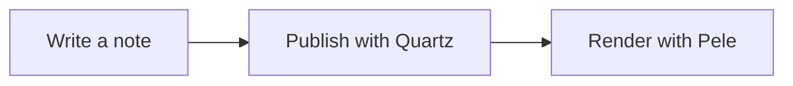

# notes.nimendra.online

Public notes from my Obsidian vault, built with [Quartz 5](https://quartz.jzhao.xyz/)
and deployed to GitHub Pages.

**Site:** https://notes.nimendra.online

## Site features

This site adds local plugins, a custom reading layout, and a selective publishing
pipeline on top of Quartz.

| Local addition                                              | What it provides                                                                                         |
| ----------------------------------------------------------- | -------------------------------------------------------------------------------------------------------- |
| [Pele diagrams](#diagrams)                                  | Locally bundled Mermaid-compatible rendering, automatic zoom, source copy, and expanded/fullscreen views |
| [Image zoom](#image-zoom)                                   | Click and keyboard image enlargement with a close control and focus restoration                          |
| [Copy note link](#copy-note-link)                           | A compact title-row button that copies the note title and public URL                                     |
| [Unavailable-link notices](#unavailable-link-notices)       | Feedback for links to unpublished pages or blocked document formats                                      |
| [Homepage and reading layout](#homepage-and-reading-layout) | Linked topic cards, responsive listings, and sidebar layout adjustments                                  |
| [Catppuccin styling](#theme-and-callouts)                   | Light/dark colors, tag chips, callout styling, and a video callout                                       |
| [Selective publishing](#what-gets-published)                | Folder includes/exclusions, referenced-media sync, validated canvases, and blocked-file checks           |
| [Site guide](templates/llms.txt)                            | A maintained `llms.txt` template copied to the published site root                                       |

Configured Quartz/community features include search with previews, Explorer,
breadcrumbs, local/global graphs, backlinks, popovers, a table of contents,
reader mode, KaTeX, alias redirects, RSS, and a sitemap. Community plugins also
provide canvas pages, draft/unlisted-page handling, and encrypted pages. These
are configured dependencies, not locally implemented plugins. Do not assume
that encrypted pages hide their titles or all page metadata.

## What gets published

[`publish.list`](publish.list) selects vault-relative folders. For example:

```text
Notes/Published
!Notes/Published/Private
```

A line starting with `!` excludes a folder and wins over any include. Write each
rule on its own line; inline comments are not supported.

The sync copies Markdown, supported media, and validated Obsidian canvases from
included folders. Referenced supported media can also be copied from outside
those folders, such as a shared attachment directory. Explicit exclusions still
apply. Review screenshots, canvas text, attachments, and embedded metadata before
publishing them. File extensions alone do not establish privacy or redistribution
rights.

PDF, EPUB, Office, archive, and base files are blocked. CI checks `content/` and
`public/` for blocked files and symlinks. These gates do not certify that allowed
text or images are safe to publish. Broken-link notices do not redact private
note titles or link targets.

`content/` and `public/` are generated and must not be committed. **Git history is
a separate publication surface:** adding an ignore rule or deleting a tracked
file does not remove its earlier versions. Historical content and existing
GitHub Actions logs still need owner review before making this repository public.
See the [public-release plan](.agents/plans/public-release.md).

## Configure deployment

Set these in the repository's Actions settings before the next deployment:

| Setting                     | Purpose                                            |
| --------------------------- | -------------------------------------------------- |
| Variable `VAULT_REPOSITORY` | Source vault repository in `owner/repository` form |
| Secret `REPO_KEY`           | Read-only access limited to that source repository |

The repository variable removes a hardcoded private repository identity from
source. It is **not a secret**: checkout actions can show it in public logs.
Review the token's scope and expiry in GitHub settings without printing its value.

Only trusted publication code may run with access to the private vault. Protect
`v5` and require review for workflow, script, dependency, and plugin changes. Do
not add private-vault access to workflows that execute untrusted pull-request
code. Public visibility alone does not grant visitors permission to run this
privileged publication workflow.

## Publish a note

Write the note in Obsidian, then push approved publication changes to `v5`. CI:

1. checks out the configured private vault using `REPO_KEY`,
2. syncs selected content into a fresh `content/` directory,
3. checks blocked files and symlinks, then runs types and tests,
4. builds, checks, and deploys the generated site to GitHub Pages.

The workflow regenerates `content/` rather than trusting a copy from the push.
The sync also copies `templates/llms.txt` to `content/llms.txt`, which Quartz copies
to the site root. CI checks that the emitted file matches the template.

Sync reports show counts by default. Detailed local reports are opt-in and can
contain private filenames and link targets. Do not attach those reports to public
issues or retain them in public Actions logs. Other build tools and failures can
also print source details; review logs before publication.

## Local preview

```bash
npm ci
./scripts/sync-content.py --vault /path/to/private-vault
npm run install-plugins
npx quartz build --serve # http://localhost:8080
```

Use `--verbose` for a detailed local sync report, or `--quiet` to suppress the
successful report. The file checker also accepts `--verbose` for local use.
Set `VAULT_PATH` as an alternative to `--vault`. One of these is required; the
previous machine-specific vault default has been removed. Keep local environment
files and private checkouts out of Git.

## Custom reader features

### Image zoom

The local [image-zoom plugin](quartz/plugins/image-zoom/) enlarges images in note
content. Click an eligible image, or focus it and press **Enter** or **Space**.
Use **Escape** or the close button to dismiss it. The integration restores focus
and refreshes its image bindings after SPA navigation.

Linked images keep their existing link behavior. Homepage cards, tag-page
images, and listing images are excluded from zoom selection.

### Copy note link

The local [share-button plugin](quartz/plugins/share-button/) adds an icon beside
note titles. **Copy note link** copies the title and public URL on separate
lines. It removes query strings and fragments from the URL. If clipboard access
fails or is unavailable, a selectable field provides the same text for manual
copying. The button is omitted from homepage, folder, tag, canvas, and error-page
layouts.

### Unavailable-link notices

The local [link-notice plugin](quartz/plugins/link-notice/) shows a notice when a
reader activates a broken internal link or a link to a blocked document format.
This avoids sending readers to destinations that are not available on the site.
It does **not** redact the link text, destination, or private information from
published output.

### Homepage and reading layout

[`templates/index.md`](templates/index.md) supplies the homepage introduction and
linked topic directory. A configured community component adds five recently
updated notes below it. Custom CSS provides responsive topic and folder/tag
cards, Explorer emphasis, and separate scrolling areas for long sidebar content
so the graph can remain visible.

Keep homepage topic links aligned with the published routes and the route
exceptions in the link-notice plugin. Update the template rather than generated
`content/index.md`.

### Theme and callouts

[`quartz/styles/custom.scss`](quartz/styles/custom.scss) and the local Catppuccin
styles extend the configured light/dark palette. They style links, tag chips,
blockquotes, callouts, listings, and mobile layouts. The custom `[!video]`
callout uses a video-camera icon and theme-aware red accents. OFM still handles
callout parsing and supported video/YouTube embeds.

Theme colors and fonts are configured in [`quartz.config.yaml`](quartz.config.yaml).
The reader-facing dark-mode and reader-mode controls come from community plugins.

## Layout

| Path                             | Purpose                                             |
| -------------------------------- | --------------------------------------------------- |
| `publish.list`                   | Folder includes and exclusions                      |
| `scripts/sync-content.py`        | Content sync, source-boundary checks, and reporting |
| `scripts/check-blocked-files.py` | Blocked-format and symlink gate                     |
| `content/`                       | Generated publication input, ignored by Git         |
| `templates/index.md`             | Homepage source                                     |
| `templates/llms.txt`             | Site overview                                       |
| `quartz.config.yaml`             | Site configuration and plugin selection             |
| `quartz/styles/custom.scss`      | Site-specific CSS                                   |
| `quartz/plugins/pele/`           | Local diagram renderer and browser checks           |
| `quartz/plugins/image-zoom/`     | Note-image enlargement                              |
| `quartz/plugins/share-button/`   | Title-row copy-link control                         |
| `quartz/plugins/link-notice/`    | Unavailable-link feedback                           |
| `.github/workflows/deploy.yml`   | Trusted publication workflow                        |

## Diagrams

Mermaid fences render with [Pele](https://pele.run/) through the local
[`quartz/plugins/pele`](quartz/plugins/pele/) transformer. Pele **1.9.0** is pinned
and bundled into local, content-hashed assets. The renderer does not load from a
runtime CDN. OFM keeps handling wikilinks, callouts, and other Obsidian features,
with only its `mermaid` option disabled in `quartz.config.yaml`.

Keep using ordinary Mermaid fences in notes; no diagram export step is needed:

````markdown

````

The browser integration uses Pele's mount/render lifecycle, cleans up during SPA
navigation, and mounts dynamically inserted diagrams and cloned popovers.

Diagrams adapt to their container and use the site theme colors and fonts.
Readers can copy the source or open an expanded view. Pele's `zoom: "auto"`
enables zoom and pan only when a diagram shrinks to fit; native controls occupy
their own row instead of covering nodes. Expanded views fit their content and
retain zoom and pan between openings at the same size on the same page. Browser
fullscreen is available where supported. Escape closes the expanded view and
returns focus to its opener; fullscreen can consume the first Escape press.
Invalid diagrams show a text error and selectable source.

Diagram colors use soft, theme-aware node and subgraph fills, readable borders,
and eight chart-series colors for light and dark mode. Explicit Mermaid `style`
and `classDef` colors remain author-controlled.

Pele uses its own layout engine, so its output differs from Mermaid.js. Mermaid
`themeVariables` do not transfer to the site theme. Fixed diagram colors remain
fixed across themes. General HTML labels, custom icon packs, and math typesetting
are not provided by this integration. Diagram image loading is disabled. See
[Pele compatibility](https://pele.run/compatibility),
[theming](https://pele.run/theming), [API](https://pele.run/api), and
[examples](https://pele.run/examples).

Run focused regression tests with:

```bash
npx tsx --test quartz/plugins/pele/pele.test.ts
```

For browser checks, build the site, serve `public/` at `http://127.0.0.1:8080`,
and use an installed Playwright CLI with Chromium:

```bash
playwright-cli -s=pele open http://127.0.0.1:8080
playwright-cli -s=pele run-code --filename=quartz/plugins/pele/browser-check.js
```

The browser check inserts synthetic diagrams into the local page only. To roll
back the renderer, disable the local Pele plugin and restore OFM `mermaid: true`
together. Keep only one renderer enabled.

## Checks

```bash
python3 -m unittest discover -s scripts -p 'test_*.py'
npx tsc --noEmit
npm test -- 'quartz/**/*.test.{ts,js}'
```

After an approved local sync and build, run:

```bash
python3 scripts/check-blocked-files.py content
python3 scripts/check-blocked-files.py public
```

Canvas text validation supports a conservative Markdown subset. It checks inline
and reference-style destinations and rejects ambiguous syntax. It is not a full
Markdown parser and can reject valid text. Canvas URL nodes permit HTTP(S) links;
other schemes fail validation. HTML link/source attributes are checked, including
unquoted values; `srcset` and `srcdoc` are not supported. Review any rejected
canvas locally with `--verbose`, without publishing the diagnostic output.

Review the actual emitted pages, search indexes, graph data, feeds, canvases, and
media before public release. Never use a passing suffix check as approval of
private information or copyrighted material.

## Custom domain

The CNAME plugin generates the domain configured in `quartz.config.yaml`. DNS
uses a `CNAME` record for `notes` pointing at `nmdra.github.io`. Enable
_Enforce HTTPS_ in the repository's Pages settings.

---

Built with Quartz. Retain the upstream [MIT license](LICENSE.txt).
Site content © [Nimendra](https://github.com/nmdra); the code license does not
automatically grant redistribution rights for third-party excerpts or images.
