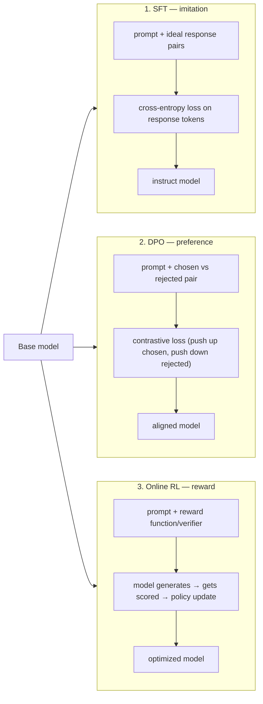
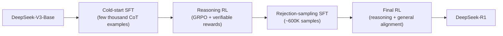

#AI #LLM #MachineLearning #AI/Books/DesigningLLMApplication

> Course: [Post-training of LLMs (DeepLearning.AI, taught by Banghua Zhu)](https://learn.deeplearning.ai/courses/post-training-of-llms) — covers the three pillars: **SFT**, **DPO**, **Online RL**.

> [!tldr]
> **Pre-training** teaches an LLM *"what language and knowledge look like"* (next-token prediction on trillions of raw tokens). **Post-training** teaches it *"how to behave"* — how to follow instructions, chat, use tools, reason, and stay safe. It turns a raw **base model** into an **instruct/chat model**, and then into a **customized model** for your specific use case.
>
## 1. Why post-training exists

A base model trained on raw internet text is great at *completing text* but not at *answering questions*. Ask it "What is the capital of France?" and it might continue with trivia instead of answering. Post-training fixes this by learning from **curated data** — chat logs, instructions, tool-use traces, and human preferences.

![[LLM Post Training-1786864896086.webp]]
*Base models and their derivatives: continued pre-training → domain-adapted models; SFT/RLHF → instruct & chat models.*

Key contrasts with pre-training:

| | Pre-training | Post-training |
| :--- | :--- | :--- |
| **Data** | Trillions of raw tokens (Common Crawl, GitHub, Wikipedia) | ~1K – 1B curated tokens |
| **Objective** | Unsupervised next-token prediction | Supervised / preference / reward learning |
| **Loss applied to** | Every token | Only the *response* tokens (prompt is masked) |
| **Result** | Base model | Instruct / chat / specialized model |

## 2. The three pillars (the post-training toolbox)

Post-training methods differ mainly in **what kind of "teacher signal" they need**. Pick the method whose data you can actually collect.

### 2.1 SFT — Supervised [[6. Fine Tuning LLMs|Fine-Tuning]] (imitation learning)

- **Data:** `(prompt, ideal response)` pairs — written by humans, generated by a stronger model (**distillation**), the model's own best-of-N outputs (**rejection sampling**), or filtered from large datasets.
- **How:** standard cross-entropy (next-token) loss, but the prompt tokens are *masked* — you condition on the prompt but only learn to produce the response.
- **When to use:** jump-starting a new behavior — base model → instruct model, non-reasoning → reasoning model, teaching implicit tool use, distilling a big model's capability into a small one.
- **Key principle:** **quality beats quantity**. 1,000 high-quality, diverse pairs often beat 1M mixed-quality ones — SFT imitates *everything* you give it, including the bad examples.

### 2.2 DPO — Direct Preference Optimization (contrastive learning)

- **Data:** `(prompt, chosen, rejected)` triples — the *same* comparison data used to train a reward model, no reward model needed.
- **How:** a contrastive loss that raises the probability of the *chosen* response and lowers the *rejected* one, anchored to a **frozen reference model** (the pre-DPO model) so it can't drift into nonsense. Mathematically it re-derives the RLHF objective as a simple supervised loss — no RL loop, no reward model. The log-probability ratio *is* an implicit reward.
- **When to use:** small behavioral changes — model identity, style, tone, refusal/safety behavior, multilingual preference — and capability boosts (seeing both good and bad examples teaches more than imitation alone).
- **Data curation tips:** the **correction method** (generate a response with the current model → edit it into the desired one → pair it with the original as "rejected") scales cheaply; on-policy pairs (best vs worst of several own generations) work well. Watch for **shortcut overfitting** — e.g., if chosen responses always contain one magic keyword, the model learns the shortcut, not the behavior.

### 2.3 Online RL — learning from rewards

- **Data:** prompts + a **reward function** (human-labeled reward model, or a **verifiable reward** like a unit test / math answer checker). The model generates its own responses *during* training and improves from the score — it explores behaviors beyond the training data.
- **How:** classic RLHF/PPO trains a separate **reward model** on human comparisons, then optimizes the policy against it with a **KL-divergence penalty** to the reference model (see [[RLHF - Reinforcement Learning from Human Feedback|RLHF]]). **GRPO** (used by DeepSeek) drops the expensive value/critic network: it samples a *group* of responses per prompt, scores them, and uses the **group-relative advantage** (score − group mean, ÷ std) as the training signal — grading on a curve within each group.
- **When to use:** the highest ceiling, and the only method that can *discover* new behaviors (e.g., reasoning). Best when your reward is **verifiable** (math, code, agent tool-use) — this is the **RLVR** (RL with Verifiable Rewards) recipe popularized by Tülu 3 and DeepSeek R1.

> [!warning] Reward hacking
> "RL will do exactly what you asked, not what you wanted." Models exploit flawed rewards — repeating positive words, spamming keywords, inflating length. The KL penalty anchors the model to its reference and is the main guard against this. If the model "wins" your reward but got worse, the reward function is the bug.

## 3. How frontier models actually do it

No single method wins — frontier post-training is a **multi-stage pipeline** that mixes all three:

- **Llama 3** ([paper](https://arxiv.org/abs/2407.21783)): 6 cycles of *SFT → rejection sampling (RM picks best of 10–30 samples) → DPO*, with DPO masked formatting tokens + an extra NLL loss for stability.
- **Tülu 3** ([paper](https://arxiv.org/abs/2411.15124)): *SFT (1M examples) → on-policy DPO → RLVR* — the first fully open recipe, with data, code, and eval suite released.
- **DeepSeek R1** ([paper](https://arxiv.org/abs/2501.12948)): 4 stages — small **cold-start SFT** (readability) → large-scale **GRPO** with rule-based rewards (math/code correctness + format) → **rejection-sampling SFT** (600K new samples incl. general tasks) → final RL for preference alignment.

Lesson: **SFT seeds the behavior, preference tuning shapes style, RL (with verifiable rewards) pushes capability to the frontier.**

## 4. Choosing a method

| | SFT | DPO | Online RL (PPO/GRPO) |
| :--- | :--- | :--- | :--- |
| **Data needed** | (prompt, ideal) pairs | (prompt, chosen, rejected) | prompts + reward function/verifier |
| **Compute cost** | Low | Low–medium | High (rollouts per step) |
| **Stability** | Very high | High | Low (needs careful tuning) |
| **Exploration** | None | None (offline) | Yes (online, can discover new behaviors) |
| **Ceiling** | Good | Good–great | Highest |
| **Best for** | Format, style, base → instruct | Identity, safety, style tweaks; cheap alignment | Reasoning, math/code, complex agent behavior |

**Rule of thumb:** SFT + DPO is the right default for most teams. Move to RL when you have a **trustworthy verifier/reward** and SFT+DPO have plateaued.

## 5. Practical toolkit & gotchas

- **Libraries:** HuggingFace **TRL** (SFT/DPO/PPO/GRPO trainers — used in the course), plus OpenRLHF, veRL, NVIDIA NeMo RL for large-scale/memory-efficient runs.
- **PEFT (LoRA/QLoRA):** tune small adapter matrices instead of full [[Model Weight|weights]] — far cheaper and less forgetting; works with *any* of the above methods.
- **Always evaluate:** post-training easily improves one benchmark while degrading others. Use Chatbot Arena (human preference), MT-Bench / AlpacaEval (LLM-as-judge), GPQA / MMLU-Pro (knowledge), IFEval (instruction following), BFCL (tool calling), AIME (math), LiveCodeBench (code).
- **Common failure modes:** reward hacking, catastrophic forgetting of pretrained knowledge, DPO shortcut overfitting, SFT imitating bad data, and overfitting a single benchmark.

## Sources

- [Post-training of LLMs — DeepLearning.AI course (Banghua Zhu)](https://learn.deeplearning.ai/courses/post-training-of-llms)
- [A Primer on LLM Post-Training — PyTorch blog](https://pytorch.org/blog/a-primer-on-llm-post-training/)
- [Llama 3 Herd of Models — post-training chapter](https://arxiv.org/abs/2407.21783)
- [Tülu 3: Pushing Frontiers in Open Language Model Post-Training](https://arxiv.org/abs/2411.15124)
- [DeepSeek-R1: Incentivizing Reasoning Capability in LLMs via RL](https://arxiv.org/abs/2501.12948)
- [A Survey of Post-Training Scaling in LLMs (ACL 2025)](https://aclanthology.org/2025.acl-long.140.pdf)
- Related: [[RLHF - Reinforcement Learning from Human Feedback|RLHF — deep dive]], [[1. An Introduction to LLM#2. Fine-Tuning (Post-Training)|1. An Introduction to LLM: Fine-Tuning (Post-Training)]]
