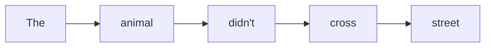
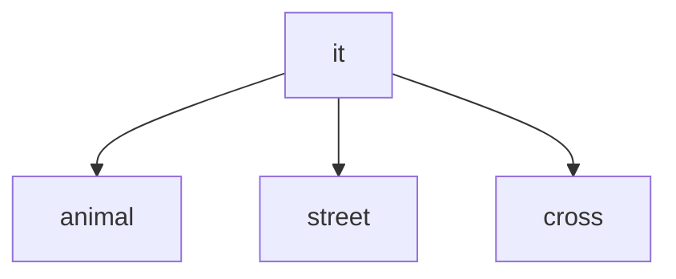
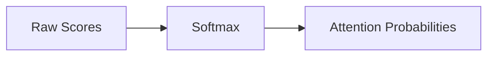
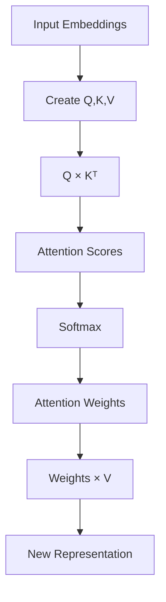
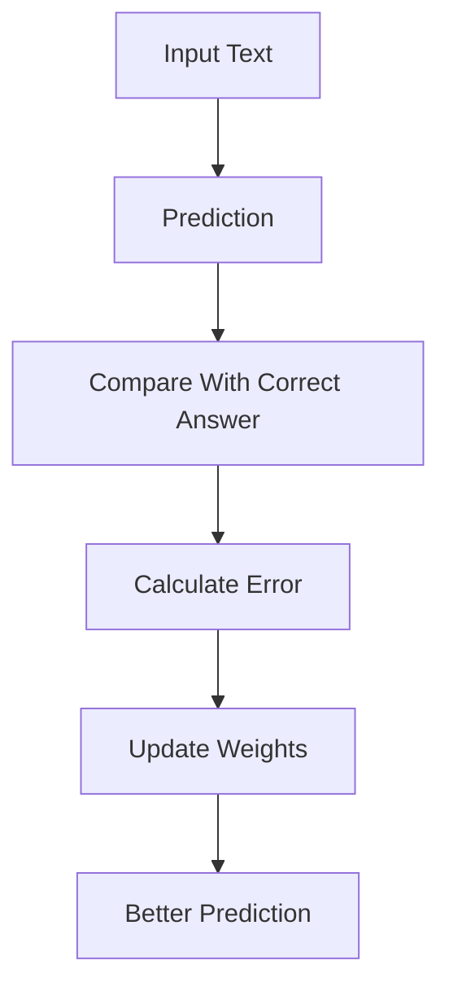
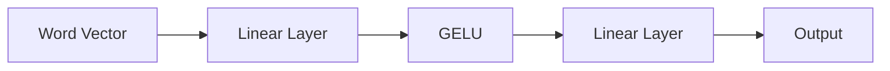
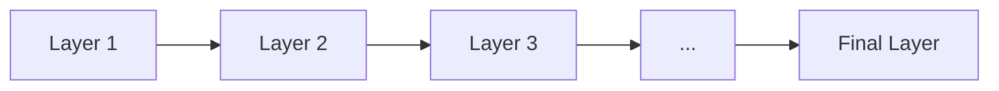

#AI #LLM #AI/Books/HandsOnLargeLanguageModels

> [[1. An Introduction to LLM#Attention]]

> [!tldr]-
> A Transformer works like this:
> 
> 1. Convert words into vectors.
>     
> 2. Create Query, Key, Value representations.
>     
> 3. Compare Query and Key to find relationships.
>     
> 4. Use Softmax to decide attention strength.
>     
> 5. Use Values to collect information.
>     
> 6. Refine information through Feed Forward Networks.
>     
> 7. Repeat through many layers.
>     
> 
> Self-Attention decides:
> 
> **"Where should I look?"**
> 
> Softmax decides:
> 
> **"How much should I look there?"**
> 
> Value decides:
> 
> **"What information should I take?"**
> 
> Feed Forward Network decides:
> 
> **"How should I transform what I learned?"**
# Introduction

The **Transformer** is a deep learning architecture introduced in the landmark paper **"Attention Is All You Need"** by Ashish Vaswani and colleagues in **2017**. It revolutionised Natural Language Processing (NLP) by replacing recurrent networks (RNNs/LSTMs) with a mechanism called **self-attention**.

> [!info]- Paper
> ![[Attention Is All You Need.pdf]]

The authors proposed a network architecture called the **Transformer**, which was solely based on the attention mechanism and removed the recurrence network that we saw previously.([[FNN and RNN#Recurrent Neural Network (RNN)]]).

Compared to the recurrence network, the Transformer could be trained in paralled, which sped up training.
## Why was the Transformer Introduced ?

Before Transformers, NLP models mainly used RNNs and LSTMs.
RNNs often struggle with such long-distance relationships.
### Problems with RNNs/LSTMs

- Process words **one at a time** (sequentially)
- Slow to train because computation cannot be fully parallelised
- Difficult to capture long-range dependencies
- Performance degrades for very long sentences
![[Attention is All You Need-1785042834214.webp]]
## The Solution: Self-Attention

The Transformer introduced **Self-Attention**, allowing every word in a sentence to directly attend to every other word.

> [!example]
> Sentence: *"The animal didn't cross the street because **it** was tired"*
>
> To understand **"it"**, the model can attend to **"animal"** rather than just the immediately preceding word.
# Transformer

> [!video]- Stanford CS25: Transformers United V6 I Overview of Transformers
> 
## What is the Transformer ?

- The **Transformer** is a neural network architecture introduced in the **2017 paper "Attention Is All You Need"** by Ashish Vaswani et al.
- It is built **entirely on the attention mechanism**, eliminating the need for Recurrent Neural Networks (RNNs).
- Since it does not process data sequentially like RNNs, it can be **trained in parallel**, making training much faster.
## Architecture

The transformer consists of two main componenets:
1. Encoder
2. Decoder
Both are made up of multiple stacked layers.

![[Attention is All You Need-1785044068809.webp]]

==Although training is parallel, the Transformer **generates output autoregressively**== ([[1. An Introduction to LLM#Autoregressive Generation]]), meaning it predicts **one token at a time**, using previously generated tokens to predict the next one.
### Encoder

Each encoder block contains:
- Self-Attention Layer
- Feed-Forward Neural Network (FFN)

![[Attention is All You Need-1785044531206.webp]]

Purpose:
- Reads the entire input sequence.
- Learns relationships between all words.
- Produces contextual representations that are passed to the decoder.
### Self Attention

Self-Attention is the key innovation of the tranformer. 

Instead of processing words one by one, self-attention allows every word to attend to every other word in the same sentence.

At inference time the K/V projections from this attention are what the [[KV cache#The Solution: Caching K and V|KV cache]] stores, so decoding does not recompute them.

![[Attention is All You Need-1785044686175.webp]]

Advantages:
- Looks at the **entire sequence simultaneously**.
- Captures long-range dependencies.
- Produces richer contextual representations.
- Enables parallel computation, making training faster.
### Decoder

The Decoder contains:
- **Masked Self-Attention**
- **Encoder–Decoder Attention**
- **Feed-Forward Neural Network**

![[Attention is All You Need-1785044768013.webp]]
#### Encoder-Decoder Attention

The decoder attends to the encoder's output to determine which parts of the inputs are most relevent when generating each output token.
#### Masked Self Attention

The decoder masks future words during training.

> [!example]
> Target sentence:  "I love AI"
> When predicting **"love"**, the decoder can only see: "I"
> It **cannot access future words** like **"AI"**.

This prevents the model from "looking into the future" and ensures it learns to generate text one token at a time.

> [[FNN and RNN#Feed-Forward Neural Network (FNN)]]
## Why the Transformer is Better than RNNs

|RNN|Transformer|
|---|---|
|Processes one token at a time|Processes all tokens simultaneously|
|Uses recurrence (memory)|Uses self-attention|
|Difficult to capture long-range dependencies|Captures long-range dependencies effectively|
|Slow training|Fast, parallel training|
# Softmax Function

The **softmax function** converts a vector of raw numbers (often called "logits") into a probability distribution — values between 0 and 1 that sum to 1.

**Formula** for an input vector $z = (z_1, ..., z_n)$:

$$\text{softmax}(z_i) = \frac{e^{z_i}}{\sum_{j=1}^{n} e^{z_j}}$$

**How it works:**

1. Exponentiate each value (makes everything positive, and amplifies differences — larger inputs become disproportionately larger)
2. Divide each by the sum of all exponentials (normalizes so they add up to 1)

**Example:** for logits `[2.0, 1.0, 0.1]`, softmax gives roughly `[0.66, 0.24, 0.10]` — the largest input gets the largest probability, but all outputs remain positive.

**Why it's used:**

- Common as the final layer in classification neural networks, turning raw scores into class probabilities
- Used in attention mechanisms (e.g., Transformers) to weight how much focus to give different inputs
- Differentiable, so it works well with gradient-based training

**Key property:** it's a "soft" version of `argmax` — instead of picking just the single biggest value (winner-takes-all), it produces a smooth distribution where bigger inputs get more probability mass, but smaller ones aren't reduced to zero.
# The Annotated Transformer

The **Annotated Transformer** is a popular blog post/tutorial created by the Harvard NLP group that provides a line-by-line walkthrough of the original "Attention Is All You Need" paper (Vaswani et al., 2017), which introduced the Transformer architecture.

> [!info]- Paper: The Annotated Transformer
> ![[The Annotated Transformer.pdf]]

---
# Transformer Architecture: A Socratic Guide

## 1. Why do we need Transformers?

> [!question]  Why can't a computer simply read a sentence from left to right?

Older models like RNNs process text sequentially:



This creates problems:
- Long-distance relationships are difficult.
- Earlier words may be forgotten.
- Processing cannot happen efficiently in parallel.
### The Transformer Idea

> [!tip]  
> Instead of reading one word at a time, allow every word to directly communicate with every other word.

This mechanism is called: Self Attention
## 2. What is Self-Attention?

> [!question] How can a word understand its meaning from the whole sentence?

Example:
> "The animal didn't cross the street because **it** was tired."

The word **it** needs to know:
```
Does "it" mean street?
Does "it" mean animal?
```

Self-attention allows:



The model learns that: `it → animal` is the strongest relationship.
## 3. From Words to Numbers

> [!question] How does a neural network understand words?

It cannot directly understand text. Words become vectors.

Example: `animal -> [0.25, -0.8, 1.3, 0.6]`

This is called: Word Embeddings
## 4. Why Matrix Multiplication?

> [!question] How does the Transformer transform these vectors?

The Transformer uses learned matrices. Three important matrices:

```
WQ = Query weights
WK = Key weights
WV = Value weights
```

The transformations:
$$  
Q = XW_Q  
$$
$$  
K = XW_K  
$$
$$  
V = XW_V  
$$
> [!example]  
> Think of a conversation.
> 
> |Component|Meaning|
|---|---|
|Query|What am I looking for?|
|Key|What information do I contain?|
|Value|What information will I provide?|
## 5. How are Attention Scores Created?

> [!question] How does "it" decide which word matters?

The Query of "it" compares with every Key.

Formula: $Score = QK^T$

Example:

```
Query(it) [2,1]

Key(animal) [3,2]
```

Calculation:

```
(2×3)+(1×2) =8
```

Score:

```
animal = 8
street = 2
tired  = 3
```

Higher score means:
> "This word is more relevant."
## 6. Softmax Converts Scores into Attention

> [!question] Why don't we directly use the scores?

Because scores are not probabilities.

Example: `[8,2,3]`

Softmax converts: `[0.99,0.005,0.005]`

Now the model knows: `99% attention → animal`
## Softmax Function

Softmax:
1. Converts numbers into probabilities.
2. Makes all values add up to 1.
3. Highlights important choices.


## 7. What Happens to Value (V)?

> [!question] After deciding what is important, how does the model collect information?

The attention weights multiply the Value vectors.

Formula:
$$  
AttentionOutput = Softmax(QK^T)V  
$$
Example:

```
animal = 0.8
street = 0.1
tired  = 0.1
```

Output:

```
0.8 × Value(animal)
+
0.1 × Value(street)
+
0.1 × Value(tired)
```

## Complete Self-Attention Pipeline


## 8. How Does the Transformer Know?

> [!question] Who tells the model that "it" refers to "animal"?

Nobody manually tells it. The model learns.

Training process:



This process uses: [[03 - Regression#Gradient Decent|Gradient Decent]] , [[2.1 Gradients & Related Concepts#Backpropagation Step-by-Step (Full Example)| Backpropagation]]

## 9. Residual Connection

> [!question] Why add the original information back?

Formula:

```
Output =
Attention Output
+
Original Input
```

Benefits:
- Prevents information loss.
- Makes deep networks easier to train.

## 10. Feed Forward Network

> [!question] If attention already connects words, why need another network?

Attention mixes information.
The Feed Forward Network transforms each word individually, while [[Mixture of Experts (MoE)|sparse expert routing]] can activate only a subset of those transformations.

Formula:

$$  
Output = W_2(GELU(W_1x))  
$$

Structure:



## 11. Why Many Transformer Layers?

## Question

> [!question] Why stack multiple Transformer blocks?

Each layer learns deeper patterns.



Lower layers:
- Word relationships

Higher layers:
- Meaning
- Context
- Reasoning patterns
## 12. Masked Self-Attention

> [!question] Why can't GPT use normal self-attention?

Because GPT generates text.

Example:

```
The cat sat ___
```

The model predicts:

```
on
```

It must not see:

```
the mat
```
### How Masking Works

Before Softmax:

```
The      2
cat      5
sat      3
on      -∞
the     -∞
mat     -∞
```

After Softmax:

```
The     0.10
cat     0.75
sat     0.15
on      0
the     0
mat     0
```

Future words receive no attention.

### Normal vs Masked Self-Attention

| |Normal|Masked|
|---|---|---|
|Future words visible|Yes|No|
|Used for understanding|Yes|Limited|
|Used for generation|No|Yes|
|Example model|BERT|GPT|

---

> [!video] Attention is all you need (Transformer) - Model explanation (including math), Inference and Training
> 