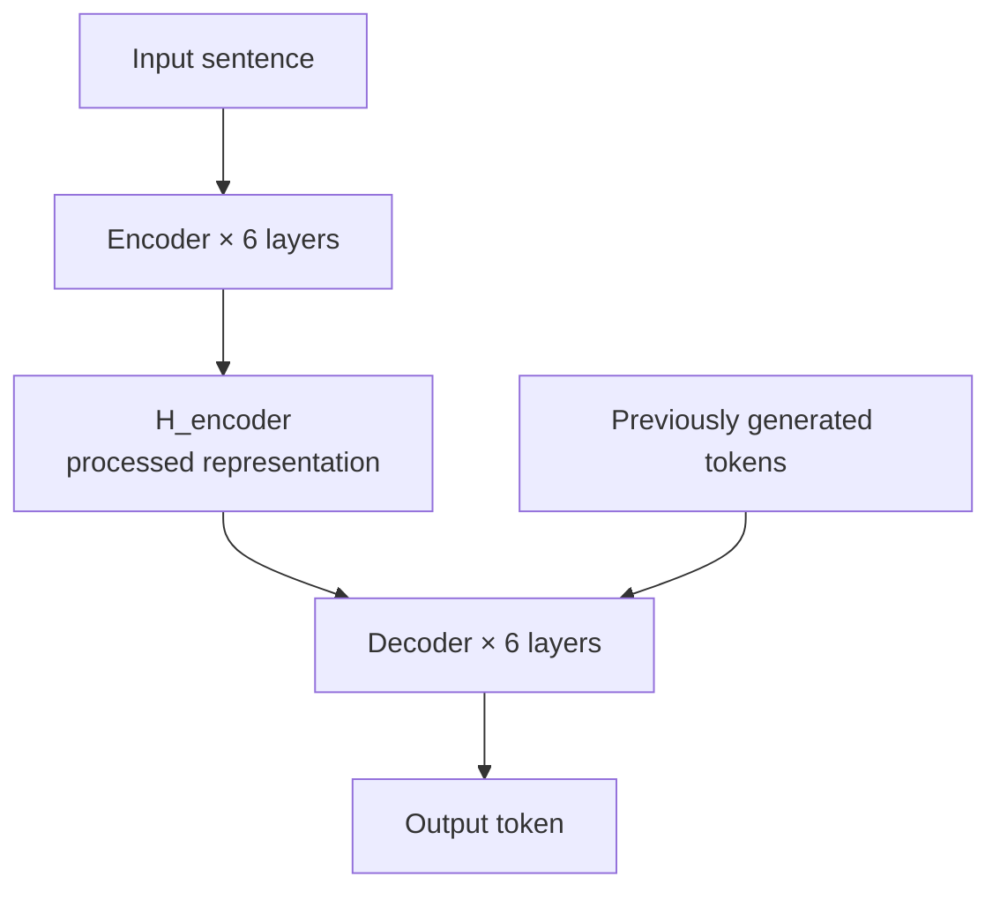
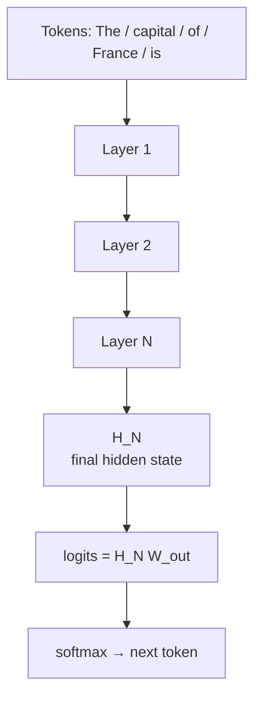
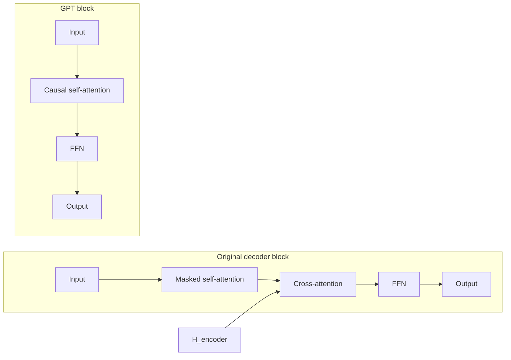
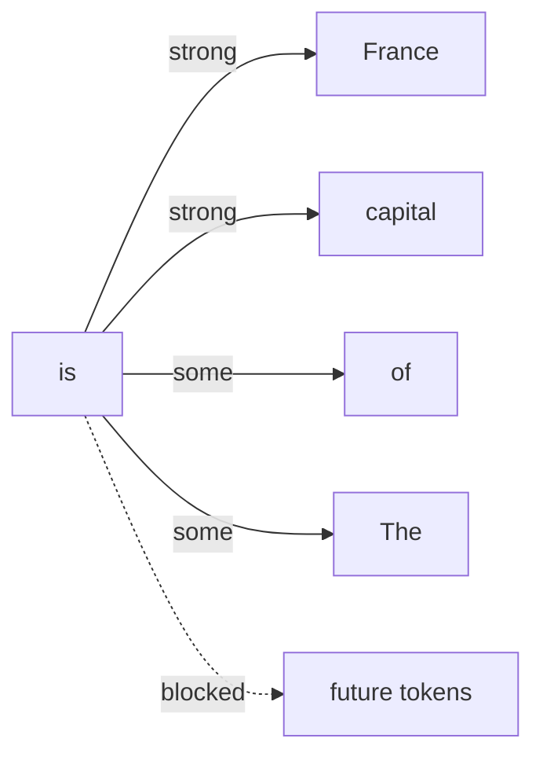

#AI #LLM #AI/Transformers

> [[Attention is All You Need (Transformers)]]
> [[1. An Introduction to LLM#Autoregressive Generation]]

> [!tldr]
> **In GPT there is no separate "processed input" from an encoder. The decoder-only stack processes the input itself.**
> 
> - Original Transformer: encoder produces $H_{encoder}$, decoder consumes it via cross-attention ($Q$ from decoder, $K, V$ from encoder).
> - GPT: no encoder, no cross-attention. The input runs through the same causal-self-attention stack that generates the output.
> - "Decoder-only" means decoder-style blocks (causal masking) used standalone, not a decoder waiting for encoder output.
> - The processed representation is still there: $X \rightarrow H_1 \rightarrow H_2 \rightarrow \cdots \rightarrow H_N$.

## 1. Original Transformer: where the decoder gets its input

==The decoder gets information from two places:==

1. Its own previously generated tokens, through masked self-attention.
2. The encoder's processed representation, through cross-attention (the decoder's third sub-layer).

In the decoder's cross-attention:

$$
Q = X_{decoder}W_Q
$$

$$
K = H_{encoder}W_K
$$

$$
V = H_{encoder}W_V
$$

So the decoder reads the encoder's output $H_{encoder}$. Details: [[Attention is All You Need (Transformers)#Encoder-Decoder Attention]].

## 2. What GPT does instead

GPT removes the encoder, so $H_{encoder}$ never exists. Radford et al. (2018) describe it as "a multi-layer Transformer decoder" that "applies a multi-headed self-attention operation over the input context tokens followed by position-wise feedforward layers."

The "processed input" you're looking for is still there. The same decoder-only stack produces it, layer by layer.

## 3. Worked example

Suppose you give GPT:

> The capital of France is

Tokenized as `The | capital | of | France | is`, i.e. $[x_1, x_2, x_3, x_4, x_5]$:

$$
X =
\begin{bmatrix}
x_1 \\
x_2 \\
x_3 \\
x_4 \\
x_5
\end{bmatrix}
$$

Layer 1 computes:

$$
Q = XW_Q, \quad K = XW_K, \quad V = XW_V
$$

$$
A = \operatorname{softmax}\left(\frac{QK^T}{\sqrt{d_k}} + M\right)
$$

The mask $M$ is what makes the block a *decoder* block:

$$
M_{ij} = \begin{cases} 0 & j \le i \\ -\infty & j > i \end{cases}
$$

A $-\infty$ entry becomes zero after softmax, so position $i$ can never attend past itself. Then:

$$
H_1 = AVW_O + \text{residual/MLP processing}
$$

Each later layer transforms the previous output:

$$
H_2 = \text{TransformerLayer}_2(H_1), \quad H_3 = \text{TransformerLayer}_3(H_2)
$$

So the flow is:

$$
\boxed{X \rightarrow H_1 \rightarrow H_2 \rightarrow H_3 \rightarrow \cdots \rightarrow H_N}
$$

No encoder sits in between. $H_N$ is the input's processed representation. Masking walkthrough: [[Attention is All You Need (Transformers)#Masked Self Attention]].

## 4. What "decoder" means in GPT

> [!warning] Terminology trap
> "GPT is a **decoder-only Transformer**" does not mean "a decoder waiting for an encoder to give it data." It means GPT uses the decoder-style block (causal masked self-attention) with the encoder and the cross-attention sublayer removed.

The original block earned the name "decoder" because it generated the target sequence while consulting the encoder. GPT runs that block standalone.

Same block, minus the arrow from $H_{encoder}$.

## 5. How GPT understands the prompt

It comes from self-attention across the prompt tokens. At the `"is"` position, its query attends only to earlier tokens:

Mathematically:

$$
h_{is} = \sum_j A_{is,j} V_j
$$

The representation of `"is"` is a weighted combination of the value vectors of the earlier tokens, and later layers keep transforming it. The mask guarantees the "blocked" edge stays at zero for every layer.

## 6. Input and output are the same sequence

In GPT, input and output are one sequence. The stack both processes the existing context and generates the continuation.

$$
P(\text{Paris} \mid \text{The, capital, of, France, is})
$$

After generating `Paris`, the sequence becomes `The capital of France is Paris`, and the model predicts:

$$
P(x_{next} \mid \text{The, capital, of, France, is, Paris})
$$

> [!note] One consequence
> Each new token makes the model re-read the whole prefix. That is why serving engines cache the per-token $K$ and $V$ vectors instead of recomputing them: [[KV cache]].

## 7. Specs side by side

| | Original Transformer (2017) | GPT-1 (2018) |
| --- | --- | --- |
| Stack | 6 encoder + 6 decoder layers | 12 decoder-only layers |
| $d_{model}$ | 512 | 768 |
| Heads | 8 ($d_k = d_v = 64$) | 12 |
| FFN inner dim | 2048 | 3072 |
| Attention sub-layers | self-attention + cross-attention | masked self-attention only |
| Position encoding | sinusoidal | learned |
| Activation | ReLU | GELU |
| Parameters | 65M (base, commonly cited) | 117M |

Sources: Vaswani et al. §3.1–3.2 (stack, dims, mask), Radford et al. 2018 "Model specifications" (layer count, dims, heads, FFN, GELU, learned positions).

## 8. The three families

| Family          | What it keeps                               | Example                            |
| --------------- | ------------------------------------------- | ---------------------------------- |
| Encoder-only    | Full bidirectional attention, no generation | [[BERT-from-First-Principles.pdf]] |
| Decoder-only    | Causal mask, generates token by token       | GPT                                |
| Encoder-decoder | Both stacks, cross-attention between them   | Original Transformer, T5, BART     |

The mask choice is the whole difference: BERT's token 3 attends to every token, GPT's token 3 attends only to tokens 1–3.

- [[1. An Introduction to LLM#Representation Models : Encoder-Only Models]]
- [[1. An Introduction to LLM#Generative Models: Decoder-Only Models]]

