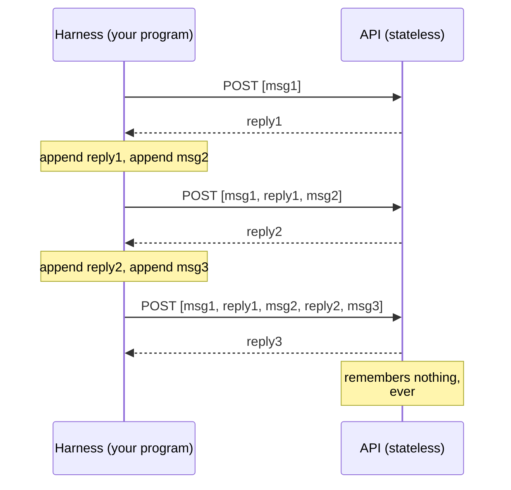
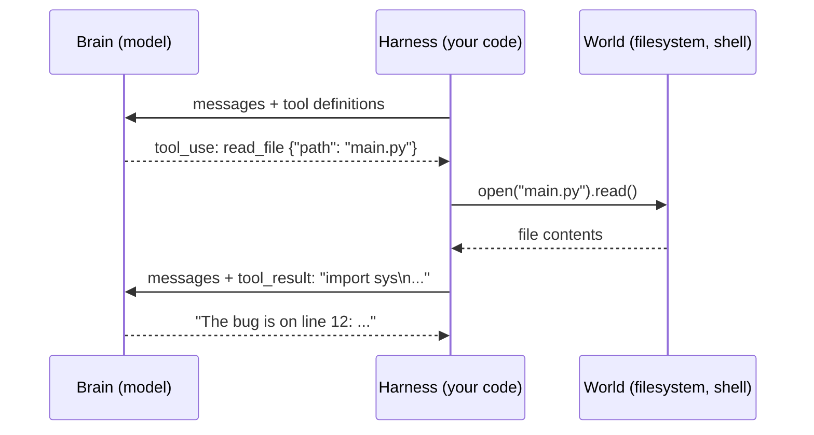

#AI #LLM #HarnessEngineering #Agents #AI/AgenticAI 

> [!summary] Core idea
> A **harness** is the program that turns a stateless LLM into an agent by maintaining the message array, managing [[3. Context and Subagents|context]], executing tool calls, enforcing permissions, and controlling [[2. The Agent Loop and Caching|Agent Loop]]. The LLM is the brain, while the harness is the body that connects it to the world.

> [Introduction - Harness Engineering 101](https://isuruwijesiri.com/harness-engineering-101/)
> [[1. Introduction to AI Agents]]

An LLM API is stateless. Every turn, you send the entire conversation as a JSON array and get text back. 

A **harness** is the program that builds, maintains, and protects that array using a simple loop. Everything the field calls “agents” is a set of patches to that one loop, and each patch exists because something concrete broke.
# It's just a JSON Array

Every agent you seen that edit/read your files and running the command is a program that builds a JSON array, POSTs it, reads the reply, updates the array and POSTs it again.

The LLM is the brain. The brain can receive text and emit text, and nothing else.

Everything it appears to _do_ in the world, some other program did for it. That program is the **harness**: the body around the brain. ==The only channel between brain and body is the JSON array.==

![[1. Introduction to AI Agents#What is an AI agent?]]

## The call

Remove every SDK and framework, and a call to a frontier model looks like this:

```python
import json, os, urllib.request

def call_llm(messages, system=""):
    body = {
        "model": "claude-sonnet-5",
        "max_tokens": 4096,
        "system": system,
        "messages": messages,
    }
    req = urllib.request.Request(
        "https://api.anthropic.com/v1/messages",
        data=json.dumps(body).encode(),
        headers={
            "content-type": "application/json",
            "x-api-key": os.environ["ANTHROPIC_API_KEY"],
            "anthropic-version": "2023-06-01",
        },
    )
    with urllib.request.urlopen(req) as resp:
        return json.loads(resp.read())
```

That is the whole interface. A list of dicts in, a dict out. No sockets, no sessions, no handshake. One HTTP POST.

The `messages` array is a transcript. Each entry has a `role` and `content`:

```json
[
  {"role": "user", "content": "What does HTTP 418 mean?"},
  {"role": "assistant", "content": "It means the server is a teapot. ..."},
  {"role": "user", "content": "Is it ever used seriously?"}
]
```

You send the array. The model continues it. The response is the next `assistant` message. That's it.

## LLM is Stateless

**The API is stateless. The server remembers nothing between calls.**

When you have a "conversation" with a model, there is no conversation stored on the provider's side. Your program holds the array, appends each new message, and resends *the entire history* on every turn. The model reads the whole transcript from scratch every time and predicts what comes next. It does not remember writing the earlier messages. It sees a transcript where half the lines are labeled `assistant` and concludes "apparently I said that."



Once this clicks, a lot of the field gets simpler:

- "Conversation memory" is your program keeping a list.
- "The model forgot something" means the thing fell out of the array.
- "Context management" means deciding what goes in the array.
- "The context window" is the maximum size of the array.
- Cost scales with the array, and you resend it every turn.

One useful consequence: **sessions are just files.** When a coding agent offers `--resume`, it loads a JSON array from disk and keeps appending. When you type `/clear`, the implementation is essentially:

```python
messages = []
```

There is no server-side session to reset. Claude Code stores sessions as JSONL files in a local directory. If you have built a to-do app, you already know how to build session management for an AI agent.
## Roles 

The array has a small set of speakers. The distinction matters because models are _trained_ to treat each role differently

- **`system`** — instructions from the developer to the model: who it is, what rules it follows. The model is trained to weight this above user text. Anthropic puts it in a top-level `system` field. OpenAI uses a message with role `system`, renamed `developer` in its newer Responses API. Same concept, three spellings: a privileged channel for the harness author.
- **`user`** — the human’s turn. Later in the series you will see the harness itself use this channel to inject information mid-conversation.
- **`assistant`** — the model’s own earlier turns. You wrote none of these, but you store and resend all of them. You can even edit them before resending, and the model can’t tell.
- **Tool results** — the outcome of actions
## Content is blocks, not strings

Originally, `content` was a string. It still can be, but in modern APIs it is a **list of typed blocks**:

```json
{
  "role": "user",
  "content": [
    {"type": "text", "text": "What's wrong with this screenshot?"},
    {"type": "image", "source": {"type": "base64", "media_type": "image/png", "data": "iVBORw0KG..."}}
  ]
}
```

Text is a block. An image is a block (base64 bytes, right in the JSON). A PDF is a block. A tool call is a block. The model’s thinking is a block. The array did not change shape when models learned to see. The blocks got new types. Chapter 2 covers what the brain does with an image block; chapter 3 covers tool blocks. The intuition to keep: **whatever modality or feature ships next year, it arrives as a new block type in the same array.**
## What Harness Does ?

So a harness is “a program that maintains a JSON array.” That sounds like a clerk’s job. Here is the actual job description, as it unfolds over this series. The harness decides:

- **What enters the array** — user text, file contents, tool results, injected instructions.
- **What leaves the array** — compaction, summarization, forgetting.
- **What the array’s structure must preserve** — ordering and byte stability, because cost depends on it.
- **Which of the brain’s requests to actually execute** — permissions, [[6. Reflexes and Guardrails|guardrails]], sandboxes.
- **When to interrupt the brain, and when to wake it**.

This is not passive plumbing. The body decides what the brain gets to see, when to interrupt it, and which of its commands to refuse. A harness is not a set of obedient limbs. It is a body with reflexes.

That framing also explains why this series is not only about coding agents. A coding harness gives the brain hands that edit files and run shells. A robotics harness gives it motors. A support-desk harness gives it a ticket queue. The bodies differ. The nervous system, the JSON array and the loop around it, is the same everywhere. This series builds a coding body because it is the easiest to demo in text, but every pattern transfers.
# LLM - The Brain

Here’s the whole model, and it is not much: **an LLM does one thing. You give it a sequence of tokens, and it gives back a probability for every possible next token. The serving layer then picks one, adds it to the sequence, and runs the model again.** That’s it. No goals, no memory, nothing saved between calls.

Serving Layer: *the provider’s inference stack. The model itself only outputs the probabilities; choosing a token from them is a separate step done by that code, which is why you can change how random it is per request*.

An LLM does exactly one thing: given a sequence of tokens, it outputs a probability for every possible next token. The serving layer does the rest — pick one, append it, run the model again. And again. That loop, run until a stop condition, is text generation. The model produces the probabilities; the code around it does the picking and the looping.

A few terms, quickly:

- **Token**: a chunk of text, usually 3 to 4 characters of English. “harness engineering” is about 4 tokens. Everything is measured in tokens: context windows, prices, speed.
- **Temperature**: how randomly the serving layer picks from the probabilities. Temperature 0 means always pick the most likely token. Higher values mean more variety. For agents you usually want low temperature; you want the probable action, not the creative one. (That’s the proof the picking happens outside the model: temperature is a setting you send with each request, so the same model can pick differently.)
- **Context window**: the maximum number of tokens the model can take as input.

## Post training

[[2. Pre-Training Data]]
[[LLM Post Training]]

A raw pre-trained model does not answer questions. If you type “What is the capital of France?” it might continue with “What is the capital of Germany?” because lists of questions were common in its training data. Post-training fixes this. The model gets more training on hand-picked conversations. Humans (and AI) judge which answers are better, and the model is tuned toward those. The result acts like an assistant: it answers the question, follows instructions, and refuses some things.

What this stage explains for you:

- **Why roles work ?** 
	- The model is trained on transcripts where `system` text sets the rules and the assistant follows them. The system prompt has authority because the model was trained to give it authority, not because the API enforces anything. This matters: role authority is a learned behavior, strong but not absolute.
- **Why the chat format exists at all ?** 
	- The message array from chapter 1 mirrors the format of post-training data. You are not sending a conversation to the model. You are sending text shaped like the conversations it was trained to continue.
# Working rules for harness engineers

Everything above compresses into rules you will use in every later chapter:

1. **The model is a pure function.** Same array in, same distribution out. All state is your problem, and your opportunity.
2. **Trust recall less than [[7. RAG - Retrieval as Context Selection|retrieval]].** Weights hallucinate; tool results do not. Feed the brain ground truth.
3. **Roles work because of training, not enforcement.** The system prompt is strong guidance, not an access-control system. Chapter 13 treats it accordingly.
4. **Tool calling and thinking are trained skills.** You get them by asking in the format the model was trained on, which the provider documents.
5. **Everything is tokens in one sequence.** Images, thinking, tool calls: all blocks, all counted, all paid for.
6. **Errors are useful input.** The model was trained to react to failure. Give it the failure.
# Tools

**Problem**: LLM can only emit text. *Ask it to “check whether the tests pass” and the best it can do is guess. It cannot run anything, read anything, or touch anything*

**Solution**: Let the model emit a structured request, and have your program execute it. That is the entire idea behind tools, and it is the single most load-bearing trick in modern AI. This chapter shows that it is just JSON on both ends.
## Contract

Tool use is a three-step contract between brain and body:

1. You tell the model what functions exist (names, descriptions, parameter schemas). This goes in the request, next to your messages.
2. The model, instead of answering in prose, ==may reply with a **tool call**: a block that names a function and provides arguments as JSON.==
3. ==Your program runs the real function,== puts the output back into the array as a **tool result**, and calls the API again so the model can continue.



## What it looks like on the wire

You define tools with a name, a description, and a JSON Schema for the arguments:

```json
{
  "name": "read_file",
  "description": "Read a file from the local filesystem and return its contents.",
  "input_schema": {
    "type": "object",
    "properties": {
      "path": {"type": "string", "description": "Path to the file"}
    },
    "required": ["path"]
  }
}
```

The description is not decoration. It is the only documentation the model gets, and writing good tool descriptions is real prompt engineering. Vague description, wrong usage.

When the model wants the tool, its reply contains a `tool_use` block instead of (or alongside) text:

```json
{
  "role": "assistant",
  "content": [
    {"type": "text", "text": "Let me look at the file first."},
    {"type": "tool_use", "id": "toolu_01A", "name": "read_file",
     "input": {"path": "main.py"}}
  ]
}
```

You run the function, then append the result as the next `user` message:

```json
{
  "role": "user",
  "content": [
    {"type": "tool_result", "tool_use_id": "toolu_01A",
     "content": "import sys\n\ndef main():\n    ..."}
  ]
}
```

Then you POST the whole array again. Notice two things. First, the tool result travels in a `user` message; from the model's point of view, the world answers on the user's channel. Second, this is chapter 1's loop with one new block type. Nothing about the wire changed.

> [!question]- Why does the model produce clean, schema-matching JSON? 
> Chapter 2's answer:
> it was RL-trained on millions of tool-call examples. You are not parsing free text and hoping. Modern providers even guarantee the arguments parse as JSON. (In the GPT-3.5 days, we begged the model in the prompt to "respond ONLY with JSON" and wrote regex fallbacks for when it apologized first. Function calling moved that trick into training, and that is the entire difference.)

## The user is a tool too

Here is a new way to look at tools that helps for the rest of the series. Once you see tools as "the model requests, the world responds," you notice the human sitting inside the world.
Production agents expose a tool that looks like this:

```json
{
  "name": "ask_user_question",
  "description": "Ask the user a clarifying question when you are blocked on a decision only they can make.",
  "input_schema": {
    "type": "object",
    "properties": {
      "question": {"type": "string"},
      "options": {"type": "array", "items": {"type": "string"}}
    },
    "required": ["question"]
  }
}
```

The implementation renders the question, waits for input, and returns the answer as an ordinary tool result. That is **human-in-the-loop** in its purest form: the person is one more thing the body can consult, on the same wire format as the filesystem. Claude Code's multiple-choice question dialogs are exactly this tool. No special mechanism, no separate channel. The model learned when to ask a person the same way it learned when to read a file.

There is a second, more important place humans enter the loop: approval. "The model asked to run `rm -rf`; should the body obey?" That is a harness decision, not a tool.

> **Structured output.** 
> Sometimes you do not want actions; you want the model's *answer* as machine-readable data, like `{"sentiment": "negative", "score": 0.87}`. Providers offer JSON modes for this. But the oldest reliable trick still works: define one tool  named `report_answer` whose input schema is your desired output format, and force the model to call it. The tool executes nothing; its arguments *are* the output. Structured output and tool calling are the same trained skill pointed at different goals: one asks for action, the other for shape.

> **Server-Side Tools.** 
> Some tools run without any harness code.
> Ask Anthropic's API for `web_search` and the *provider's* infrastructure executes the search during the request, splices the results into the conversation, and bills you for the tokens. The array you get back shows the tool round already resolved. Same contract, but the provider's body did the work: limbs you did not build. The trade is control. You cannot gate, log, or modify a server-side tool call. Your permission system never sees it. Convenient for search; think twice before accepting it for anything that touches your systems.


---
[[2. The Agent Loop and Caching]]