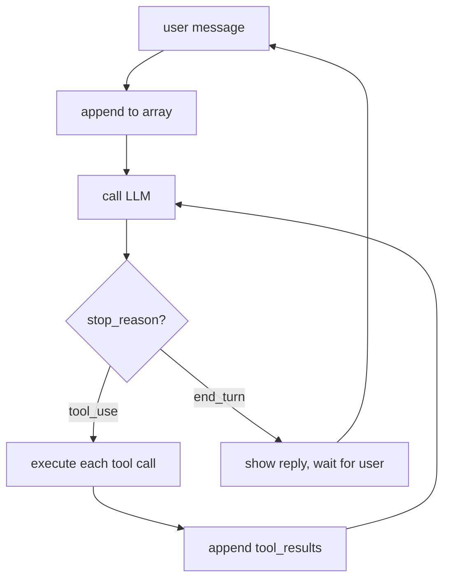

#LLM #AI #HarnessEngineering #Agents #AI/AgenticAI 

> [!tldr] Core Idea
> **An agent is a while loop around a chat completion: call the model, run the tools it asked for, append the results, repeat until `end_turn`. The message array must stay append-only or prompt caching stops paying off.**
> 
> - `stop_reason` drives the loop: `tool_use` means keep going, `end_turn` means done. One user turn can be dozens of API calls.
> - A tool failure is information for the model, not an exception: send back the raw error. Crashing, swallowing, or silently fixing it removes the model's best signal.
> - Every round resends the whole history, so input tokens grow roughly quadratically; prefix caching only helps while the prefix stays byte-for-byte identical (append at the bottom, sort tools, no timestamps up top).
> - Related: [[KV cache]], [[Prefix Caching Deep Dive]], [[3. Context and Subagents]].

# The Agent Loop

> [The Agent Loop - Harness Engineering 101](https://isuruwijesiri.com/harness-engineering-101/04-the-agent-loop)
## Introduction

**Problem**: Harness executes one tool call, lets the model react, and hands control back to the human. Ask it to “find the bug in this project and fix it” and it stalls after the first step, because step two needs the result of step one, and nobody is there to keep the conversation going.

**Solution**: keep the conversation going. Automatically. In a loop.

This is the point where the industry's vocabulary gets grand: "agentic AI," "autonomous systems," "orchestration." Here is what the words mean in code:

```python
while True:
    reply = call_llm(messages)
    messages.append(assistant_message(reply))
    if reply["stop_reason"] != "tool_use":       # model is done talking
        break
    results = [execute_tool(b) for b in tool_calls(reply)]
    messages.append(tool_results_message(results))
```

Call the model. If it asked for tools, run them, append the results, and call the model again. Repeat until it stops asking. **An agent is a while loop around a chat completion.** Everything else in this series is a patch to this loop.
## Stop reasons: how the loop knows when to stop

Each API response carries a `stop_reason` telling you why the model stopped generating. The loop is really a dispatch on this field:

| stop_reason | Meaning | Loop's job |
|---|---|---|
| `tool_use` | "I want tools run" | execute, append results, continue |
| `end_turn` | "I'm done" | exit loop, show the user the text |
| `max_tokens` | reply hit the length cap | continuation is truncated; handle it (retry higher, or continue) |
| `refusal` / safety | model declined | exit, surface the message |
The two-state core is: **`tool_use` means the turn is still in progress; `end_turn` means the brain considers the task done.** A "turn" in an agent is not one API call. It is one user request plus however many model+tool rounds the loop runs before `end_turn`. A single "fix the tests" turn might be 40 API calls. The user sees one answer; the array saw 40 round trips.



## Errors

The most surprising habit in agent building: **when a tool fails, you are not handling an error. You are delivering information.**

In an agent, a failed command is a problem for the _model_, and the model is good at it. Send back the compiler error, the stack trace, the “file not found,” exactly as the tool produced it, and the model reads it and adjusts: fixes the typo in the path, installs the missing package, takes another approach. Agents debug themselves, but only if the loop delivers the failure.

The failure modes to avoid, in increasing order of how often I see them:

- **Crashing the loop on a tool error.** The model never learns what happened; the turn dies.
- **Swallowing the error** and returning something vague like “command failed.” You just replaced the model’s best signal with noise.
- **Fixing it silently in the harness** (retrying with a “corrected” argument you guessed). Now the model’s picture of the world is wrong, and its next step builds on a state it does not know about.
## ReAct: the loop’s ancestor

![[ReAct#The Idea at a Glance]]

Before models were trained for tool use, we got agent behavior by prompt formatting. You instructed the model to answer in a rigid pattern:

```
Thought: I should check what files exist here.
Action: run_command["ls"]
Observation: main.py  test_main.py
Thought: Now I should read main.py.
Action: ...
```

The harness parsed the `Action:` line with string matching, executed it, appended a fake `Observation:` line, and called the model again. Same loop as ours, but with the tool protocol built from prose and hope. It broke whenever the model varied the wording, which was often.

**ReAct matters for two reasons.** 
First, historically: 
its "reason, act, observe" cycle is what got baked into models during the RL training chapter 2 described. Native tool calling *is* ReAct, moved from the prompt into the weights. The pattern won; the string parsing died. 
Second, practically:
when you see a framework or tutorial teaching ReAct-style prompting today, you are looking at a technique for models that lack tool training, or at a tutorial older than it looks. With a modern model you get the Thought (as thinking blocks), the Action (as tool_use blocks), and the loop, natively.

> **Parallel tool calls.** Models often request several tools in one reply (read three files at once). That is why the code collects every `tool_use` block before calling the API again: all results for one assistant message must come back in one user message, matched by ID. Run them concurrently if you like; deliver them together.

---
# Caching

> [Caching: Why Order Is Load-Bearing - Harness Engineering 101](https://isuruwijesiri.com/harness-engineering-101/05-caching)
> [[KV cache]]
> [[Prefix Caching Deep Dive]]
> [[Prefix vs KV vs Prompt Caching]]

**Problem**: Agent loops repeatedly resend the full, ever-growing conversation history. As each round adds more tool calls/results, total input-token usage grows roughly **quadratically**, making long agent runs surprisingly expensive. (*10,000 + 12,000 + 14,000 + … + 88,000 = **1.96 million tokens**, for one user request.*)

**Solution**: Provider-side [[Prompt Caching In Agents|prompt caching]] reduces that cost by reusing previously processed context at a much lower price. ==But caching only works well when the unchanged prefix of the prompt remains **byte-for-byte identical**,== so the harness must preserve context stability across rounds.

## Prefix Caching

Prefix caching works by reusing the model’s already-computed state for the **unchanged beginning of a prompt**.

On each new agent round, the provider compares the new request with the previous one from the start. The longest identical prefix is treated as cached, so only the newly appended tail must be processed at full cost.

For an agent loop:

```
Round 1: [10k existing context]
Round 2: [same 10k][+2k new]
Round 3: [same 12k][+2k new]
...
```

the old context becomes cheap cached input, while only each round’s new tool call/result is processed normally. This can reduce both cost and latency dramatically.

If earlier messages remain unchanged and you only add new messages at the end, the prompt has a long stable prefix and caching works well. If the harness rewrites, reorders, or modifies earlier context, it can break the cache and force the provider to recompute much more of the prompt.
![[2. The Agent Loop and Caching-1789474610351.webp]]
## Keep the conversation append-only

> **Appending is cheap. Editing anything above the append point costs you everything below it.**

This sounds easy to follow, and it is genuinely easy to break. The classic accidental cache-busters, all of which I have shipped or reviewed:

- **A timestamp in the system prompt.** `Current time: 14:32:07` at the top of the array means _no request ever hits the cache_. If the model needs the date, put it somewhere stable (the date, not the second), or inject it low in the array.
- **Reordering tools.** Tool schemas are part of the prefix. Building the tool list from an unordered dict, so it serializes in a different order per process? Cache gone. Sort your tools.
- **“Improving” the system prompt mid-session.** Any conditional text up top (“the user seems frustrated, add a tone note”) rewrites byte one.
- **Rotating content in place**, like keeping a live “current status” section near the top of the array and updating it each round.
- **Removing old messages from the middle** to save space. This is the painful one: trimming the array to make it _smaller_ can make it _more expensive_, because the trim invalidates the prefix. Context reduction has to be done in deliberate, occasional jumps, as described in [[3. Context and Subagents|context management]], not in small continuous trims.

The design consequence runs deeper than avoiding bugs: **information wants to enter the array at the bottom.** When the harness must tell the model something mid-session (a file changed on disk, the current todo list), append it as a new message near the end. Don’t update some canonical block near the top.

> [!tip] Provider Cache Behavior
> Cache behavior varies significantly by provider. For example, OpenAI applies prompt caching automatically, while Anthropic requires caching to be configured explicitly. Cache lifetime also differs across providers: some retain cached prefixes for only a few minutes, while others, such as DeepSeek, may keep them for much longer, potentially up to 24 hours.
> [[Prefix vs KV vs Prompt Caching#Provider comparison]]