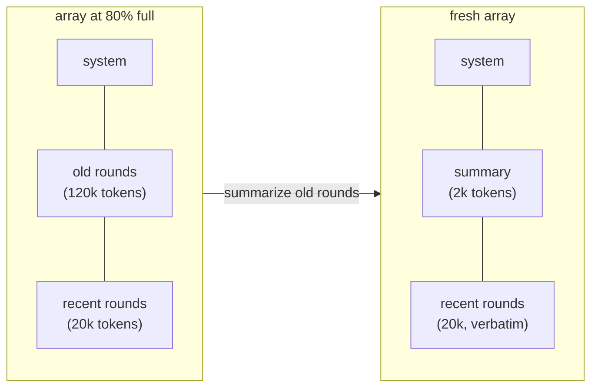
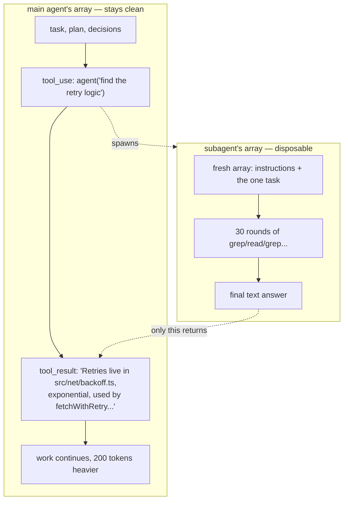

#HarnessEngineering #LLM #AI #Agents #AI/AgenticAI 
# Context

**Problem:** Long-running agent loops keep accumulating files, commands, and conversation history until the context window becomes overloaded. ==Performance degrades even before the hard token limit important details and instructions get lost due to **context rot** and eventually the task can fail completely when the limit is reached.==

**Solution:** Treat context as a **limited budget**, not unlimited storage. Manage it deliberately by **compacting/removing less-important context** and **storing important information externally in memory files**, keeping the active context small and useful.
## 1. Know what you are spending on

==Track token usage and understand what is filling the context window.== In coding agents, **tool outputs**—file contents, command logs, and search results—usually consume far more context than prompts or conversation.

![[3. Context-1789481367076.webp]]

The easiest ways to reduce usage are:

- **Truncate large tool outputs** and clearly indicate when truncation happened.
- **Read only relevant portions of files** using offsets and limits.
- **Let the model fetch information when needed** instead of injecting everything upfront, as in [[7. RAG - Retrieval as Context Selection|retrieval-augmented context selection]].

> Measure context usage first, then reduce the biggest source of waste—usually tool results.
## 2. Compaction: forgetting well

When a session gets close to its context limit, **compaction** replaces older conversation history with a much shorter summary.

Compaction has two important properties:

- **It is lossy.** 
	- Summaries preserve conclusions but may lose reasoning, failed attempts, and subtle details. Good compaction prompts should explicitly preserve decisions, files changed, constraints, current state, and next steps. ([one-code/extensions/compaction/prompt.ts at master · IsuruMaduranga/one-code · GitHub](https://github.com/IsuruMaduranga/one-code/blob/master/extensions/compaction/prompt.ts))
- **It should happen occasionally, not continuously.** 
	- One large reset is cheaper and simpler than repeatedly trimming small pieces of context.

> **Compaction is a Cache Reset, and that is fine, coz its rare.**

> Compaction deliberately sacrifices old detail to recover working space while preserving the information most important for continuing the task.
## 3. Memory files: remembering outside the array

Some information should survive beyond one session. Instead of keeping it permanently in the context window, store it in **memory files** such as `CLAUDE.md`.

These files can contain durable project knowledge such as:

- build commands,
- project structure,
- coding conventions,
- warnings,
- important decisions.

The useful analogy is:

**Context array = RAM**  
**Files = disk**

Memory files can also be maintained by the model itself. For example, if the user says a project uses `pnpm`, the model can add that fact to the project's memory file so future sessions inherit it.

Two important design rules:

- Inject memory as **user/project context**, rather than changing the system prompt.
- Keep memory files **small**. Use them as an index pointing to larger documents that the model can fetch when needed.

> Persistent knowledge belongs outside the active context window, but even persistent memory must be kept compact.
## 4. The budget mindset

Treat the model's context window as a **limited resource**, not storage you can fill indefinitely.

A nominal ~200k-token window may have significantly less space where attention remains consistently reliable. That budget is divided among:

|Area|How to control it|
|---|---|
|System prompt and tools|Keep them lean; avoid loading rarely needed tools|
|Memory files|Keep them short and point to deeper documents|
|Conversation and tool results|Truncate, fetch on demand, and compact|
|Free headroom|Preserve space for upcoming reasoning and tool use|
Eventually, some tasks genuinely require more information than one context window can handle. At that point, trimming alone is not enough—you need to distribute the work elsewhere.

> Effective agents actively manage context as a budget, preserving enough free capacity for the model to keep reasoning well.

---
# Subagents

> [!tldr]
> **Subagents let an agent spend lots of temporary context elsewhere and bring back only the small piece of information worth keeping.**
## 1. The failure and the patch

Some tasks require a huge amount of exploration but produce only a tiny useful answer. If the main agent performs all that exploration itself, thousands of tokens of searches, file reads, and dead ends remain in its context and contribute to context rot.

The solution is a **subagent**: a separate agent loop with its own fresh context. It completes one task, returns only its final answer to the parent, and then its context is discarded.

> Move context-heavy work into a disposable context and keep only the useful conclusion.
## 2. Subagents are a context tool, not an org chart

Subagents are often described as teams of specialist agents, but their main engineering purpose is simpler:

==**They protect the main agent's working memory.**==

The parent keeps its important context—task, plan, and decisions—while the child spends its own context budget investigating something. The child might use 50,000 tokens, but the parent may receive only a 200-token summary.

This does **not necessarily save API cost**. The child still consumes tokens. What it saves is the parent's limited attention and context capacity.

> Subagents trade extra computation for cleaner main-agent context.
## 3. Three structural facts about subagents

### The child knows nothing

A fresh subagent does not automatically know:

- the conversation,
- the user's goals,
- the parent's plan,
- previous decisions.

Therefore, the parent must give it a **self-contained task description** explaining what to do, where to look, and what to return.

> Delegation quality depends heavily on the quality of the task brief.
### The parent sees only the report

The parent does not normally receive all the searches and reasoning performed by the child. It only receives the final result.

This keeps context clean, but also makes errors harder to inspect. Good subagent reports should therefore include evidence such as file paths, line numbers, or test results.

> Hide the exploration, but preserve enough evidence to verify the conclusion.
### Results return like any other tool result

From the parent's perspective, a subagent is simply another tool call:

**task sent → subagent works → report returned**

This means normal tool practices still apply, including clear failures and error handling.

> Architecturally, a subagent can be treated as a tool backed by another agent loop.
## 4. What to delegate

The best rule is:
> Delegate work with **large intermediate context but a small final result**.

Good examples include:

- **Search and exploration:** locating where something is implemented.
- **Verification:** running large test suites and summarizing failures.
- **Research:** reading several documents and extracting conclusions.
- **Parallel independent tasks:** reviewing several unrelated files simultaneously.

These tasks generate lots of temporary information that the parent does not need to retain.

> Delegate work where most of the information produced is disposable.
## 5. What not to delegate

Some work benefits from staying in the main loop.

Poor candidates include:

- **Tasks requiring accumulated judgment.** A fresh child does not share the parent's full understanding of the session.
- **Tiny lookups.** Starting another agent loop has overhead; a simple search may be cheaper directly.
- **Long chains of dependent work.** Repeated handoffs cause information loss.

The chapter argues for a relatively shallow structure:

**one coordinator + disposable workers**

rather than deeply nested agent hierarchies.

> Keep context-sensitive decision-making centralized and delegate bounded investigations.
## 6. Production notes

Real systems add features around the same basic idea.
### Named agent types

Different subagents can receive different:

- system prompts,
- roles,
- tool permissions.

For example, an exploration agent might be allowed to read files but not modify them.
### [[8. One Harness, Many Brains|Different models]] for different jobs

Simple investigation can be assigned to cheaper models, while harder reasoning stays with a stronger model.
### Background execution

Slow subagents can run independently instead of blocking the parent.
### Messaging running children

Some systems allow follow-up instructions to an already-running child.
### Forked subagents

Not every child must start empty. A **forked child** can receive a copy of the parent's current context.

The trade-off is:

**Fresh child:** cheaper context, less inherited knowledge  
**Forked child:** more inherited knowledge, more context cost

> Production systems mainly add routing, permissions, concurrency, and context-sharing options around the same core mechanism.
## 7. Writing good subagent tasks

A useful mental model is to write the task as if you were assigning work to:
> a contractor who has no access to your previous conversations.

A good task should explain:

- what needs to be done,
- where to investigate,
- relevant background,
- what counts as completion,
- what evidence to provide,
- what the final response should contain.

Many apparent "multi-agent coordination" failures are really failures to provide enough context in the delegation.

> Clear task specifications are more important than elaborate agent coordination.

*This separation between working context and durable memory also appears in [[3. Agentic AI and Autonomous Systems|agent memory architecture]].*