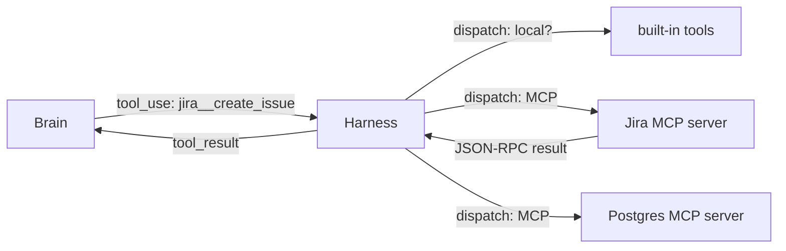

#HarnessEngineering #LLM #AI #Agents #AI/AgenticAI #MCP 
  
> **Keep the harness thin, keep context intentional, and keep the final request observable.**
# Every Framework Is a Wrapper

> [!tldr] Core Idea
> Most agent-framework terminology is abstraction over a few simple primitives:
> 
> - **Memory** → message array
> - **Prompt template** → string construction
> - **Tool** → schema + dispatch function
> - **Agent executor** → model/tool loop
> - **Chain** → function composition
> - **Graph** → state machine / ordinary control flow
> - **Multi-agent system** → another agent loop invoked like a function
> 
> Frameworks are therefore less mysterious than their vocabulary suggests.
## Why frameworks became complicated

Older models required more scaffolding: parsing, few-shot prompts, explicit chains, and hand-written planning. As models improved, many of those responsibilities moved **into the model**, while frameworks shifted toward orchestration, integrations, tracing, retries, and deployment infrastructure.

> [!important]  
> The biggest framework cost is **distance from the final request array**.

Useful abstractions:
- provider compatibility
- retries / rate limits / streaming
- tracing
- shared conventions for teams

Risky abstractions:
- hidden prompt construction
- invisible message reordering
- framework-controlled context management
## Framework evaluation checklist

When learning a new framework, ask:
1. **Where is the loop?** Find the code that calls the model repeatedly on `tool_use`. Everything is oriented around it.
2. **Who builds the array?** Can you see and modify the final request (messages, order, system prompt) before it is sent? This is the transparency question, and it is the make-or-break one.
3. **What is its unit of composition?** Chains (function composition), graphs (state machines), agents-as-tools: all fine, all just control flow. You are checking whether the unit fits your task’s shape.
4. **What does it do that is _not_ in this series?** Usually the honest answers are integrations, tracing, and deployment plumbing. Those are real; weigh them against the transparency answer from question 2.

The most important question is whether you can inspect and modify the exact request sent to the model.
# Extending the Body: MCP, Skills, Deferred Loading, Hooks

> [!tldr]
> The problem changes from _building an agent_ to **extending it without hardcoding everything or overflowing its [[3. Context and Subagents|context window]]**.
## MCP — add capabilities

**[[AI-Powered Root Cause Analysis at Scale|Model Context Protocol]]** lets external programs expose tools to the harness.

> An MCP **server** is a small external process (or remote service) that speaks a JSON-RPC protocol. The harness, as MCP **client**, launches or connects to it and asks `tools/list`. The server replies with tool definitions: name, description, JSON schema. Sound familiar? It is exactly chapter 3’s tool format. The harness merges these into the tool list it sends the model, prefixed to avoid collisions (`jira__create_issue`). When the model calls one, the harness forwards the call to the server (`tools/call`) instead of its own dispatch table, and relays the result back as an ordinary `tool_result`.



The harness discovers schemas with `tools/list`, forwards calls with `tools/call`, and returns the result to the model like any other tool result.

> MCP = the ordinary tool dispatch table + a network hop.

Its major benefit is **interoperability**: an integration can be written once and reused by many MCP-compatible agents.
## Skills — add procedures

A **skill** contains instructions that are loaded only when relevant.
Instead of putting a large runbook into every request:

```text
Context:
- release: instructions for performing releases
- testing: instructions for running tests
- deploy: production deployment procedure
```

The model first sees only the compact index. The full instructions are fetched when needed.

This pattern is **progressive disclosure**:

> index in context → detail outside context → fetch on demand

Skills extend **knowledge of how to do something**, rather than adding a new capability.
## Deferred loading — add scale

Having hundreds of tools available does not mean hundreds of full schemas should appear in every request.

Instead:
```text
small tool index
      ↓
tool_search
      ↓
relevant schemas loaded
      ↓
model uses tools
```

Once exposed, schemas should remain stable for the session rather than constantly appearing and disappearing.

MCP, skills, and deferred tools therefore share the same architecture:

```text
Index in context
      ↓
Detail outside context
      ↓
Fetch when required
```
## Hooks — add guarantees

Hooks are different because they are **[[6. Reflexes and Guardrails|deterministic code]]**, not choices made by the model.

Examples:
- run formatter after every edit
- prevent access to `.env`
- run a linter
- record tool activity
- notify another service

> [!tip] **Brains choose. Bodies guarantee.**

Use:

|Need|Mechanism|
|---|---|
|Talk to another system|MCP / tool|
|Teach a procedure|Skill|
|Support many tools efficiently|Deferred loading|
|Enforce always/never behavior|Hook|
# Debugging the Array

> [!tldr] Core Idea
> 
> > [!danger]  
> > **You cannot fix the prompt you cannot see.**
> 
> When an agent behaves strangely, reading application code alone is insufficient.
> 
> The model acted on the **final assembled request**:
> ```text
> system prompt
> + memory
> + messages
> + skills
> + tool schemas
> + reminders
> + compacted history
> = actual model input
> ```
> 
> Debug that object first.

## 1. Capture the actual request

Log the full request immediately before the API call, along with the response.

Do not merely log:
```text
"memory inserted successfully"
```

Capture the actual bytes/JSON the model received.

This reveals bugs such as:
- instructions missing after compaction
- reminders inserted in the wrong position
- truncated tool results
- reordered schemas
- unexpected middleware modifications
## 2. Monitor cache-read tokens

`cache_read_input_tokens` is a useful [[5. Evolutionary Observability|health signal]].

Example:
```text
round 12
input:      84,213
cache_read: 82,900 ✅

round 13
input:      86,120
cache_read: 0 ❌
```

A sudden loss of cache hits often means something modified what should have been a stable prefix.
## 3. Replay requests

Because the API is stateless, a captured request contains the entire state needed to reproduce a model interaction.

Debugging becomes an experiment:
```text
capture
  ↓
form hypothesis
  ↓
change one thing
  ↓
replay
  ↓
compare result
```

This turns prompt debugging from guesswork into controlled experimentation.
## 4. Test request fidelity in CI

Tests can assert:

- **Presence** — required information exists.
- **Placement** — information appears in the correct location/order.
- **Bytes** — cache-sensitive prefixes remain byte-identical.

This catches harness drift before it becomes a behavioral or cost problem.

*This request-level testing resembles [[Spec-Driven Development (SDD)|spec-driven development]] because both make expected behavior explicit and reviewable.*


