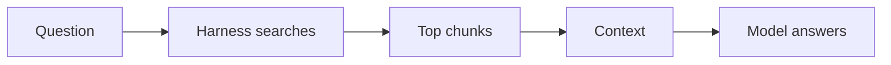
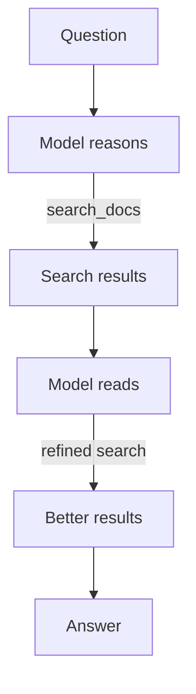

#HarnessEngineering #LLM #AI #Agents #AI/AgenticAI 

> [!summary] Core Idea
> **[[12. Retrieval-Augmented Generation (RAG)|RAG]] is deciding what text enters the model's context.** Every RAG variant is ultimately a different answer to: **Which text should be selected, and how should it be selected?**
## The Core Problem

The model does not automatically know:

- your company wiki
- your private codebase
- yesterday's tickets
- internal documents
- newly created information

And these sources are often too large to paste into the context wholesale.

So the harness must **select relevant information** before or during reasoning.

```text
large knowledge source -> selection -> small relevant subset -> model context
```

That selection process is RAG.

## Classic RAG

Classic RAG follows this pattern:

```text
question
   ↓
harness searches
   ↓
top relevant chunks
   ↓
chunks + question enter context
   ↓
model answers
```

The important detail:
> **The harness retrieves before the model reasons.**

Example:
```python
def rag_answer(question):
    chunks = search(question, top_k=5)

    context = "\n\n".join(
        chunk.text for chunk in chunks
    )

    messages = [{
        "role": "user",
        "content":
            f"Answer using this context:\n"
            f"{context}\n\n"
            f"Question: {question}"
    }]

    return call_llm(messages)
```

Conceptually:

```text
search + context injection + one model call
```

There does not need to be an agent loop at all.
## The Search Machinery

Most of the intimidating RAG vocabulary lives inside:

```python
search(question)
```
### Embeddings

[[1. An Introduction to LLM|Embeddings]] convert text into vectors so semantically similar text lands near similar text.

Example:

```text
query:
"How do I get my money back?"

can retrieve:
"Refunds may be requested within 30 days."
```

even though the wording differs.

> [!tip] Think of embeddings as **grep for meaning**.
### Chunking

Documents are divided into smaller retrievable units.

```text
document
   ↓
chunk 1
chunk 2
chunk 3
chunk 4
```

Retrieval then selects chunks rather than entire documents.

The chunking strategy affects retrieval quality because a chunk should ideally contain enough context to be useful without becoming unnecessarily large.
### Vector Database

A vector database stores embeddings and efficiently finds nearby vectors.

```text
query embedding -> nearest-neighbour search -> similar document chunks
```

This is fundamentally a **search infrastructure component**, not part of the model itself.
### Hybrid Search

Vector search is strong at semantic similarity.

Keyword search is often stronger at:

- exact identifiers
- filenames
- product IDs
- unusual terminology
- rare tokens

So production retrieval often combines both:

```text
keyword search + vector search -> merge / rank -> final candidates
```

## The RAG Zoo, Decoded

| Name               | What it really means                            |
| ------------------ | ----------------------------------------------- |
| **Naive RAG**      | Vector search → paste top-k results             |
| **Hybrid RAG**     | Combine keyword + semantic search               |
| **Re-ranking**     | Retrieve broadly, then use a better ranker      |
| **Graph RAG**      | Search entities and relationships               |
| **Corrective RAG** | Detect weak retrieval and try again             |
| **Self-RAG**       | Model evaluates whether retrieval is sufficient |
| **Agentic RAG**    | Model controls retrieval through tools          |

The names sound like separate architectures, but most differences are simply:

```text
index choice + ranking choice + retry logic
```

> [!important] Learn the retrieval knobs, not the taxonomy.
## Push vs Pull

This is the chapter's main distinction.
### Push — Classic RAG / Harness Retrieval

The ==harness guesses what the model will need **before reasoning starts**.==



The body chooses the evidence.
#### Advantages

- cheap, fast, predictable
- often one search + ==one LLM call==
- easy to operate at high volume
#### Weakness

The retrieval query is based only on the original question.

==If the harness retrieves the wrong material, the model may be confidently grounded in the wrong documents.==
### Pull — Agentic Retrieval

Instead of injecting everything up front, expose retrieval as a tool. (`search_docs(query)`)

Now the model decides when and what to search.



==The LLM (brain) controls the reading.==

Example:
```text
Question:
Compare our current refund policy
with the policy before the rebrand.

Model:
"I need the current policy."

→ search_docs("current refund policy")

Model:
"Now I need the previous version."

→ search_docs("refund policy before rebrand")

Model:
compares both
```

This is difficult for one-shot retrieval and natural for a loop.
### Push vs Pull Trade-off

#### Pull wins on quality

The model can:

- formulate its own searches
- inspect results
- notice missing evidence
- reformulate queries
- perform multi-hop retrieval

The retrieval process gains a **feedback loop**.

```text
search -> inspect -> reason -> search again
```
#### Push wins on cost and latency

Classic RAG can be:
```text
1 search + 1 model call
```

Agentic retrieval might require:
```text
search → model → search → model → search → model
```

That costs more tokens, time, and compute.
### Design Rule

> [!quote] **Pull when reasoning should steer the reading. Push when the reading is predictable.**
#### Push fits

- FAQ bots
- clean support knowledge bases
- predictable single-hop questions
- batch pipelines
- strict latency requirements
#### Pull fits

- investigation
- research
- ambiguous questions
- multi-hop reasoning
- coding agents
- large heterogeneous knowledge stores
### Push + Pull Together

These patterns are not mutually exclusive. A strong architecture can combine both:

```text
obvious context --> push into initial request
additional uncertain context --> pull via tools as needed
```

==For a coding agent==: 
```text
memory file = push
grep / search / read_file = pull
```

This hybrid architecture often provides a good cost-quality balance.
## Deep Retrieval as a Subagent

Some retrieval tasks consume many rounds and produce a relatively small final result.

Example:

```text
Parent agent
    ↓
spawn research agent
    ↓
search
read
search
compare
verify
    ↓
cited summary
    ↓
Parent keeps only summary
```

This prevents the parent context from filling with retrieval debris.

> [!tip] **Fork high-volume work that leaves behind a low-volume result.**

Deep-research systems often approximate this architecture.
## The Bigger Lesson

RAG appears externally as a specialized AI discipline. From the harness perspective, it collapses into familiar primitives:

```text
stateless context
+
limited context budget
+
search
+
context injection
+
optional tool loop
+
optional subagent
```

The only substantially new component is the **search index**. *This makes RAG a memory-and-retrieval layer for the [[3. Agentic AI and Autonomous Systems|agent architecture]], not a separate kind of model.* Everything else is context engineering.