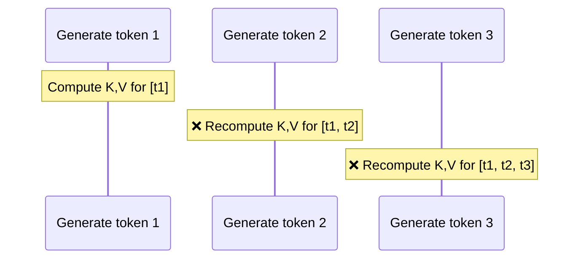
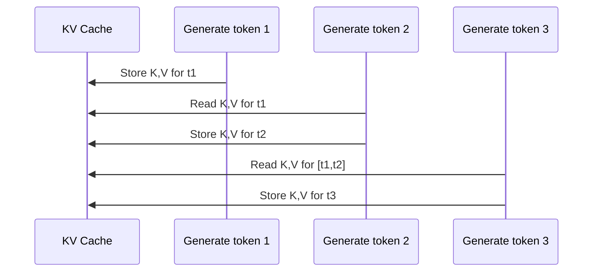

#LLM #AI #AI/AgenticAI 

> [KV Caching Explained: Optimizing Transformer Inference Efficiency](https://huggingface.co/blog/not-lain/kv-caching)

> [!tldr]
> The **KV cache** is a memory trick used when a language model generates text. Instead of redoing the same math over and over for tokens it has already seen, the model **saves (caches) two sets of numbers — Keys (K) and Values (V) — for every token**, and just reuses them. This turns text generation from painfully slow and wasteful into fast and efficient, at the cost of extra memory (VRAM/RAM).
## 1. Prerequisites (Quick Refresher)

You don't need to be an expert, but it helps to know these terms first:

- **Transformer**: the neural network architecture behind almost all modern LLMs (GPT, Claude, Llama, etc.).
- **Self-Attention Mechanism**: the mechanism that lets each token "look at" other tokens in the sequence to understand context.
- **[[1. An Introduction to LLM#Autoregressive Architecture|Autoregressive generation]]**: LLMs generate text **one token at a time**, feeding each new token back in as input for generating the next one. ([[DeepSeek's DSpark]])

> [!info] What are Q, K, V ? 
> Inside every attention layer, each token's embedding is projected (via learned weight matrices) into three vectors:
> 
> - **Query (Q)** --> "what am I looking for?"
> - **Key (K)** --> "what do I contain / represent?"
> - **Value (V)** --> "what information do I actually pass along if selected?"
> 
> Attention works by comparing a token's Query against every other token's Key to decide how much attention to pay, then mixing together the Values weighted by that attention.

The core attention formula:
$$ \text{Attention}(Q, K, V) = \text{softmax}\left(\frac{QK^T}{\sqrt{d_k}}\right)V $$
## 2. The Problem: Redundant Computation

LLMs generate text token-by-token. Because of **causal masking**, a token can only attend to itself and the tokens _before_ it (not future ones — this is what makes generation "autoregressive").

Here's the catch: once a token's K and V vectors are computed, **they never change**. Token #5's Key and Value vectors look identical whether you're currently generating token #6 or token #500 — they only depend on token #5 and what came before it, never on what comes after.

> [!warning] 
> Without a KV cache If you naively regenerate text without caching, then to produce token #500 you must **recompute the Key and Value vectors for tokens #1 through #499 all over again** — even though you already computed them when generating earlier tokens. This redundant work grows with every new token, making long generations dramatically slower the longer they get.



## 3. The Solution: Caching K and V

Since past Keys and Values never change, we can **compute them once and store them** in a buffer — the KV cache — then simply reuse them for every future step, only computing K/V for the _newest_ token each time.


### Step-by-step process

> [!example] How it actually works
> 
> 1. **Prompt / prefill phase**: The full input prompt is processed in one forward pass. K and V vectors are computed for _every_ token in the prompt and stored in the cache (per layer, per attention head).
> 2. **Decoding phase (token-by-token)**: For each new token generated: a. Compute Q, K, V **only for this one new token**. b. **Append** its K and V to the cache. c. Compute attention using this token's Q against **all cached K/V** (old + new). d. Output the next token, then repeat.

This means each new step only requires processing **one new token** through the expensive Q/K/V projection and feed-forward layers, instead of reprocessing the entire growing sequence.
## 4. Why This Matters: Speed

> [!tip] 
> Intuition Think of it like taking notes while reading a book, one page at a time. If someone asks "summarize everything so far" after every single page, you don't reread the whole book from page one each time — you keep a running notebook (the cache) and just add a line for the new page.

Without caching, each generation step gets progressively more expensive as the sequence grows, because the whole sequence is reprocessed through every layer. With caching:

- Each **new token's own processing cost** stays roughly constant (O(1)-ish per step for its own Q/K/V/FFN computation).
- The **attention lookup** against the cache still grows with sequence length, but it's a much cheaper operation (dot products) than recomputing full projections and feed-forward layers for every prior token.

Overall, KV caching is one of the main reasons modern LLM inference is fast enough to feel like a real-time conversation rather than a slow batch job.
## 5. The Cost: Memory

There's no free lunch — the KV cache **must be stored somewhere** (typically GPU VRAM), and it grows linearly with:

- Sequence length (more tokens → more cached K/V pairs)
- Number of layers
- Number of attention heads × head dimension (together, this equals the model's hidden size)
- Batch size (more concurrent requests → more caches)
- Numeric precision (fp32 vs fp16 vs int8)
### Approximate formula

$$ \text{KV Cache Size} \approx 2 \times L \times H \times S \times B \times P $$
Where:

- $2$ = one for Keys, one for Values
- $L$ = number of transformer layers
- $H$ = hidden dimension size (num attention heads × head dimension)
- $S$ = sequence length (tokens cached so far)
- $B$ = batch size (number of concurrent sequences)
- $P$ = bytes per parameter (e.g., 2 bytes for fp16/bf16)

> [!example]- Worked Example
> For a 7-billion-parameter model similar in shape to Llama 2 7B (32 layers, hidden size 4096, fp16 precision), caching a 4096-token context for a single sequence:
> 
> $$ 2 \times 32 \times 4096 \times 4096 \times 2 \text{ bytes} \approx 2.1\text{ GB} $$
> 
> That's **~2 GB of GPU memory just for the KV cache** of one 4K-token conversation — on top of the model weights themselves (which for a 7B model in fp16 are roughly ~14 GB). This is why KV cache memory is a serious, well-known bottleneck for serving LLMs with long contexts or many simultaneous users.
## 6. Common Optimizations

Because KV cache memory can balloon quickly, several techniques have been developed to shrink it:

| Technique                             | Idea                                                                                      | Trade-off                                                                                 |
| ------------------------------------- | ----------------------------------------------------------------------------------------- | ----------------------------------------------------------------------------------------- |
| **Multi-Query Attention (MQA)**       | All query heads share a _single_ Key/Value head                                           | Big memory savings, slight quality risk                                                   |
| **Grouped-Query Attention (GQA)**     | Query heads are split into groups, each group shares one K/V head                         | Middle ground between MQA and full multi-head attention; used in Llama 2/3, Mistral, etc. |
| **KV Cache Quantization**             | Store cached K/V in lower precision (e.g., int8 or int4 instead of fp16)                  | Saves memory, small potential accuracy loss                                               |
| **[[Efficient Memory Management for Large Language Model Serving with PagedAttention|PagedAttention]]** (used in vLLM)     | Manages the KV cache like OS virtual memory, in non-contiguous "pages"                    | Reduces memory fragmentation/waste, improves serving throughput                           |
| **Sliding Window Attention**          | Only keep the most recent _N_ tokens' K/V, discard older ones                             | Enables very long generations with bounded memory, but loses distant context              |
| **KV Cache Sharing / [[Prefix Caching Deep Dive|Prefix Caching]]** | Reuse cached K/V across requests that share a common prompt prefix (e.g., system prompts) | Big wins for high-throughput serving of similar prompts                                   |
## 7. Minimal Pseudocode

```python
# Simplified illustration — not production code

kv_cache = {layer: {"K": [], "V": []} for layer in range(num_layers)}

def generate_token(new_token_embedding):
    for layer in range(num_layers):
        q, k, v = project_qkv(new_token_embedding, layer)

        # Append new K, V to the cache instead of recomputing old ones
        kv_cache[layer]["K"].append(k)
        kv_cache[layer]["V"].append(v)

        # Attend over ALL cached K, V (old + new)
        attn_output = attention(q, kv_cache[layer]["K"], kv_cache[layer]["V"])

        new_token_embedding = feed_forward(attn_output, layer)

    return predict_next_token(new_token_embedding)
```
## 8. Key Takeaways

> [!success] Summary
> 
> - KV cache stores previously computed **Key** and **Value** vectors so they don't need to be recalculated at every generation step.
> - It **massively speeds up** autoregressive text generation.
> - It **costs GPU/RAM memory**, which grows with sequence length, batch size, and model size.
> - Techniques like **GQA, quantization, PagedAttention, and sliding windows** exist specifically to tame that memory cost.
> - This is a pure **inference-time** optimization — it doesn't affect training and doesn't change the model's outputs, just how efficiently they're computed.
## Further Reading

- Vaswani et al., _"Attention Is All You Need"_ (2017) — the original Transformer paper
- Kwon et al., _"Efficient Memory Management for Large Language Model Serving with PagedAttention"_ (2023) — the vLLM paper

---

> [!info]- [Prompt Caching - Sam Rose](https://ngrok.com/blog/author/sam-rose)
> ![[Prompt caching - 10x cheaper LLM tokens, but how.pdf]]

## Related

- [[FNN and RNN#Recurrent Neural Network (RNN)|FNN and RNN]] — why sequential models need cached state
- [[Attention is All You Need (Transformers)#Self Attention|Attention is All You Need (Transformers)]] — where K and V come from
- [[2. Tokens and Embeddings#LLM Tokenization|2. Tokens and Embeddings]] — tokens are the units the cache grows with
- [[How Compaction Works in Pi Agent#Compaction and prompt caching|How Compaction Works in Pi Agent]] — a real-world compaction strategy that drops KV state