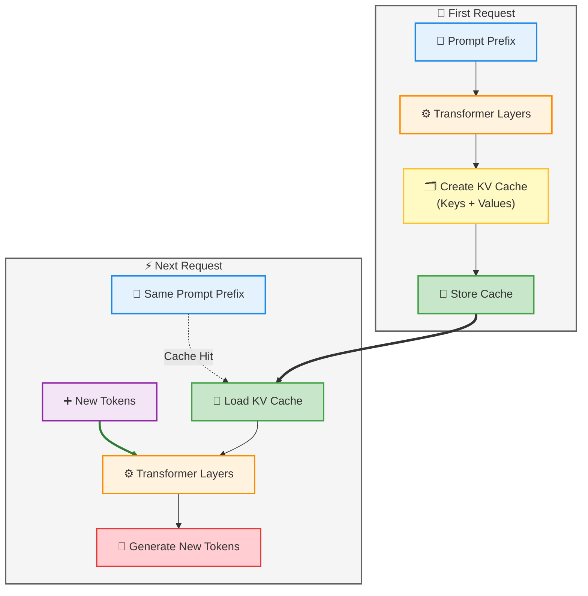

#AI #LLM #AI/AgenticAI  

> [Context Caching](https://api-docs.deepseek.com/guides/kv_cache/)
> [[KV cache]]

> [!video]- What is Prompt Caching? Optimize LLM Latency with AI Transformers
> 

> [!abstract]
> [[Prefix vs KV vs Prompt Caching|Prompt caching]] lets an LLM provider reuse the internal computation (the [[KV cache]]) from a previous request instead of recomputing it. When a new request shares an identical prefix with a cached one, the provider skips redundant GPU work — and passes some of that savings to you as a **cache hit discount**. This note covers the mechanics, pricing model, provider differences, and practical usage patterns.
## Why Prompt Processing Is Expensive

Every token in a prompt has to pass through the full transformer stack before generation can even begin:

```
Token → Embed → Attention (all layers) → Store Keys/Values → Next Token
```

For a 20,000-token prompt, that's 20,000 tokens' worth of attention computation _before_ the model writes a single output token. Send that same 20K-token prefix again tomorrow, and — without caching — the provider redoes all of it from zero.

> [!info] 
> The core insight Inference cost scales with prompt length. Anything that lets a provider **skip recomputation of unchanged input** directly reduces their GPU cost — and that's exactly what caching does.
## What Actually Gets Cached
![[Prompt Caching in LLM-1784439208757.webp]]
==A common misconception: providers cache your _prompt text_.== They don't — they cache the **Key-Value (KV) cache**, the internal attention state produced after processing a prefix.

> This differ from traditional  [[Caching]].



This means:

- The cache is **provider/model/account-scoped** — not portable across providers or even model versions.
- A single-character edit to the cached prefix typically **invalidates the match** (exact prefix matching).
- Nothing about your _output_ is cached — see [[#Common Misconceptions]].

![[Prompt Caching in LLM-1784439237129.webp]]

## The Four Pricing Categories

Most providers bill input/output across four buckets:

|Category|What it means|Relative cost|
|---|---|---|
|**Regular input**|Freshly processed, non-cached tokens|1× (baseline)|
|**Cache write**|First time a prefix is seen; provider computes _and stores_ the KV cache|~1.25×–2× baseline|
|**Cache read (hit)**|Prefix matches an existing cache entry; provider just loads it|~0.1×–0.5× baseline|
|**Output tokens**|Generated tokens — never cached, always computed fresh|1× baseline (output rate)|

> [!tip] 
> Why cache reads are so cheap A cache hit skips the most expensive part of inference — the forward pass over the prefix. The provider's marginal cost is closer to a memory read than a computation, so pricing reflects that: often **~90% cheaper** (Anthropic) to **~50% cheaper** (OpenAI) than normal input.

> [!warning] 
> Cache writes cost _more_, not less Storing a KV cache is extra work on the first pass. If you never reuse that prefix again, caching cost you money rather than saving it. Caching only pays off with **repeated reuse within the TTL window**.
## Worked Cost Example

> [!tip] LLMs are stateless between API calls.
> They retain no memory of previous requests. So to maintain a "conversation," the full context (system prompt, chat history, etc.) must be resent with every request.

Coding assistant sending a fairly typical payload:

|Component|Tokens|
|---|---|
|System prompt|4,000|
|Coding rules|8,000|
|Repo summary|12,000|
|Current file|2,000|
|User request|200|
|**Total**|**26,200**|

**Without caching:** every request pays for all 26,200 input tokens.

**With caching:** the first 24,000 tokens (system prompt + rules + repo summary) are cached after the first call. Every subsequent call in the session pays the cheap cache-read rate on those 24,000 tokens and the normal rate only on the ~2,200 tokens that actually changed (file + request).

Over a long [[Prompt Caching In Agents|agentic session]] with dozens of turns, this compounds into a large fraction of total cost saved — which is why caching matters so much for tools like Claude Code, [[12. Retrieval-Augmented Generation (RAG)]] pipelines, and long chat sessions.
## Cache Lifetime (TTL)

Caches expire. Once gone, the next request is billed as a fresh **cache write**.

- Typical TTLs: **5 min, 30 min, 1 hr**, sometimes configurable per request.
- TTL policy varies by provider and pricing tier.
- Bursty, infrequent usage patterns may never benefit from caching if requests are spaced further apart than the TTL.
## Provider Comparison

| Provider               | Cache control                            | Matching                                    | Cache write cost      | Cache hit discount    |
| ---------------------- | ---------------------------------------- | ------------------------------------------- | --------------------- | --------------------- |
| **OpenAI**             | Automatic, no manual setup               | Automatic prefix detection (~1,024+ tokens) | Not separately priced | ~50% off input        |
| **Anthropic (Claude)** | Explicit cache breakpoints in the prompt | Exact prefix match at breakpoints           | ~1.25× input          | ~90% off input        |
| **DeepSeek**           | Mostly automatic                         | Prefix-based                                | Varies                | Often steep discounts |
## Best Practices

- **Static content first, dynamic content last.** System prompt → tools → docs → conversation → current message. Anything after the first change breaks the cached prefix.
- **Keep prefixes byte-identical across calls.** Even whitespace or wording tweaks ("a helpful assistant" vs. "an extremely helpful assistant") create a _different_ cache entry.
- **Don't rebuild system prompts per request.** Stabilize them; treat them as append-only where possible.
- **Match your call frequency to the TTL.** If your app calls the same context every 10 minutes but the TTL is 5, you're always paying cache-write rates.
- **Don't cache one-off prompts.** Translation requests, single Q&A, anything genuinely unique gets no benefit — sometimes a net cost increase.

![[Prompt Caching in LLM-1784439378925.webp]]
## Common Misconceptions

> [!failure] 
> "My prompt is stored forever." No — caches expire per the provider's TTL (minutes, not days).

> [!failure] 
> "The cached answer is returned instantly with no new generation." No — only the **prefix's computation** is skipped. The model still generates a fresh response to your actual new input every time. This is prompt caching, not [[#Prompt Caching vs. Response Caching|response caching]].

> [!failure] 
> "Caching increases my context window." No — [[#Prompt Caching vs. Context Window|context window]] and prompt caching are unrelated. Caching only affects _compute cost_, not how much the model can attend to.
### Prompt Caching vs. Response Caching

|Prompt Caching|Response Caching|
|---|---|
|Reuses transformer computation|Reuses a completed answer|
|Still generates a fresh response|Skips inference entirely|
|Works even if the question differs|Only works for identical requests|
|Implemented via KV cache|Implemented via app/database cache|
### Prompt Caching vs. Context Window

- **Context window** = how much the model _can_ attend to in one request (e.g., 128K, 1M tokens).
- **Prompt caching** = how cheaply it _re-processes_ portions of that context across requests.

These are orthogonal — a model can have a huge context window with no caching support, or a small window with aggressive caching.
## When It Helps Most

- AI agents with fixed system prompts + tool definitions
- Coding assistants (stable guidelines, changing file content)
- RAG systems with unchanged retrieved documents across turns
- Long multi-turn conversations resending full history
- Enterprise bots grounded in static policy/handbook documents
## When It Doesn't Help

- Fully unique, one-off prompts
- Rapidly changing context on every call
- Very short prompts (below the provider's minimum cacheable length)
- Calls spaced further apart than the cache TTL
## Key Takeaways

- Caching stores **KV state**, not prompt text — and not output.
- Four billing buckets: regular input, cache write (pricier), cache hit (much cheaper), output (unaffected).
- Biggest wins come from long-lived, mostly-static prefixes reused within the TTL window — agents, coding tools, RAG, long chats.
- Structure prompts static-first, dynamic-last, and keep the cached portion byte-identical to actually get hits.