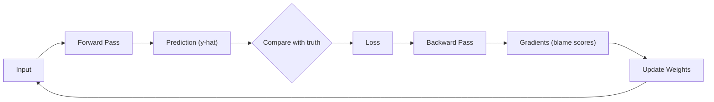
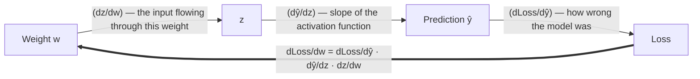
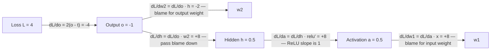
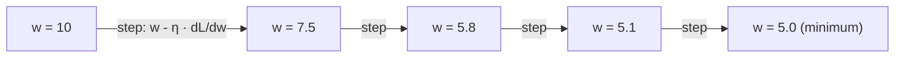

#AI #LLM #MachineLearning 

> [Backpropagation (Wikipedia)](https://en.wikipedia.org/wiki/Backpropagation)
> [Backpropagation — Google Machine Learning Crash Course](https://developers.google.com/machine-learning/crash-course/neural-networks/backpropagation)
> [Neural Networks and Deep Learning — Chapter 2 (Michael Nielsen)](http://neuralnetworksanddeeplearning.com/chap2.html)

> [!abstract]-
> **Backpropagation** is the algorithm that teaches a neural network. It answers one question: *"Which weights caused the error, and by how much?"* It works in two parts — a **forward pass** (make a prediction) and a **backward pass** (trace the error backward through the network, using the **chain rule**, to give every weight its own "blame score" or **gradient**). The optimizer then nudges each weight in the direction that reduces the error. This loop — predict, measure, blame, adjust — repeated millions of times is how every modern AI, from GPT to image classifiers, learns.
## 1. The Big Picture: How a Neural Network Learns

Training a neural network is a repeating loop of 4 steps:

1. **Forward pass** — feed input data through the network to get a prediction.
2. **Compute loss** — measure how wrong the prediction was.
3. **Backward pass (backpropagation)** — figure out how much each weight contributed to that error.
4. **Update [[Model Weight|weights]]** — nudge every weight in the direction that reduces the error.



> [!important] Backpropagation is only step 3
> Backpropagation **computes the gradients** (blame scores). Gradient descent / optimizers (step 4) **use those gradients to update the weights**. People often mix these up — they are two separate pieces.

### Analogy: Blindfolded Darts

Imagine throwing darts blindfolded at a target.

- The **forward pass** is your throw (a guess).
- The **loss** is how far off you were.
- **Backpropagation** is the precise feedback: *"your elbow was too high, your wrist turned too far left"* — telling each muscle exactly how it contributed.
- The **weight update** is adjusting your throw accordingly.

Repeat until you hit the bullseye. This analogy is also used in [[2. Artificial Neural Networks (ANNs) - Detailed Study Notes]].
## 2. The Problem: Credit Assignment

A real neural network has **millions or billions of weights**. After a wrong prediction, the network needs to know, for *every single weight*:

- Did this weight cause the error?
- By how much?
- Which direction should it change to reduce the error?

Computing this naively (one calculation per weight, from scratch) is impossibly expensive. With 1 million weights, that's 1 million separate full runs. **Backpropagation computes all of them in roughly the cost of 2 runs** — one forward, one backward.

## 3. The Forward Pass (Quick Recap)

Before backpropagation can run, the network must make a prediction. Data flows layer by layer: each neuron multiplies its inputs by its **weights**, adds a **bias**, passes the result through an **activation function** (like ReLU), and sends it to the next layer.

The forward pass also **saves intermediate values** (activations) at every layer — the backward pass needs them later to compute gradients. This is why training uses much more memory than inference.
## 4. The Loss: How Wrong Are We?

The **loss function** measures the difference between the prediction $\hat{y}$ and the true answer $y$. A common one is Mean Squared Error (MSE):
$$L = \frac{1}{n} \sum (y - \hat{y})^2$$

Training is just **minimizing this loss**. Visualize it as a landscape — for one weight, it's a parabola: the bottom is the best value for that weight.

## 5. The Secret Ingredient: The Chain Rule

The chain rule is the math behind backpropagation. It says: if a value depends on another value, which depends on another, you can compute the sensitivity by **multiplying the local sensitivities along the path**.



A neural network is exactly this: a long chain of nested functions. The chain rule lets us walk backward from the loss, one layer at a time, reusing already-computed values. See [[1. Artificial Neural Networks (ANNs)]] for the full derivation.
## 6. The Backward Pass: Blame, Layer by Layer

Backpropagation starts at the **loss** and walks backward to the **input**. At each node it follows one recipe:

> **Upstream gradient × local derivative = gradient to pass down**

### Worked Example with Real Numbers

Take a tiny network: one input `x = 1`, one hidden unit, weight `w1 = 0.5`, output weight `w2 = -2`, target `t = 1`, ReLU activation.

**Forward pass:** `a = 0.5`, `h = ReLU(0.5) = 0.5`, `o = (-2)(0.5) = -1`, loss `L = (-1 - 1)² = 4`

**Backward pass** (start at the loss, walk back):



What do these numbers mean?

- `dL/dw1 = +8` — increasing `w1` increases the loss, so gradient descent will **decrease** it.
- `dL/dw2 = -2` — increasing `w2` decreases the loss, so we **increase** it.
- The sign tells the **direction**; the size tells **how sensitive** the loss is to that weight.

This is the same pattern as the chain rule equation in section 5 — just applied systematically, layer by layer, from output to input.
## 7. The Update: Gradient Descent

Once we have every gradient, the optimizer moves each weight a small step **downhill**:

$$w \leftarrow w - \eta \cdot \frac{\partial L}{\partial w}$$

- $\eta$ (eta) is the **learning rate** — how big each step is.
- Too big → you overshoot and bounce around. Too small → learning takes forever.



This "hills and valleys" view of gradients and the loss landscape is covered in [[2.1 Gradients & Related Concepts]] and [[02 - Introduction to Optimization]].
## 8. Why It's Efficient

- The backward pass **reuses** intermediate values saved during the forward pass — no gradient is ever computed from scratch twice.
- One forward + one backward pass gives gradients for **every** weight, no matter how many there are.
- The backward pass costs roughly **2× the forward pass**, so a full training step is about 3× one inference. This is why training billion-parameter models is even possible.

> [!tip] In practice you never do this by hand
> Frameworks like PyTorch and TensorFlow build a **computation graph** during the forward pass and apply backpropagation automatically with one line of code:
> ```python
> loss.backward()   # computes every gradient via autograd
> optimizer.step()  # uses them to update weights
> ```
## 9. When Things Go Wrong

- **Vanishing gradients** — the blame signal shrinks as it travels back through many layers (the gradient is a product of many small factors). Early layers stop learning. Fixes: ReLU activations, residual connections (like in [[Attention is All You Need (Transformers)|Transformers]]).
- **Exploding gradients** — the signal grows out of control. Fixes: lower learning rate, gradient clipping.
- **Dead ReLU** — if a neuron's input is negative, ReLU's slope is 0, so no gradient flows through it — that neuron stops learning entirely.
## 10. Related Vault Notes
- [[1. Artificial Neural Networks (ANNs)]] — the backward pass and chain rule derivation
- [[2. Artificial Neural Networks (ANNs) - Detailed Study Notes]] — backpropagation with analogies, gradients, and loss
- [[2.1 Gradients & Related Concepts]] — the gradient: what it is, how it's computed
- [[02 - Introduction to Optimization]] — optimization: the math behind minimizing loss
- [[FNN and RNN]] — the networks backpropagation trains
- [[Chain of Thought (CoT)]] — how LLMs use reasoning; backpropagation is what trained them