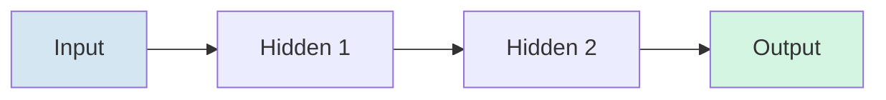
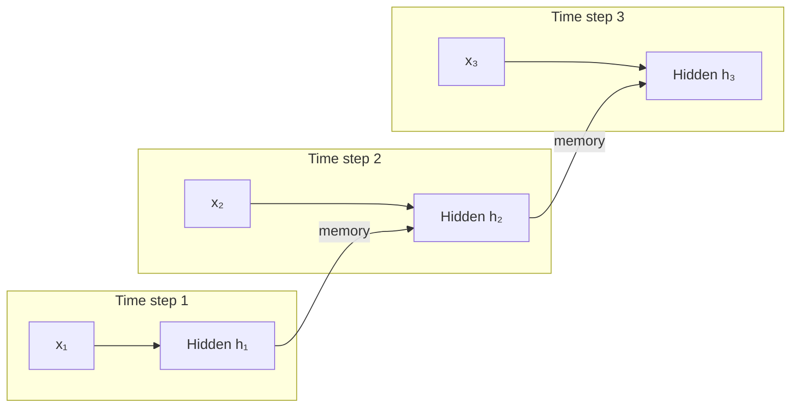

#LLM #AI #MachineLearning 

> [!abstract]-
> **FNN** (Feed-Forward Neural Network) and **RNN** (Recurrent Neural Network) are the two classic neural network families. **FNN** processes each input independently — data flows one way, no memory. **RNN** has loops: it keeps a **hidden state** that carries memory of what came before, so it can handle **sequences** where order matters. Every modern LLM ([[Attention is All You Need (Transformers)|Transformer]]) descends from these ideas — and both are trained with [[Backpropagation]].

![[FNN and RNN-1784997286217.webp]]
## Feed-Forward Neural Network (FNN)

**Definition**
- The simplest type of neural network.
- Data flows in **one direction only**: **Input → Hidden Layer(s) → Output**.
- There are **no feedback loops** or memory.

**Characteristics**

- No memory of previous inputs — each sample processed independently.
- Best for **static (independent) data**.
- Simple architecture; faster and easier to train.

**Applications**

- Image classification
- Object detection
- Handwritten digit recognition (MNIST)
- Medical diagnosis
- Credit scoring

## Recurrent Neural Network (RNN)

**Definition**
- A neural network designed for **sequential data**.
- Contains **feedback connections (recurrent loops)** that allow it to remember previous inputs.

**Characteristics**

- Has memory using **hidden states** — the same network is reused at each time step.
- Processes data step by step; order and context matter.
- More complex and slower to train.
- Can suffer from **vanishing/exploding gradient** problems (see [[Backpropagation]] §9).

**Applications**

- Language translation
- Speech recognition
- Sentiment analysis
- Time-series forecasting
- Stock price prediction
- Weather forecasting

## Key Differences

| Feature | FNN | RNN |
| --- | --- | --- |
| Data Flow | One-way (Input → Output) | Recurrent/feedback loops |
| Memory | No memory | Yes (hidden state) |
| Data Type | Static, independent | Sequential / time-series |
| Context Awareness | No | Yes |
| Training Speed | Faster | Slower |
| Complexity | Simple | More complex |
| Common Problems | None significant | Vanishing/exploding gradients |
## When to Use

### Use FNN when:

- Data samples are independent.
- No previous information is needed.
- Example: Image classification or customer credit scoring.
### Use RNN when:

- Data is sequential.
- Previous information affects future predictions.
- Example: Predicting the next word in a sentence or forecasting stock prices.
## Simple Example

### FNN

**Input:** Image of a cat → Predicts: **Cat**
Each image is processed independently.

### RNN

**Input Sentence:**
> "I love learning ___"

The model remembers the previous words **"I love learning"** and predicts: → **AI**
The prediction depends on the previous context.
## Related Notes
- [[Backpropagation]] — the training algorithm behind both architectures
- [[Mixture of Experts (MoE)]] — how modern models scale the FNN feedforward layer
- [[Chain of Thought (CoT)]] — reasoning techniques for today's LLMs
- [[RLHF - Reinforcement Learning from Human Feedback]] — how LLMs are aligned after training
- [[KV cache#The Solution: Caching K and V|KV cache]] — the attention state caching that makes transformer (and hence LLM) decoding efficient