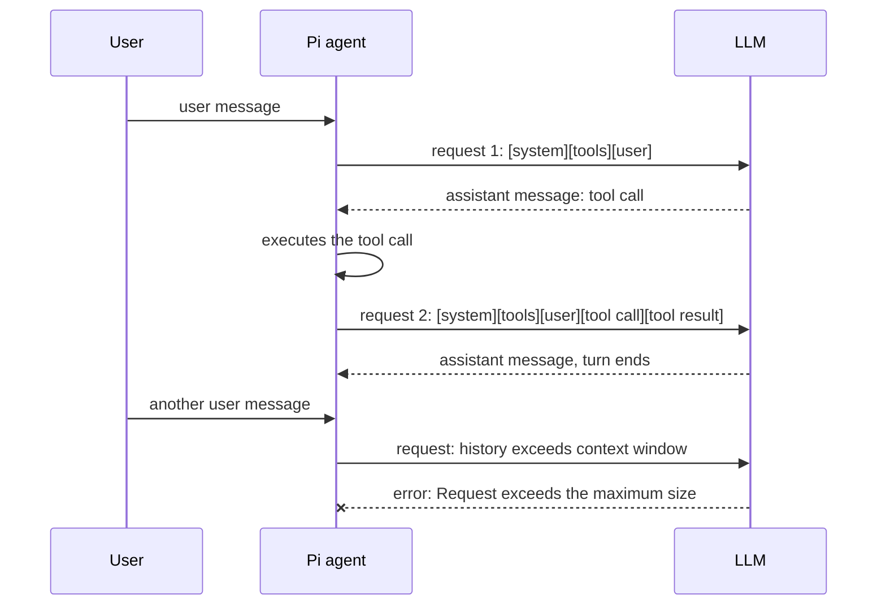
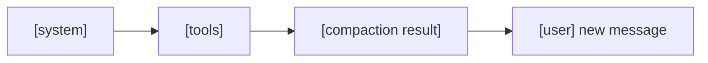
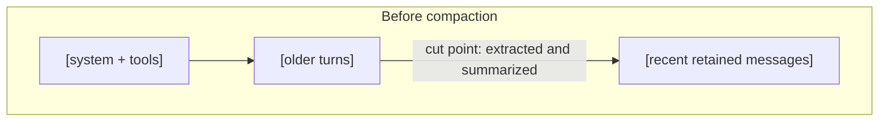
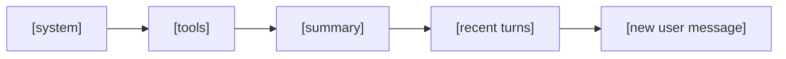
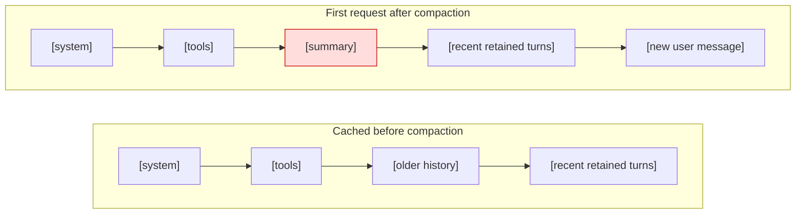

#AI #LLM #AI/AgenticAI #clippings

> [How Compaction Works in Pi \| EARENDIL](https://earendil.com/posts/compaction-in-pi/)

> [!tldr] Core Idea
> **When a session outgrows the context window, compaction replaces the older history with a short summary and keeps recent turns verbatim, trading one prompt-cache miss for room to keep working.**
> 
> - The alternatives are starting over (losing decisions and unresolved work) or compressing; compaction is an LLM request that summarizes the history.
> - Pi keeps a token budget of recent messages (default 20k tokens, roughly 5 to 20 turns) unchanged and summarizes everything before that cut point, into sections for goal, progress, and key decisions.
> - The summary is a standalone request with its own system prompt, so it can run on a different model, and it is stored as plain text to stay portable.
> - Compaction creates a new prefix, so it breaks the [[Prompt Caching In Agents|prompt cache]] once; afterwards caching resumes and the [[KV cache#The Problem: Redundant Computation|KV state]] the next prefill must build is far smaller.

If you have ever had a long coding session in a coding agent like [Pi](https://pi.dev/), Claude Code, or Codex, you will have triggered a compaction. In this post we explain how compaction works and when Pi needs to compact.
## An LLM conversation

Large language models (LLMs) have limited [context windows](https://en.wikipedia.org/wiki/Context_window). The context window is what the model can "see" while producing a response. The [[Attention is All You Need (Transformers)#Transformer|Transformer Architecture]] used by LLMs limits how much input they can process. The input for a coding agent session includes all the previous messages and tool calls, and this keeps growing as you work. Once it exceeds the context window, the LLM rejects the request. *For a primer on context windows and autoregressive generation, see [[1. An Introduction to LLM]].*

When working interactively with a coding agent like Pi, the agent sends requests to an LLM and receives responses. Each request includes a system prompt, loaded files such as [`AGENTS.md`](https://agents.md/), tool definitions, and the conversation history.

A coding agent's first LLM request contains this initial context, along with a first user message.

This starts a turn. The LLM may first return an assistant message containing tool calls. The agent program executes them and sends a new request to the LLM containing the complete conversation, now including the tool results. We get back another assistant message. The turn is finished when the assistant has completed generating output.

We continue working, and send another message.

## Handling context overflow

When we cannot continue with the existing conversation as-is, we have two choices.

1. We can start a new, empty conversation without the accumulated context. This discards the history, including prior decisions and unresolved work. It might still be a good idea to do, because [the performance of LLM outputs decrease as the context size grows](https://www.trychroma.com/research/context-rot).
2. We can create a smaller representation of the [[3. Context and Subagents|conversation context]], since we want to keep this conversation going. That is what compaction does.

*Weighing these options against context and cost limits is a core question of production [[4. Advanced Agent Engineering|agent engineering]].*

## Compaction

In theory, there are many ways to implement compaction. For example, we can write a deterministic function which keeps some of what is in the conversation and discards the rest. In practice, though, implementations of compaction use an LLM request to summarize the conversation history.

Compaction replaces part of the history with a compressed representation, leaving room for additional messages and tool calls.

## Pi's implementation

Let's look more closely at how Pi specifically [implements compaction](https://pi.dev/docs/latest/compaction#summary-format).

When conversations grow too long, Pi uses compaction to summarize older content while preserving recent work. Compaction is triggered when the context limit is nearing the total size of the context window. It can also be manually triggered using the `/compact` command.

Pi checks for auto-compaction after a turn ends. Until then, each request extends the existing prompt and can reuse its cached prefix. Pi may also compact mid-turn, if it encounters a context overflow error.

When compacting, Pi retains some number of recent messages unchanged.

The number of retained messages varies because Pi uses a [configurable token budget](https://pi.dev/docs/latest/compaction#when-it-triggers). Pi's current default of 20 thousand tokens comes out to roughly 5 to 20 turns. All the messages before this cut point are extracted and serialized, and will be summarized.

## Pi's compaction prompt

The ideal outcome of a good summarization for a coding agent is like a handoff briefing from one shift to the next. *The session transcript is the agent's operating log — [[The Log is the Agent]] argues the log should be the core abstraction of agent design.* Pi's compaction prompt focuses on the fact that there is a lot in the existing context that is no longer relevant. We should only keep around what is still important context for the next LLM request.

Pi therefore sends a different request for compaction than for regular conversation.

1. The system prompt used in the standalone compaction request is different. Instead of telling the LLM "you are an expert coding assistant", we tell the LLM ["you are a context summarization assistant."](https://github.com/earendil-works/pi/blob/47610217098d9ba8f22d223fa7c1413f9f5fd759/packages/coding-agent/src/core/compaction/utils.ts#L152-L158)
2. The user message in the compaction request is also different. It requests ["a structured summary of this conversation branch for context when returning later."](https://github.com/earendil-works/pi/blob/47610217098d9ba8f22d223fa7c1413f9f5fd759/packages/coding-agent/src/core/compaction/compaction.ts#L463-L498) The prompt specifies sections for goal, progress and key decisions.
3. It's a standalone request that doesn't use any of the existing conversation history, which means it can use a different LLM model without incurring any unnecessary cost.

The result of the compaction is appended to the Pi session as a compaction entry, and the session can now continue. After the compaction request, the context has been compressed.

There is now room in the conversation context for many more messages.

Pi stores the compaction summary as plain text in the session. This keeps the compacted context readable and [portable](https://earendil.com/posts/session-portability), since we can switch models in Pi and continue using the summary.

## Compaction and prompt caching

> [[Prompt Caching in LLM]]
> *[[Prompt Caching In Agents]]*

[Prompt caching](https://earendil.com/posts/prompt-caching) is used by LLM providers to make repeated requests in the same conversation less expensive. In an active coding session, we pay less for the context that has already been generated by the model. This caching requires an exact prefix match, so compacting a session will break the prompt cache.

The retained turns contain the same tokens, but they now follow a different prefix. Their previous cached state therefore cannot be reused.

New requests after compaction will benefit from prompt caching again.

Every conversation turn appends to the model's [[KV cache#The Problem: Redundant Computation|KV cache]]; compacting replaces a long token history with a short summary, drastically shrinking the KV state the next prefill must build.

---
> [!info] *Some text is added by AI to represent connections to other notes; it is shown in italics.*