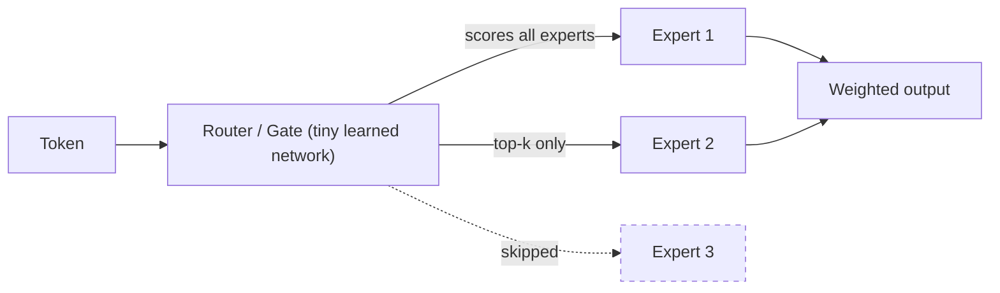

#AI #LLM #MachineLearning #Agents

> [!abstract]-
> **Mixture of Experts (MoE)** makes a model very large without making it slow. Instead of one big feedforward network processing every token, an MoE layer has many smaller **experts**, and a tiny **router** sends each token to only the best few (e.g. 2 of 8). Huge total parameters, small "active" parameters per token.

## The Idea at a Glance

> 8 experts exist → a token activates only 2. The rest stay idle.

## Why Bother?

| | Dense model | MoE model |
| --- | --- | --- |
| Total parameters | All used per token | Many, mostly idle |
| Active per token | All | Only top-k |
| Compute per token | High | Relatively low |
| Capability | — | Close to a model with all parameters |

MoE = **large total capacity** (what it knows) at **low per-token cost** (how much it computes).

## Key Pieces

- **Expert** — an [[FNN and RNN#Feed-Forward Neural Network (FNN)|FFN]], structurally the same as the dense FFN it replaces. Specialization is *learned*, not hand-assigned.
- **Router / gate** — a small learned network that scores every expert per token (top-k executed, rest skipped → *sparse*).
- **Load balancing** — a loss that stops a few experts from hogging all tokens.
- **Two routing styles** — *tokens choose experts* (standard) vs *experts choose tokens*.
- **Upcycling** — building MoE from an existing model by copying its FFN into multiple experts.

## Real Examples

- **Mixtral 8x7B** — 8 experts, top-2 routing
- **DeepSeek-V3** — 671B total, only ~37B active per token
- **Qwen3-235B-A22B** — 235B total, 22B activated (read the name: *total*-A*active*)

## Pros & Cons

**Pros:** more capacity for roughly dense-compute cost; fewer FLOPs per token; scaling without proportional cost.

**Cons:** more memory (all experts must fit); router + load-balancing complexity; communication overhead when experts are sharded across machines; harder to serve than dense models, so [[9. Inference Optimization|inference optimization]] matters.

---
## Deep Dive

> [!see]- MoE - A First-Principles Study Note (PDF)
> Full anatomy, routing math, history (GShard → Switch Transformer → DeepSeekMoE), and the 2026 frontier
> ![[Mixture of Experts - A First‑Principles Study Note.pdf]] 
