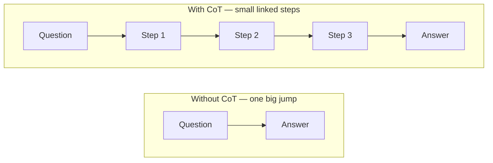

#AI #LLM #PromptEngineering #AI/AgenticAI #Reading/ResearchPaper 

> [Chain-of-Thought Prompting Elicits Reasoning in Large Language Models (Wei et al., 2022)](https://arxiv.org/abs/2201.11903)
> [Large Language Models are Zero-Shot Reasoners (Kojima et al., 2022)](https://arxiv.org/abs/2205.11916)

> [!abstract]-
> **Chain of Thought (CoT)** is a prompting technique that asks an LLM to write out its reasoning steps *before* giving the final answer — instead of jumping straight to the result. By making the model "show its work," CoT dramatically improves accuracy on math, logic, and multi-step problems.
>
> The two simplest flavors are **Zero-shot CoT** (just add *"Let's think step by step"*) and **Few-shot CoT** (show a few solved examples with reasoning).
## 1. The Problem: LLMs Jump to the Answer

An LLM doesn't "think" like we do. It predicts the next word, again and again, based on the words before it.

If you ask for a final answer directly, the model has to guess it in one shot — with no room to work things out. For easy questions this works fine. For multi-step problems (math, logic puzzles), it often jumps to a confident but **wrong** answer, and by the time it realizes, it has already committed to the wrong number.

It's like doing long division in your head vs. writing it down on paper. Without paper, easy to slip up.
![[Chain of Thought (CoT)-1786904498781.webp]]
## 2. The Fix: Chain of Thought

> [!important] The Core Idea
> **Ask the model to think out loud.** Write the reasoning steps first, and put the final answer last.

A **thought** is one small reasoning step. A **chain** is many small steps linked together, each one building on the one before it.

### Example: Without CoT

> **Q:** A shop has 12 apples. It sells 5 in the morning and buys 8 in the evening. How many apples does it have at the end of the day?
> **A:** 15

The model guesses. Sometimes right, sometimes wrong.
### Example: With CoT

> **Q:** A shop has 12 apples. It sells 5 in the morning and buys 8 in the evening. How many apples does it have at the end of the day?
> Let's think step by step.
> **A:** The shop starts with 12 apples. It sells 5, so 12 - 5 = 7. Then it buys 8, so 7 + 8 = 15. The answer is **15**.

Each step uses the result of the previous step. If a step is wrong, you can *see where* it went wrong.
## 3. Two Simple Ways to Trigger CoT

### Zero-shot CoT (easiest)
Just append a trigger phrase to your question — no examples needed:
- "Let's think step by step."
- "Show your work."
- "Explain your reasoning, then give the final answer."

| | Zero-shot CoT | Few-shot CoT |
| --- | --- | --- |
| Examples given | None | 1–2 solved examples with reasoning |
| How it triggers | A trigger phrase | The model copies the pattern |
| Prompt length | Short | Longer |
| Effort to write | Very little | More |
| Best for | Quick, common problems | Harder or unusual problems |

### Few-shot CoT (more reliable)
Show the model 1–2 solved examples *with the reasoning shown*, then ask your real question. The model imitates the step-by-step style and the answer format.

### Auto-CoT (bonus)
Instead of handwriting examples, ask the model to generate example reasoning chains from a small set of seed questions, then use those as few-shot examples. Saves manual effort.
## 4. Why Does It Work?

- **A scratchpad:** When the model writes steps, those words become part of what it reads next. It builds the final answer on top of visible, correct steps instead of guessing from nothing.
- **Easier sub-problems:** A big hard problem becomes many small easy steps. The model is good at small steps.
- **[[2. Pre-Training Data|Training data pattern]]:** The internet is full of worked examples (textbook solutions, tutorials). Step-by-step text is a pattern the model knows well.

> [!note] Important caveat
> The model is **not actually thinking** — it is still just predicting the next word. The steps can look perfectly logical and still lead to a wrong answer. Always verify the reasoning yourself for important tasks.
## 5. When to Use CoT (and When Not To)

**Use it when:**
- Math word problems, calculations
- Logic puzzles and multi-step questions
- Tasks where you want an auditable trace of how the answer was reached
- Smaller / older models without built-in reasoning

**Skip it when:**
- Simple facts: "What is the capital of France?"
- Simple retrieval / classification / format conversion
- Latency or cost matters — extra [[9. Inference Optimization|inference-time compute]] adds time and cost
- The model already has built-in reasoning (e.g., o1-style "thinking" models) — forcing explicit CoT can be redundant or even hurt accuracy

> [!tip] Pro tip
> For high-stakes answers, sample multiple chains and take the majority answer (**self-consistency**). It is more reliable than one single chain.
## 6. Related Techniques

- **Self-consistency** — generate several chains, vote on the final answer
- **Tree of Thought (ToT)** — branch and explore multiple reasoning paths, backtrack on dead ends (see [[3. Agentic AI and Autonomous Systems]])
- **[[ReAct]]** — interleave reasoning with actions/tool use (see [[ReAct|ReAct paper notes]])
- **Least-to-most** — decompose a hard problem into subproblems and solve them in order
- **Prompt chaining** — multiple prompt rounds instead of one self-contained response
## 7. Related Vault Notes
- [[2. Pre-Training Data]] — why LLMs need reasoning techniques like CoT
- [[3. Agentic AI and Autonomous Systems]] — CoT inside planning & reasoning frameworks, ToT comparison
- [[RLHF - Reinforcement Learning from Human Feedback]] — post-training, another way to shape LLM behavior

---
![[Chain-of-Thought Prompting Elicits Reasoning in Large Language Models-Annotated.pdf]]