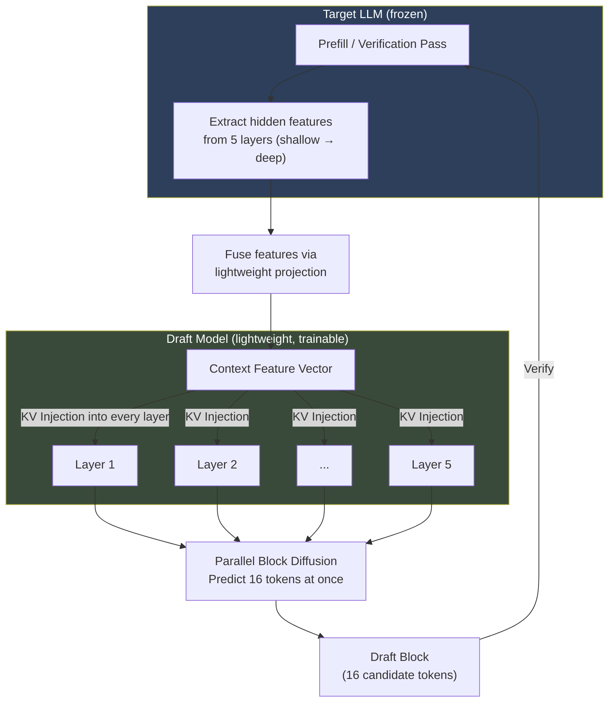
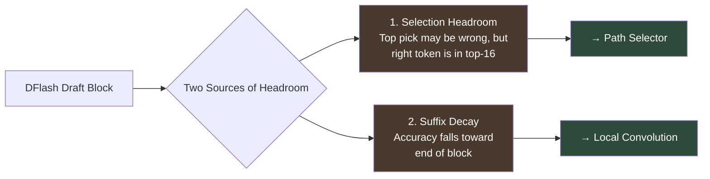

#AI #LLM #Agents #Reading/ResearchPaper

[[KV cache]]
[[DeepSeek's DSpark#Speculative Decoding]]

> [!abstract] TL;DR
> **DFlash** replaces the *autoregressive draft model* in [[9. Inference Optimization|speculative decoding]] with a **lightweight block diffusion model** that predicts an entire block of tokens in a **single forward pass**. By injecting deep hidden features from the target LLM into every layer of the draft model, it achieves high acceptance rates with a tiny model. Result: **>6× lossless speedup** — up to **2.5× faster than EAGLE-3**.

> [!see]- DFlash Paper
> ![[DFlash Block Diffusion for Flash Speculative Decoding.pdf]]
## 1. The Problem: Why LLMs Are Slow

Large language models generate text **autoregressively** — one token at a time. Each new token depends on all previous tokens:
$$x_i \sim p_{\text{target}}(x_i \mid x_{<i})$$
> [!info] What does "autoregressive" mean?
> Think of it like writing a sentence one word at a time, where each word is chosen based on everything written so far. You *cannot* write the second word before you've written the first. This is inherently **sequential**.

This sequential nature causes two problems:

| Problem | Explanation |
|---------|-------------|
| **High latency** | Generating $N$ tokens requires $N$ separate forward passes through the model |
| **Poor GPU utilization** | Each pass produces only one token, leaving most GPU compute idle |

Modern GPUs are designed for massive parallel computation. Generating one token at a time is like hiring a 100-person construction crew to build a house one brick at a time — 99 workers stand idle while one lays a brick.
## 2. Background: Speculative Decoding

### 2.1 The Core Idea

**Speculative decoding** is an existing acceleration technique. It works like this:

1. A **small, fast "draft" model** guesses the next several tokens
2. The **large "target" model** verifies all guesses in a single parallel forward pass
3. Correct guesses are accepted; the first wrong guess triggers a fallback

> [!example] Analogy
> Imagine a junior developer (draft model) quickly writes a draft of code, and a senior developer (target model) reviews it. The senior developer can review many lines at once — much faster than writing each line themselves. If the junior made a mistake on line 5, the senior corrects it and the junior starts again from there.
### 2.2 The Speedup Formula

The average per-token latency is:
$$L = \frac{T_{\text{draft}} + T_{\text{verify}}}{\tau}$$
Where:
- $T_{\text{draft}}$ = time to generate draft tokens
- $T_{\text{verify}}$ = time for the target model to verify (one forward pass)
- $\tau$ = **acceptance length** (average number of tokens accepted per cycle, including a "bonus" token the verifier produces)

Speedup over normal decoding: $\eta = L_{\text{target}} / L$

> [!tip] The Two Levers
> To go faster, you can either:
> 1. **Increase $\tau$** — make better guesses (more tokens accepted)
> 2. **Decrease $T_{\text{draft}}$** — generate guesses faster
>
> DFlash improves *both* simultaneously.

### 2.3 The Bottleneck in Existing Methods

Existing speculative decoding methods (like **EAGLE-3**) use **autoregressive draft models** — the draft model itself generates tokens one at a time:

$$T_{\text{draft}}^{\text{AR}} = \gamma \cdot t_{\text{step}}$$

Where $\gamma$ is the number of draft tokens and $t_{\text{step}}$ is the cost of one forward pass. Drafting cost grows **linearly** with the number of tokens you want to draft.

> [!warning] The Capacity Squeeze
> Because drafting is sequential and costly, existing methods are forced to use **very shallow** draft models (e.g., a single transformer layer in EAGLE-3). A shallow model can't make great guesses, so acceptance length $\tau$ quickly **saturates** — you draft more tokens but most get rejected. This caps practical speedups at ~3–4×.
## 3. The Key Idea: Diffusion-Based Drafting

### 3.1 What Is a Diffusion Model?

> [!info] Diffusion Models — Intuition
> A diffusion model works in two phases:
> - **Forward (noising):** Gradually corrupt data by adding noise until it becomes pure noise
> - **Reverse (denoising):** Learn to reverse the process — start from noise and progressively "clean" it into valid data
>
> In image diffusion (like DALL·E), you start with random pixels and denoise them into a coherent image. In **text diffusion**, you start with masked (unknown) tokens and denoise them into real words.

**Block diffusion models** extend this to text. Instead of generating one token at a time, they denoise an entire *block* of masked tokens **in parallel**. It's like filling in a fill-in-the-blank puzzle where all blanks are filled simultaneously rather than left-to-right.

### 3.2 Why Diffusion Solves the Drafting Problem

DFlash's draft model generates all $\gamma$ tokens **in a single forward pass**:

$$T_{\text{draft}}^{\text{diffusion}} = t_{\text{parallel}}$$

This is **constant** — it does *not* grow with the number of tokens. Modern GPUs excel at parallel operations, so $t_{\text{parallel}} \ll \gamma \cdot t_{\text{step}}$ for comparable model sizes.

> [!important] The Design Space Shift
> Because drafting cost no longer scales with the number of generated tokens, DFlash can afford **deeper, more expressive** draft models without adding latency. More capacity → better guesses → higher acceptance → more speedup.

Empirically, a **5-layer** DFlash draft model generating **16 tokens** achieves both *lower latency* and *higher acceptance* than EAGLE-3 generating 8 tokens with a 1-layer model.
## 4. How DFlash Works: The Architecture

### 4.1 Overview



### 4.2 Context Features from the Target Model

> [!important] Key Insight: "The Target Knows Best"
> Large autoregressive LLMs' [[11. Representation Learning and Embeddings|hidden features]] (internal representations at each layer) **implicitly contain information about multiple future tokens**. They encode long-range dependencies, task semantics, and future-token predictions — far richer than what surface-level logits reveal.

DFlash exploits this. During the target model's forward pass (prefill or verification), it:

1. **Extracts** hidden representations from a fixed set of layers (e.g., 5 layers), uniformly sampled from shallow to deep
2. **Concatenates** them and passes through a lightweight projection layer to fuse cross-layer information:

$$\mathbf{H}_t = \text{RMSNorm}\left(W_c [\mathbf{H}^{(l_1)}; \ldots; \mathbf{H}^{(l_5)}]\right)$$

3. The resulting **context feature** is used to condition the draft model

> [!note] Without Target Features
> The paper tested a diffusion drafter *without* target model conditioning. Result: only ~2–3× speedup. Without rich contextual guidance, the draft model must predict future tokens "from scratch" — it doesn't know what the target model is "thinking."
### 4.3 KV Injection: The Secret Sauce

This is DFlash's most important architectural innovation.
#### The Problem with Prior Approaches

Methods like EAGLE-3 also use target features, but they **fuse** them with the draft model's token embeddings and feed them only as **input** to the first layer. As the signal passes through deeper layers, it gets progressively **diluted** — like a game of telephone where the message degrades with each person. This means adding more draft layers gives diminishing returns.
#### DFlash's Solution: Inject into Every Layer

Instead of feeding target features as input, DFlash treats them as **persistent contextual information** and injects them directly into the **Key (K) and Value (V) projections** of *every* draft model layer:

$$\mathbf{K}_i = [W_i^K \mathbf{H}_t;\; W_i^K \mathbf{H}_d]_{\text{seq}}$$

$$\mathbf{V}_i = [W_i^V \mathbf{H}_t;\; W_i^V \mathbf{H}_d]_{\text{seq}}$$

Where $\mathbf{H}_t$ is the target context feature and $\mathbf{H}_d$ is the draft model's hidden state.

> [!tip] What This Means in Plain English
> In a transformer's attention mechanism, "Keys" and "Values" represent the information that each token can "look at." By injecting target features as additional K/V entries, the draft model at *every layer* can directly attend to the target model's deep understanding — as if the draft model can "peek" at the target model's thoughts at each step.
>
> The target features **bypass** the draft model's Query projection, output projection, self-attention update, and FFN — they serve purely as additional memory entries. This is lightweight but powerful.

**Result:** Acceptance length **scales effectively** with the number of draft layers. More layers = better drafts, because the rich target context is never diluted.

> [!success] Minimal Memory Overhead
> The only extra parameterized component is the shared projection $W_c$. For Qwen3.5-35B-A3B ($D=2048$, BF16), this adds **~42 MB** — negligible compared to the ~70 GB target model. During decoding with block size 16, temporary activation is **below 400 KB**.
### 4.4 Parallel Diffusion Drafting

The draft model predicts an entire block of tokens using **block-level diffusion**:

1. Start with a block of $\gamma$ **masked** (unknown) token positions
2. Condition on: the last verified token + the injected target context features
3. Run a **single forward pass** — all masked positions are decoded in parallel
4. Sample each token independently to form the draft block

> [!note] Single-Step Diffusion
> Unlike traditional diffusion models that need many denoising steps (50–1000 for images), DFlash collapses the diffusion process into essentially a **single pass**. The noise scheduling is learned and integrated into linear layers for efficiency.
### 4.5 The Decoding Loop

Each cycle of DFlash proceeds as follows:

```
┌─────────────────────────────────────────────┐
│              DFLASH DECODING CYCLE          │
├─────────────────────────────────────────────┤
│                                             │
│  1. BLOCK DRAFTING                          │
│     • Draft model proposes γ=16 candidate   │
│       tokens in a single parallel forward   │
│       pass, conditioned on target features  │
│                                             │
│  2. BLOCK VERIFICATION                      │
│     • Target LLM computes logits for all 16 │
│       positions in ONE batched forward pass │
│                                             │
│  3. ACCEPTANCE CHECK                        │
│     • Compare each draft token against the  │
│       target model's greedy choice          │
│     • Accept tokens sequentially until first│
│       mismatch                                │
│     • On mismatch: target model produces one  │
│       correct "bonus" token, then resume      │
│                                               │
│  → Accepted tokens are appended to output     │
│  → Cycle repeats with updated context         │
│                                               │
└─────────────────────────────────────────────┘
```

> [!important] Lossless Guarantee
> The output distribution **exactly matches** the target LLM's own output. This is because verification uses the target model's own probabilities — rejected tokens are replaced with the target model's actual choice. The speedup is "free" in terms of output quality.
## 5. Training

### 5.1 Training Objective

DFlash draft models are trained to align block-level diffusion predictions with the outputs of a **frozen** autoregressive target model. The target model is never modified — only the lightweight draft model is trained.

### 5.2 Key Training Innovations

#### Random Sampling of Masked Blocks

Standard block diffusion divides text into uniform blocks and masks random positions within each. DFlash instead:

1. **Randomly samples anchor tokens** from the response
2. Each anchor becomes the **first position** of a block
3. The remaining positions are masked

This directly matches inference behavior (where the draft always conditions on a clean "bonus" token from the previous verification). Randomizing anchors also exposes the model to more diverse target context features — **improving both acceptance length and speedup**.

> [!success] Ablation Result
> Random anchor sampling improved acceptance length from 4.94 → 5.64 on Math500 and speedup from 4.13× → 4.69× compared to standard block construction.

#### Loss Weighting (Exponential Decay)

Not all tokens are equal. An error at position 1 in a block invalidates *all* subsequent tokens. DFlash weights the loss to emphasize early positions:

$$w_k = \exp\!\left(-\frac{k-1}{\gamma}\right)$$

Where $k$ is the position within the block and $\gamma$ controls the decay rate. This makes training converge **faster and better**.

#### Shared Embedding and LM Head

The draft model **shares** the token embedding layer and language modeling head with the target model (both kept frozen). Only the draft Transformer layers are updated, making it a lightweight [[11. Representation Learning and Embeddings|representation-space adapter]]. This:
- Reduces trainable parameters
- Keeps the draft model aligned with the target's representation space
- Makes the draft model function as a **lightweight diffusion adapter**

#### Efficient Long-Context Training

Training speculative drafters on long contexts is hard for methods like EAGLE-3 (costly training-time tests). DFlash fixes the number of masked blocks per sequence and randomly samples anchor positions each epoch — effective data augmentation with bounded training cost.

---
## 6. Experimental Results

### 6.1 Setup

| Aspect | Details |
|--------|---------|
| **Target models** | Qwen3 (4B, 8B, Coder-30B-A3B), LLaMA-3.1-8B Instruct |
| **Draft model** | 5 layers (8 for Coder), block size 16 (10 for LLaMA) |
| **Target features** | 5 layers, uniformly sampled between layer 2 and third-to-last |
| **Training data** | ~800K samples (NVIDIA Nemotron Post-Training V2 + CodeAlpaca), responses generated by target model |
| **Hardware** | NVIDIA H200 / B200 GPUs |
| **Baselines** | Vanilla autoregressive decoding, EAGLE-3 |
| **Tasks** | Math (GSM8K, MATH-500, AIME25), Code (HumanEval, MBPP, LiveCodeBench), Chat (MT-Bench, Alpaca) |

### 6.2 Main Results (Transformers Backend)

#### Greedy Decoding (Temperature = 0)

| Model | Method | GSM8K | MATH-500 | HumanEval | MBPP | MT-Bench | **Avg** |
|-------|--------|-------|----------|-----------|------|----------|---------|
| Q3-8B | EAGLE-3 (16) | 1.94× | 1.81× | 1.89× | 1.69× | 1.63× | **1.76×** |
| Q3-8B | EAGLE-3 (60) | 2.23× | 2.05× | 2.17× | 1.93× | 1.90× | **2.02×** |
| Q3-8B | **DFlash (16)** | **5.15×** | **6.08×** | **5.14×** | **4.65×** | **2.75×** | **4.86×** |

> [!success] DFlash achieves ~2.4× improvement over EAGLE-3 (16) and also beats EAGLE-3 (60) — with higher acceptance length AND lower verification overhead.

#### Sampling (Temperature = 1)

DFlash maintains **4.1× average speedup** (vs 4.9× at temp=0) and **2.2× improvement over EAGLE-3**, even under non-greedy sampling.

### 6.3 Acceptance Length Comparison

| Model | EAGLE-3 (16) τ | EAGLE-3 (60) τ | DFlash (16) τ |
|-------|----------------|-----------------|----------------|
| Q3-4B | 3.05 | 3.48 | **6.54** |
| Q3-8B | 2.96 | 3.40 | **6.49** |

DFlash roughly **doubles** the acceptance length compared to EAGLE-3.

### 6.4 Real-World Serving (SGLang on B200)

| Model | Task | Concurrency 1 | Concurrency 8 | Concurrency 32 |
|-------|------|---------------|---------------|-----------------|
| Q3-8B | Math500 | **5.1×** | **4.5×** | **2.8×** |
| Q3-8B | HumanEval | **4.2×** | **3.6×** | **2.4×** |
| Qwen3-Coder-30B | HumanEval | **3.5×** | **3.2×** | **3.1×** |

> [!tip] Practical Impact
> DFlash provides speedups across all concurrency levels (1–32), achieving up to **5.1× speedup** on Qwen3-8B. This translates directly to **reduced serving costs** in production.

### 6.5 Key Ablation Findings

| Ablation | Finding |
|----------|---------|
| **Draft layers** | 5 layers gives best speedup (8 layers = higher τ but more latency). Acceptance scales with depth thanks to KV injection |
| **Target features** | 5 features > 3 features (richer context → higher τ). More features = higher training storage cost |
| **Block size** | Train at block 16 → generalizes well to inference at block 8. Reverse does NOT hold. Enables **dynamic block-size scheduling** |
| **KV injection vs. input fusion** | KV injection is critical — it's what allows acceptance to scale with depth |
| **Loss decay** | Exponential decay converges faster and better than uniform weighting |
| **Random anchor sampling** | Substantially improves both acceptance length and speedup |

---

## 7. DFlash 2: Keep Drafting Parallel

> [!info] DFlash 2
> Released August 2026 by **Inco AI** (the team behind DFlash). DFlash 2 pushes parallel drafting further: **>20% more output** per verification pass for **~1% added cycle latency**, with output provably unchanged.

### 7.1 The Two Sources of Headroom

When DFlash predicts every position independently, there are two places where accuracy is left on the table:



#### Problem 1: Selection Headroom

An analysis of DFlash's draft positions showed that while the **top-1** pick is right ~85% of the time at position 0, the **top-16** candidates contain the correct token ~90–92% of the time. An **oracle** that always picks the right candidate from the top-16 would lift acceptance length from 4.27 → 6.79. That gap is "pure selection headroom."

**Solution — Lightweight Path Selector:**

DFlash 2 keeps the top-16 candidates at each position and scores every **adjacent pair** (predecessor $a$, candidate $b$):

$$S_t(a,b) = U_t(b) + \langle A(a) \odot H(h_t), B(b) \rangle$$

- $U_t(b)$: DFlash's own logit — how much the drafter already liked $b$
- $\langle A(a) \odot H(h_t), B(b) \rangle$: how well $b$ follows $a$ — a **low-rank bilinear attention** over adjacent candidates (256-dim embeddings, context-gated)
- Scoring is **fully parallel** — no extra backbone or LM-head pass
- The only sequential work is a final greedy walk over precomputed scores

> [!success] Selector Results
> - Improves DFlash by **+0.34 tokens** at T=0, **+0.47** at T=1
> - Beats DSpark correction with **~40× fewer parameters** and **~16× lower latency overhead**
> - Adds only **2.0M params** and **0.6% cycle latency**
> - "Choosing is cheaper than predicting."

#### Problem 2: Suffix Decay

Even with perfect selection (the oracle), accuracy still decays from 99.5% (position 0) to 87.8% (last position). The candidates themselves are running out of quality. This is a **backbone problem** — the draft model loses track of dependencies across the block.

Analysis revealed that within-block attention shrinks from 30% (Layer 1) to 8% (Layer 5), concentrating in a few heads. The attention mechanism has two jobs — reading context *and* modeling within-block dependencies — but it neglects the latter in deeper layers.

**Solution — Two-Tap Dynamic Convolution:**

DFlash 2 inserts a short depthwise convolution (reaching one position back) before and after each attention and feed-forward sublayer:

$$\text{Conv}_k(x)_t = k_{t,0} \odot x_t + k_{t,1} \odot x_{t-1}$$

Each coefficient combines a learned base kernel with a content-dependent correction. The first position reads the last verified token; every later position reads its predecessor. Information crosses the block **while all positions still compute in parallel**.

> [!success] Convolution Results
> - Adds only **16.5M params (3%)** and **0.7% cycle latency**
> - Five-layer DFlash + conv comes close to **15-layer DFlash** performance
> - That's vs. 15.2% latency overhead for adding 10 extra transformer layers
> - "Suffix decay is mostly a local problem."

### 7.2 Combined Results

| Method | GSM8K | MATH-500 | HumanEval | MBPP | MT-Bench | **Mean** |
|--------|-------|----------|-----------|------|----------|---------|
| MTP | 4.78 | 5.04 | 4.84 | 4.16 | 3.90 | **4.54** |
| DFlash | 4.99 | 5.42 | 5.43 | 4.49 | 4.26 | **4.92** |
| DSpark | 5.69 | 6.20 | 5.80 | 4.96 | 4.77 | **5.49** |
| **DFlash 2** | **6.20** | **6.76** | **6.28** | **5.41** | **5.20** | **5.97** |

> *(Qwen3.5-4B, thinking enabled, temp=1.0, top-p=0.95, top-k=20, lossless rejection sampling)*

DFlash 2 gains **+1.05 tokens over DFlash (21%)** and leads on every benchmark. The selector + convolution together add only **1.3%** to the draft-verify cycle latency.

### 7.3 Real-World Impact

On Qwen3.8-27B with SGLang, DFlash 2 serves at **2.7–3.4× the throughput** of autoregressive decoding at batch size 1. On Muse Glimmer 30B, it achieves **3.1–4.6×** throughput.

> [!quote] Industry Adoption (as of August 2026)
> DFlash now runs in **SGLang, vLLM, TensorRT-LLM, and llama.cpp**. NVIDIA measured **up to 15× throughput** on Blackwell GPUs; Google reported **3× more tokens/sec** on TPUs. CoreWeave's production Kimi K2.7 Code endpoint runs DFlash by default. DFlash models have been **downloaded 3.5M+ times** on Hugging Face. NVIDIA, Red Hat, Modal, Meta, Poolside, and Xiaomi have all published official DFlash drafters.

---

## 8. Key Concepts Glossary

| Term | Meaning |
|------|---------|
| **Autoregressive (AR) decoding** | Generating tokens one at a time, each depending on all previous tokens |
| **Speculative decoding** | Using a fast draft model to guess tokens, verified by the target model in parallel |
| **Acceptance length (τ)** | Average number of draft tokens accepted per verification cycle (higher = better) |
| **Draft model** | A small, fast model that proposes candidate tokens |
| **Target model** | The large LLM whose output we want to reproduce (acts as verifier) |
| **Diffusion model** | A model that generates data by denoising — starting from noise/masks and progressively cleaning |
| **Block diffusion** | Denoising an entire block of masked tokens in parallel, block by block |
| **KV injection** | Injecting target model's hidden features into the Key/Value projections of every draft layer |
| **Lossless acceleration** | Output distribution exactly matches the target model — no quality degradation |
| **Block size (γ)** | Number of tokens drafted in one parallel pass (typically 16) |
| **Bonus token** | The extra correct token the target model produces during verification |
| **Suffix decay** | (DFlash 2) Accuracy decline at later positions in a draft block |
| **Selection headroom** | (DFlash 2) The gap between top-1 accuracy and top-16 accuracy |

---

## 9. Why DFlash Matters

> [!important] The Big Picture
> DFlash's core insight is elegant: **diffusion models don't need to compete with autoregressive LLMs in generation quality. They just need to be great drafters.** By confining diffusion to the drafting stage and conditioning on target-model features, DFlash achieves both high acceptance rates and low drafting latency.

### Key Takeaways

1. **Parallel drafting breaks the sequential bottleneck** — generating 16 tokens in one pass instead of 16 sequential passes
2. **KV injection is the key innovation** — it lets a tiny draft model "borrow" the target model's intelligence at every layer, enabling acceptance to scale with depth
3. **The draft model is a diffusion adapter**, not a standalone generator — it shares embeddings/LM head with the target and only learns lightweight transformer layers
4. **Lossless by construction** — verification guarantees the output exactly matches the target model's distribution
5. **Production-ready** — integrated into SGLang, vLLM, TensorRT-LLM, and llama.cpp with broad industry adoption
6. **DFlash 2 shows the design has headroom** — a path selector and local convolution add 20%+ more output for ~1% latency, without changing the fundamental one-pass design
## 10. Resources

| Resource | Link |
|----------|------|
| 📄 **Paper** | [arXiv:2602.06036](https://arxiv.org/abs/2602.06036) |
| 💻 **Code** | [github.com/z-lab/dflash](https://github.com/z-lab/dflash) |
| 🤗 **Models** | [HuggingFace DFlash Collection](https://huggingface.co/collections/z-lab/dflash) |
| 🌐 **Project Page** | [z-lab.ai/projects/dflash](https://z-lab.ai/projects/dflash/) |
| 📝 **DFlash 2 Blog** | [inco.ai/blog/dflash2](https://inco.ai/blog/dflash2/) |
| 🤗 **DFlash 2 Models** | [HuggingFace DFlash 2 Collection](https://huggingface.co/collections/incoai/dflash-2-6a8432273c9998ce1685d4c5) |
| 🔧 **NVIDIA Model Optimizer** | [DFlash integration docs](https://github.com/NVIDIA/Model-Optimizer/blob/main/examples/speculative_decoding/doc/dflash.md) |
