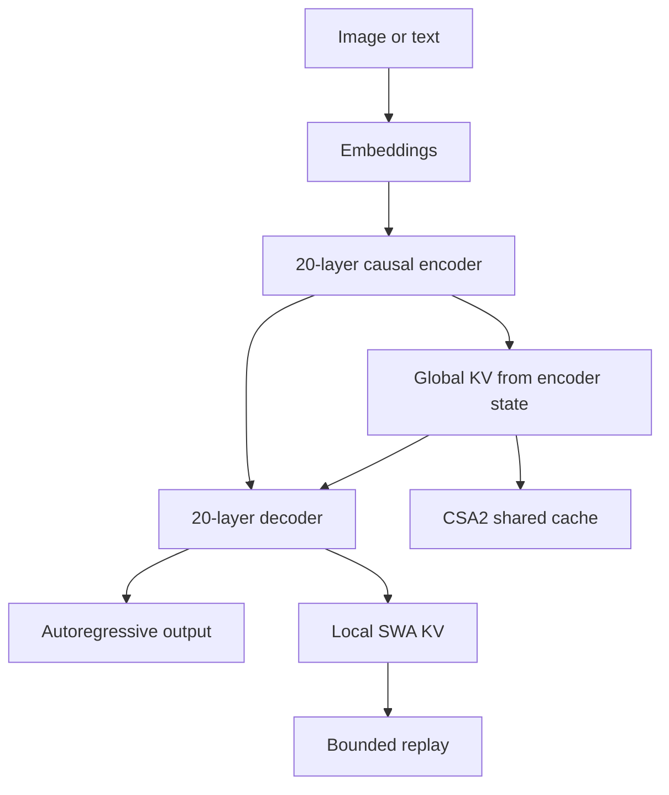

#AI #LLM #DeepSeek #Reading/ResearchPaper

> [[DeepSeek's DSpark]] 
> [[Prefix Caching Deep Dive]] 
> [[KV cache]] [[Mixture of Experts (MoE)]]

> [!abstract]
> **DeepSeek-V4.1-Flash is primarily a serving-architecture paper.** Its central idea is to separate the work needed to build global context from the work needed for local, layer-specific computation. CED reduces prefill depth, CSA2 shares global KV across layers, FP4 compresses the main KV cache, and bounded replay avoids persisting most SWA state.

> [!info]
> **Paper:** *DeepSeek-V4.1-Flash: Pushing the Limits of KV Cache Compression*  
> **Model:** 552B backbone parameters + 196B Engram parameters  
> **Context:** up to 1M tokens  
> **Active parameters:** 8B/token during prefill, 16B/token during decode  
> **Headline cache claim:** 890 bytes per token for global KV

## Architecture at a glance

![[02-overall-architecture-figure.webp]]

The model is a multimodal [[Mixture of Experts (MoE)|MoE]] Transformer with **40 causal layers**:

- **20-layer causal encoder**
- **20-layer decoder**
- The first two encoder layers use only sliding-window attention.
- The remaining 18 encoder layers use CSA2 with compression ratio $m=2$.
- All 20 decoder layers use CSA2 with compression ratio $m=1$.
- Every Transformer block uses DeepSeekMoE.
- The vision encoder and text embeddings enter the same causal backbone.

## 1. Causal Encoder–Decoder (CED)

### The problem

In a standard Transformer, prefill runs every prompt token through every layer. This is expensive for agents because every tool call can create another long prefill request.

### The design

The first 20 layers form a causal encoder. For decoder global attention, the model does **not** create KV entries from the decoder's own hidden states. Instead, each decoder layer projects its global KV from the final encoder hidden state:

$$
C^l = H^{L/2}W^l_{KV}, \qquad Z^l = H^{L/2}W^l_Z
$$

where $C^l$ is the compressed KV representation and $Z^l$ contains the corresponding compression weights.

This allows the decoder's global KV cache to be produced without running the full decoder over every prompt token.

### What CED saves

For sequence length $N$ much larger than the SWA window $n_{win}$, the paper gives the approximation:

$$
O(NL) \rightarrow O(NL/2 + n_{win}L/2) \approx O(NL/2)
$$

The expected benefit is close to half the prefill computation for long sequences.

### What CED does not remove

SWA remains layer-specific. Decoder SWA still needs decoder computation, so the system uses **Decoder SWA Bounded Replay** over the last $n_{win}$ tokens. The paper sets:

- $n_{win}=128$
- Exact replay would require roughly $L/2 \times n_{win}$ decoder-token processing.
- Bounded replay processes only the most recent window.

The resulting SWA state is approximate, not mathematically identical to a full forward pass.

## 2. Compressed Sparse Attention 2 (CSA2)

![[03-csa2-modes-figure.webp]]

CSA2 compresses attention along three dimensions:

1. **Entry dimension:** compressed latent KV representations.
2. **Sequence dimension:** one main KV entry can represent multiple source tokens.
3. **Layer dimension:** multiple layers reuse the same main KV and indexer K.

Each layer still computes its own query and local SWA KV. The reusable quantities are the global main KV, indexer K, and sometimes the Top-K selection.

### CSA2 modes

| Mode | Main KV | Indexer K | Top-K indices | Purpose |
|---|---|---|---|---|
| **Full** | New | New | New | Creates a shared global cache and selection |
| **Reindex** | Reused | Reused | New | Keeps the cache but selects different positions |
| **Reuse** | Reused | Reused | Reused | Avoids both new indexing and new global KV |

This decoupling is important. Reusing the cache does not force every layer to reuse the same sparse positions. Reindex layers can rescore the shared KV with a new query.

### Layer schedule

**Encoder:**

- First two layers: SWA only.
- Remaining 18 layers: three groups of six.
- Each group: one Full layer followed by five Reuse layers.
- Compression ratio: $m=2$.

**Decoder:**

- Five groups of four layers.
- First group: one Full layer followed by three Reuse layers.
- Remaining four groups: one Reindex layer followed by three Reuse layers.
- Compression ratio: $m=1$.

### Main attention settings

- 64 query heads
- Query head dimension: 512
- Query compression dimension: 1280
- 32 indexer query heads
- Indexer head dimension: 128
- Top-K global entries: 512
- SWA window: 128 tokens

## 3. Hierarchical Sparse Indexer

![[04-hierarchical-indexer-figure.webp]]

CSA2 reduces how often the model indexes, but a remaining Full or Reindex layer could still score the entire context. The hierarchical indexer reduces this cost for later decoder indexers.

1. The first decoder Full layer scores the complete visible context.
2. It selects high-scoring blocks.
3. The selected blocks form a shared candidate pool.
4. Later Reindex layers score only that pool.
5. Each layer can still choose its own final Top-K positions.

The configured candidate pool is:

- 2,048 blocks
- 8 positions per block
- Up to 16,384 candidate positions
- 512 final selected positions

The first Full layer remains linear in context length. Later Reindex layers have a bounded search domain.

> [!warning]
> This is a recall-versus-compute trade-off. If the first indexer misses an important block, later indexers cannot recover it. The paper acknowledges this robustness boundary but does not provide extensive adversarial recall tests.

## 4. KV cache formats and storage

![[01-decode-flops-figure.webp]]

### Main global KV

The main KV cache uses [[LLM quantization|quantization-aware training]] and is stored in an FP4-like format:

- E2M1 data values
- One E4M3 scale per 16 channels
- Quantization after RoPE
- Global/main KV uses FP4

The authors retain FP8 for SWA KV because it is more sensitive to quantization.

The paper reports a **global KV footprint of 890 bytes/token**, approximately one quarter of DeepSeek-V4-Flash's corresponding footprint. This figure depends on the stated layer schedule, compression ratios, cache formats, and metadata accounting.

### Persistent cache

The persistent-cache reduction is described as two multiplicative effects:

1. SWA KV is removed from the long-lived persistent cache.
2. The retained global KV is reduced to approximately one quarter of the V4 footprint.

Since V4's persistent cache is described as roughly half global KV and half SWA KV, this gives approximately one eighth of the original footprint.

SWA state is instead placed in a short-TTL distributed host-memory pool. When that state is missing, bounded replay reconstructs it from a recent window.

> [!note]
> The one-eighth figure is best understood as a cache-policy and representation estimate. A complete deployment result would also report replay frequency, hit rates, host-memory traffic, SSD bandwidth, and end-to-end latency.

## 5. Multimodal path

The model processes images and text jointly in the language backbone.

### Vision encoder

- DeepSeek-ViT trained from scratch
- 32 layers
- Hidden dimension: 1024
- 16 attention heads
- Patch size: 14
- 2D-RoPE
- RMSNorm and SwiGLU
- 3x3 pixel-unshuffle before the projector
- Supports approximately 1344x1344 input resolution

The pixel-unshuffle reduces the visual token count by a factor of nine before visual embeddings are inserted into the language sequence.

### Modality-specific expert balancing

Image and text tokens use separate expert-correction biases. This prevents aggregate load balancing from hiding an imbalance within one modality.

## 6. Other architectural extensions

### Single-Pass mHC

The model shifts the residual-stream mixing coefficient by one block. This removes a dependency and lets the deployment kernel fuse residual update, input mixing, and coefficient prediction.

The claimed benefit is approximately half the activation-memory traffic compared with the original multi-kernel implementation.

### Engram

Engram is a conditional memory module for memorization:

- 196B total Engram parameters
- Two modules
- N-gram orders 2, 3, and 4
- Eight hash heads
- 2,048 embedding dimensions per order
- Approximately 16M entries per hash table
- Modules placed at layers 1 and 14
- FP8 embeddings and key/value projections

Engram parameters are included in the overall model but are usually discussed separately from the 552B backbone. This distinction matters when comparing total parameter memory with other models.

### DSpark

DSpark is the speculative-decoding module:

- Three Transformer blocks
- Sliding attention window of 128
- Five draft positions generated through [[DFlash - Block Diffusion for Flash Speculative Decoding|parallel block drafting]]
- Markov head for dependencies among draft tokens
- Confidence head for prefix-survival estimates
- Hardware-aware verification-length scheduler

It is trained after backbone pretraining and updated during post-training without sending DSpark gradients back into the backbone.

## 7. Architecture-level mental model

> [!tip]
> **DeepSeek-V4.1-Flash is a deep model with a shallower long-context prefill path.**
>
> - CED avoids running the full decoder over the prompt.
> - CSA2 avoids storing a separate global KV cache for every layer.
> - Hierarchical indexing avoids rescoring the entire context repeatedly.
> - FP4 reduces the bytes stored per global KV element.
> - Bounded replay avoids keeping SWA state on long-lived storage.
> - DSpark reduces the number of expensive autoregressive decode steps.

These optimizations target different bottlenecks. CED targets prefill compute. CSA2 and FP4 target KV memory. Hierarchical indexing targets long-context retrieval compute. Bounded replay targets persistent storage. DSpark targets decode latency.

## 8. Architecture caveats

- The paper does not provide a complete ablation table for CED, CSA2, FP4, bounded replay, Engram, and DSpark.
- The reported cache numbers depend on a specific schedule and precision configuration.
- Sparse retrieval can fail when the initial candidate pool misses relevant context.
- Bounded replay produces approximate hidden states at cache-resumption boundaries.
- FLOP estimates use custom precision weights and are not equivalent to measured latency.
- The 552B headline excludes the separately reported 196B Engram parameters.

## Sources

- [DeepSeek-V4.1-Flash technical report](https://huggingface.co/deepseek-ai/DeepSeek-V4.1-Flash/blob/main/DeepSeek_V41_Tech_Report.pdf)
- [DeepSeek-V4.1-Flash model card](https://huggingface.co/deepseek-ai/DeepSeek-V4.1-Flash)
- [DeepSeek announcement](https://www.deepseek.com/en/news/deepseek-v4-1-flash/)
