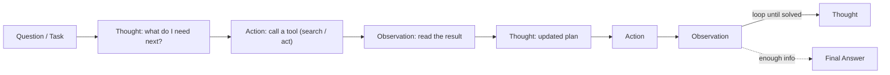

#LLM #AI #Agents #Reading/ResearchPaper 

> [[Chain of Thought (CoT)]]
> [[3. Agentic AI and Autonomous Systems]] 

> [!abstract]-
> **ReAct (Reasoning + Acting)** makes an LLM agent *think and do* at the same time. Instead of just reasoning in its head (CoT) or blindly calling tools (Act-only), it cycles through **Thought → Action → Observation** until the task is solved. The model uses tools to fetch real information, reads the results, and adjusts its plan — like a human who searches, checks, and retries.

## The Idea at a Glance

> The loop keeps repeating: reason, act, observe, reason again — until the agent has enough information to answer.

## Why Both? (CoT vs Act vs ReAct)

| Approach | Reasoning | Acting | Problem |
| --- | --- | --- | --- |
| **CoT** (think only) | ✅ | ❌ | Hallucinates facts; no access to real information |
| **Act-only** (act only) | ❌ | ✅ | No planning; repeats wrong actions |
| **ReAct** (think + act) | ✅ | ✅ | Grounded in real observations, plans as it goes |

The key trick: the model's **thoughts and actions are interleaved** in one trajectory, so its reasoning is guided by what it actually observes.

## Key Pieces

- **Thought** — free-form reasoning: decompose goals, extract facts, adjust plans
- **Action** — calling an [[10. Interfacing LLMs with External Tools|external tool]] (e.g. search query, environment step)
- **Observation** — the tool's result, fed back into the next thought
- **No fine-tuning needed** — works by few-shot prompting a frozen LLM (PaLM-540B) with 1–6 human-written example trajectories

## Results (from the paper)

- **More grounded, fewer hallucinations** — false-positive rate 6% vs 14% for CoT on HotpotQA; hallucination is CoT's main failure mode (56%)
- **Beats Act-only** on both knowledge QA and decision-making (ALFWorld) — reasoning guides better actions
- **vs CoT**: better on FEVER fact verification (60.9 vs 56.3), slightly behind on HotpotQA (27.4 vs 29.4) — but with far fewer made-up facts
- Weakness: repetitive thought/action loops, and it depends on search returning good information

## Why It Matters

ReAct is the foundation of modern **tool-using agents** (the industry-standard pattern for multi-tool workflows), connecting [[10. Interfacing LLMs with External Tools|tool interfaces]] to an iterative agent loop. Any agent that "thinks, calls a tool, and reacts to the result" is following the ReAct loop.

---
![[ReAct_SYNERGIZING REASONING AND ACTING IN_LANGUAGE MODELS.pdf]]