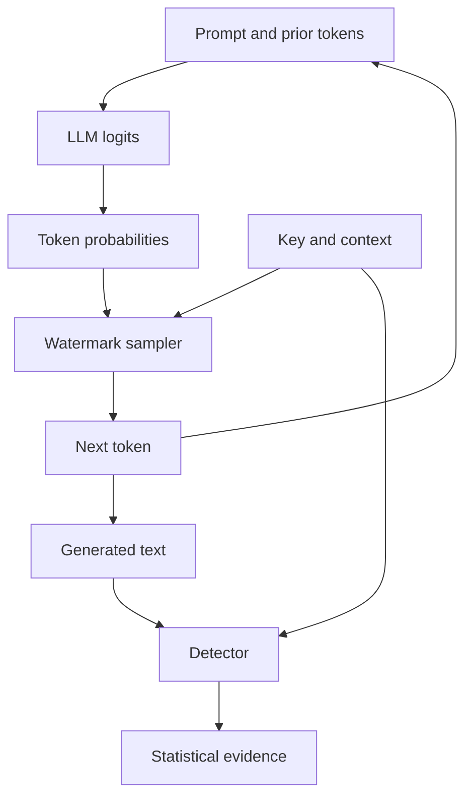
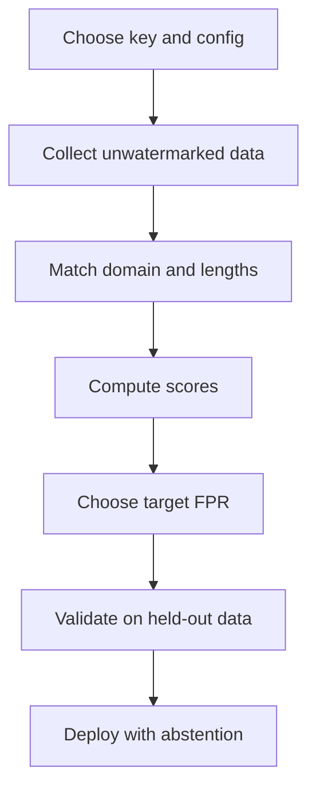

#AI #LLM #Reading/ResearchPaper

> [!tldr]-
> An LLM watermark changes token selection while text is generated. Kirchenbauer et al. randomly partition the vocabulary into context-dependent green and red lists and add a logit bias to green tokens. The detector recreates the lists and tests whether green tokens occur more often than chance. SynthID-Text instead over-generates candidate tokens and uses several keyed pseudorandom tournament functions to select a winner, then detects the resulting score correlation. Both methods work best when many tokens are plausible, both require careful calibration, and neither proves authorship.

> [!video]- Why You Cannot See a Watermark in AI Text
>  
## Destination

After studying this note, I should be able to:

1. Explain how a generative text watermark changes token sampling.
2. Derive the basic green-list detector and calculate its $z$-score.
3. Explain why entropy controls the quality and detectability trade-off.
4. Compare Kirchenbauer et al.'s soft green-list method with SynthID-Text.
5. Interpret a detector result without confusing statistical evidence with proof of authorship.
6. Describe common attacks, calibration requirements, and deployment risks.

## The central idea

A generative watermark is a hidden statistical pattern added while an [[1. Introduction to LLMs#What is an LLM?|LLM]] generates text. It changes the sampling rule, not the model's learned parameters. The change is designed to be invisible to a reader but measurable by a detector that knows the watermark configuration.

The watermark is not a visible character, special Unicode symbol, extra token, or user identifier. It changes which reasonable [[2. Tokens and Embeddings|token]] the model selects when several choices have similar probability.

The shortest accurate description is:

> A watermark correlates the generator's secret, context-dependent randomness with the tokens that it emits.

The detector later tests whether the observed tokens contain more of that correlation than ordinary unwatermarked generation would produce.



The key causal chain is:

1. The LLM produces a probability distribution over its token vocabulary.
2. A keyed watermark rule uses the recent context to generate a pseudorandom preference.
3. The sampler subtly favors tokens that agree with that preference.
4. Repeating this over many tokens creates a detectable surplus or correlation.
5. The detector measures that signal without necessarily running the LLM.

## Three different ideas

These ideas are related, but they solve different problems.

| Idea | Where the signal lives | When it is added | Typical detector |
| --- | --- | --- | --- |
| Post-hoc AI-text detection | Statistical style or content features | After text is written | Classifier |
| Generative text watermarking | Token choices in the output | During sampling | Keyed statistical test |
| Model watermarking | Parameters, behavior, or training data | During training or fine-tuning | Model or behavior test |

### Post-hoc detection

A post-hoc detector observes text and guesses whether an AI system produced it. It does not require cooperation from the generator, but it can fail when the domain, model, language, or writing style changes. Classifier thresholds can also create unequal false-positive rates across populations or writing styles.

### Generative text watermarking

A generative watermark is inserted by a cooperating generator. This allows the detector to test a known statistical signature instead of guessing from general writing style. Detection can be cheap because it may need only the text, tokenizer, watermark configuration, and secret key, not the model weights or a live model API.

### Model watermarking

Model watermarking marks a model or its behavior. It is not the same as marking a particular text response. A model can be watermarked even when its output does not contain a text watermark, and a text watermark can be applied to an existing model without [[6. Fine Tuning LLMs|retraining or fine-tuning]] it.

## Before watermarking: how an LLM generates a token

A tokenizer converts text into token IDs. Tokens may be words, word fragments, punctuation, or special symbols. The [[3. Vocabulary and Tokenization|vocabulary and tokenization]] notes explain why this representation matters, while [[BERT-from-First-Principles.pdf|the BERT tokenization deep dive]] shows how a tokenizer pipeline maps text into a sequence.

At generation step $t$, the LLM receives the prompt and previously generated tokens $x_{<t}$ and produces one logit $l_k$ for each vocabulary token $k$:

$$
l^{(t)} = f_\theta(x_{<t})
$$

The logits become probabilities through softmax:

$$
p^{(t)}_k = \frac{\exp(l^{(t)}_k)}{\sum_{i \in V} \exp(l^{(t)}_i)}
$$

The next token is sampled from that distribution:

$$
x_t \sim p_{\mathrm{LM}}(\cdot \mid x_{<t})
$$

This is autoregressive generation. The chosen token is added to the context, and the model produces the next distribution.

The [[Prompt caching - 10x cheaper LLM tokens, but how.pdf|logits and softmax]] determine the probability distribution. Decoding controls such as temperature, top-$k$, and top-$p$ reshape or truncate that distribution. The [[1. Introduction to LLMs#LLM APIs|LLM API notes]] explain these controls, and [[9. Inference Optimization|inference optimization]] connects generation to techniques such as speculative decoding.

A generative watermark usually has three components:

1. **Random seed generator:** Produces a pseudorandom value $r_t$ from the recent context and a secret key.
2. **Sampling algorithm:** Uses $r_t$ to introduce a controlled correlation between the watermark and the selected token.
3. **Scoring function:** Reconstructs the relevant values from the text and key, then measures the evidence.

The generator needs access to the model distribution. The detector may not need the model at all.

## Kirchenbauer et al.: soft green-list watermarking

Primary paper: [A Watermark for Large Language Models](https://arxiv.org/abs/2301.10226)

![[Watermarking LLMs - Kirchenbauer Figure 1.webp]]

*Figure 1 from Kirchenbauer et al. contrasts unwatermarked and watermarked output. The colored words illustrate the statistical pattern rather than a visible marker in the text. Source: [arXiv:2301.10226](https://arxiv.org/abs/2301.10226), Figure 1.*

The method is often described as a green-list or soft red-list watermark.

### Step 1: derive a keyed partition

At each generation step, the watermark uses a hash or pseudorandom function of recent context and a secret key to create a seed. The seed partitions the vocabulary $V$ into:

- a **green list** $G$, containing a fraction $\gamma$ of the vocabulary;
- a **red list** $R$, containing the remaining fraction $1-\gamma$.

The partition changes with context. The word "green" does not mean that the same tokens are always green. A token can be green in one context and red in another.

A hash function is useful here because the detector can reproduce the same partition from the text and key. The [[8.Cryptographic Money#Part 3: Cryptographic Foundations of Bitcoin|hash-function and key background]] is relevant, but the watermark's pseudorandom construction should not automatically be treated as a cryptographic authentication system.

### Step 2: apply a soft preference

The hard version forbids red-list tokens. That is easy to detect, but it can damage quality when the correct next token is red.

The soft version adds a bias $\delta$ to green-list logits:

$$
\hat{l}^{(t)}_k = l^{(t)}_k + \delta \cdot \mathbf{1}[k \in G_t]
$$

The modified distribution is:

$$
\hat{p}^{(t)}_k = \frac{\exp(\hat{l}^{(t)}_k)}{\sum_{i \in V} \exp(\hat{l}^{(t)}_i)}
$$

The next token is sampled from $\hat{p}^{(t)}$.

The parameter $\delta$ controls watermark strength. A larger value usually creates stronger evidence but increases the risk of changing fluency, meaning, perplexity, or diversity.

### Step 3: detect an excess of green tokens

The detector receives a candidate text and the correct watermark key. It tokenizes the text, reconstructs the context-specific green lists, and counts how many generated tokens belong to their corresponding green lists.

Let:

- $T$ be the number of tested generated tokens;
- $|s|_G$ be the number of green-list tokens;
- $\gamma$ be the expected green-list fraction.

Under the null hypothesis that the text was not generated with knowledge of the watermark rule:

$$
\mathbb{E}[|s|_G] = \gamma T
$$

$$
\mathrm{Var}(|s|_G) = T\gamma(1-\gamma)
$$

The one-sided $z$-statistic is:

$$
z = \frac{|s|_G - \gamma T}{\sqrt{T\gamma(1-\gamma)}}
$$

A large positive $z$ means that the text contains more green-list tokens than expected by chance under the chosen null hypothesis.

A $p$-value is not the probability that the text was written by AI. It is the probability, under the null model, of observing a result at least this extreme. It becomes useful evidence only when the null model, key, tokenizer, tested length, and threshold are appropriate.

### Worked $z$-score example

Assume:

- $\gamma = 0.25$;
- $T = 400$ generated tokens;
- $|s|_G = 140$ green-list tokens.

The null expectation is:

$$
\gamma T = 0.25 \times 400 = 100
$$

The null standard deviation is:

$$
\sqrt{T\gamma(1-\gamma)}
= \sqrt{400 \times 0.25 \times 0.75}
= \sqrt{75}
\approx 8.66
$$

Therefore:

$$
z = \frac{140 - 100}{8.66} \approx 4.62
$$

The original paper uses $z>4$ as an illustrative threshold, whose one-sided normal-tail false-positive rate is approximately $3\times10^{-5}$ under its assumptions. That number is not a universal operating point. A real system must calibrate its threshold on representative unwatermarked data and account for text length, repeated context, tokenizer behavior, and the intended decision policy.

### What the detector does and does not need

For the basic detector, the detection algorithm does not need:

- the LLM weights;
- the LLM's private API;
- the original prompt, unless the scheme requires it for context reconstruction;
- the watermark strength $\delta$ used during generation.

It does need the correct or candidate watermark key, the correct hash or pseudorandom construction, the green-list fraction $\gamma$, compatible tokenization, and the relevant generated token sequence.

A useful property of the Kirchenbauer detector is that its $z$-statistic depends on the green-list fraction and the list-generation rule, not directly on the strength $\delta$. A provider can vary the enforcement strength while keeping a compatible detector, although changing the implementation still requires careful validation.

## Why entropy controls the trade-off

The important variable is not whether a passage is called "factual" or "creative." The causal variable is the conditional token distribution at each generation step.

The Shannon entropy of a token distribution is:

$$
H(p) = -\sum_{k \in V} p_k \log p_k
$$

High entropy means that probability mass is spread across many plausible tokens. Low entropy means that one token or a small set of tokens dominates.

### High-entropy context

Suppose several continuations are nearly equally plausible. Adding $\delta$ to the green-list logits changes the relative probabilities, but the model can still choose a fluent continuation. The watermark creates evidence at a relatively low quality cost.

### Low-entropy context

Suppose one token is almost required by grammar, factual correctness, code syntax, or a fixed phrase. If that token is red, the sampler has little room to obey the watermark without selecting a worse token. The watermark signal is weak, or quality suffers if the sampler forces the change.

This is why exact arithmetic, deterministic code, named entities, and tightly constrained factual statements can contain little evidence. They are examples, not a universal category rule. The same topic can have different entropy under a different model, prompt, temperature, or top-$k$/top-$p$ setting.

The original paper calls this difficulty **low-entropy watermarking**. SynthID-Text makes the same broad observation: when the LLM distribution is nearly deterministic, the sampler cannot select a better-scoring candidate that is not already plausible.

### The quality-detection frontier

Increasing watermark strength generally increases detectability, but can also:

- increase perplexity;
- alter word choice and factual precision;
- reduce response quality;
- reduce diversity across repeated responses;
- make attacks easier to notice.

Longer text provides more statistical evidence, but length does not repair a badly mismatched key, a tokenizer mismatch, or a heavily edited passage.

## SynthID-Text

Primary paper: [Scalable watermarking for identifying large language model outputs](https://doi.org/10.1038/s41586-024-08025-4)

![[Watermarking LLMs - SynthID Figure 2.webp]]

*Figure 2 from Dathathri et al. shows the keyed random functions and the tournament that selects one output token. Source: [Nature](https://doi.org/10.1038/s41586-024-08025-4), Figure 2.*

Reference implementation: [google-deepmind/synthid-text](https://github.com/google-deepmind/synthid-text)

SynthID-Text keeps the three-component architecture but replaces simple green-list logit bias with **Tournament Sampling**.

### Random seed and watermark functions

In the Nature experiments, the random seed $r_t$ is generated by hashing the most recent $H=4$ tokens together with the watermark key. The paper notes that Tournament Sampling can also use another random-seed generator.

The seed is passed to $m$ independent pseudorandom watermark functions:

$$
g_1(\cdot,r_t), g_2(\cdot,r_t), \ldots, g_m(\cdot,r_t)
$$

In the paper's example, each function assigns a binary score of $0$ or $1$ to a candidate token. The scoring functions are not simply a permanent green list. They produce several layers of keyed, context-dependent preferences.

### Tournament Sampling step by step

For one next-token decision:

1. Draw $M=2^m$ candidate tokens from the original LLM distribution. Candidates can repeat.
2. Randomly pair the candidates.
3. In each pair, use $g_1$ to select the higher-scoring token. Break ties randomly.
4. Randomly regroup the winners into pairs.
5. Use $g_2$ to select the next set of winners.
6. Continue until layer $g_m$ produces one final winner.
7. Emit the final winner as the next token.

The output token was sampled from the LLM distribution before the tournament, but the tournament makes tokens that score well under the keyed functions more likely to win.

With $m=3$, the method over-generates $2^3=8$ candidates. The Nature experiments generally use $m=30$ layers unless otherwise stated. More layers can provide more evidence and lower score variance, but the benefit does not increase indefinitely because each layer consumes some available entropy.

The $2^m$ candidate description is the paper's conceptual sampling view. An efficient implementation does not need to materialize all $2^m$ candidates for every token. The SynthID reference implementation applies the corresponding tournament transformation to logits layer by layer, often after restricting computation to top-$k$ candidates.

### SynthID detection score

For text $x_1,\ldots,x_T$, the simple mean score is:

$$
\mathrm{Score}(x) = \frac{1}{mT}\sum_{t=1}^{T}\sum_{\ell=1}^{m} g_\ell(x_t,r_t)
$$

Watermarked text should have a higher average score because the tournament selected tokens that tended to win under the keyed functions.

Longer text gives more evidence. Higher-entropy LLM distributions give the tournament more plausible candidates from which to select. Low-entropy distributions give it fewer choices and weaken the signal.

In a real implementation, the detector also needs masks. It may exclude:

- tokens before enough context exists to compute the required $n$-gram;
- end-of-sequence padding or tokens after the end of the response;
- repeated contexts that do not provide independent evidence;
- prompt tokens when only the generated response is being tested.

### Non-distortionary and distortionary configurations

"Non-distortionary" has a specific scope. It does not mean that every finite response is identical to an unwatermarked response.

- **Single-token non-distortion:** Averaged over the random seed, the output-token distribution equals the original LLM distribution.
- **Sequence-level non-distortion:** A stronger property concerning one or more whole generated sequences. SynthID uses repeated context masking to extend distribution-preservation properties across sequences.
- **Distortionary configuration:** Uses more than two competitors per match to strengthen the watermark, accepting more change in the output distribution.

The Nature paper's default is a single-sequence non-distortionary configuration. It preserves response quality well, but can still reduce inter-response diversity. When stronger detectability matters more than quality, a distortionary configuration is available.

### SynthID detector families

The reference implementation contains three detector families:

| Detector | Main idea | Training required | Important calibration point |
| --- | --- | --- | --- |
| Mean | Average all $g$-values | No | Works as a basic score, but needs a threshold |
| Weighted mean | Reweight evidence from tournament layers | No | Calibrate thresholds by length and target false-positive rate |
| Bayesian | Learn how $g$-value patterns map to watermarked versus unwatermarked text | Yes | Train separately for each watermark key using independent, representative data |

The Bayesian detector returns a score between $0$ and $1$. A score near $1$ means stronger evidence that the text matches the specified watermark configuration. It is not a universal probability of AI authorship. Its acceptance threshold is an application decision.

### Reference implementation configuration

The downloaded reference repository defines a configuration with fields including:

```python
class WatermarkingConfig(TypedDict):
    ngram_len: int
    keys: Sequence[int]
    sampling_table_size: int
    sampling_table_seed: int
    context_history_size: int
    device: torch.device
```

The repository applies the watermark through PyTorch mixins for Hugging Face Gemma and GPT-2 causal language models. Generation still uses ordinary Transformers controls such as temperature, top-$k$, and top-$p$.

The reference repository is for research and reproducibility. Its README warns that the static configuration is unsuitable for production and that `accumulate_hash()` provides no cryptographic-security guarantees. The Nature paper describes productionized SynthID systems, but the downloaded GitHub checkout should not be treated as that production system.

## Kirchenbauer versus SynthID-Text

| Dimension | Kirchenbauer soft green list | SynthID-Text |
| --- | --- | --- |
| Basic embedding mechanism | Add $\delta$ to green-list logits | Over-generate candidates and select tournament winners |
| Context signal | Hash or pseudorandom partition from recent context and key | Seed from recent context and key, then several keyed $g$ functions |
| Main evidence | Excess green-list tokens | Mean or learned score of keyed $g$-values |
| Detector | One-sided green-token $z$-test | Mean, weighted mean, or Bayesian score |
| Model access for detection | Not required | Not required in principle |
| Main quality control | $\gamma$ and $\delta$, plus decoding settings | Number of layers and number of competitors, plus decoding settings |
| Detector calibration | Null distribution and sequence assumptions | Length, masks, thresholds, and possibly per-key Bayesian training |
| Low-entropy behavior | Few plausible tokens can be promoted safely | Few plausible candidates reduce tournament advantage |
| Stronger watermark | Increase $\delta$ or adjust enforcement | Increase tournament competition or layers, with trade-offs |
| Key implementation warning | Key and pseudorandom construction must match | Keys are per-layer and reference hashing is not cryptographically secure |

The shared principle is more important than the implementation difference:

> Both methods turn a sequence of individually plausible token choices into a repeated, keyed statistical pattern.
## How to interpret a detector result

A detector should not return only a binary label. A safer output includes:

- the detector family;
- the watermark key or key identifier tested;
- the number of usable generated tokens;
- the score or $z$-statistic;
- the threshold and target false-positive rate;
- the calibration population and text-length range;
- excluded tokens and masks;
- an evidence category.

A practical evidence policy can use three categories:

1. **Evidence consistent with the tested watermark:** The score exceeds a calibrated threshold.
2. **Insufficient evidence:** The text is too short, too low entropy, too edited, or otherwise outside the validated range.
3. **No detected evidence for this key:** The score does not exceed the threshold. This does not prove human authorship or prove that another AI did not generate the text.
### What a positive result means

A positive result means that the text is statistically consistent with generation under the tested watermark configuration. It may support a provenance claim such as:

> This passage is consistent with processing by a system that used this watermark key.

It does not prove:

- that an AI wrote every word;
- which person used the system;
- that the text was not edited by a human;
- that the named provider was the only system involved;
- that the text was not copied from another watermarked passage.
### What a negative result means

A negative result means that this test did not find enough evidence for the tested configuration. It can happen because:

- the text is human-written;
- the text came from a different model or key;
- the text is too short;
- the generation was low entropy;
- a human edited, translated, paraphrased, or mixed the text;
- the tokenizer or detector configuration is wrong;
- the watermark was never applied.

A negative result is therefore not proof of human authorship.
## Detector calibration

A threshold is meaningful only relative to a validation procedure.
### Calibration questions

Before using a detector, specify:

1. What false-positive rate is acceptable?
2. What minimum generated-token length is required?
3. Which languages, domains, models, prompts, and decoding settings are in scope?
4. How are repeated contexts and duplicate passages handled?
5. Which tokenizer and normalization pipeline are required?
6. How are prompt tokens, quoted text, copied text, and human edits treated?
7. What happens when the text is below the minimum evidence threshold?
### Length matters

A count-based test accumulates evidence as $T$ increases, but the signal-to-noise ratio grows only roughly with $\sqrt{T}$. Very short text can produce unstable decisions. A threshold calibrated for 400 tokens should not automatically be reused for 40 tokens.

The SynthID reference README recommends computing thresholds at the target false-positive rate for specific token lengths when using Weighted Mean across varying lengths, or using the weighted frequentist method described in its Appendix A.3.1.
### Repeated context matters

If a watermark reuses context or sees repeated $n$-grams, the resulting scores may not behave like independent observations. A detector should mask or account for repeated contexts rather than treating every token as fresh evidence.

### Calibration workflow



1. Freeze the key, tokenizer, normalizer, watermark configuration, and detector version.
2. Collect representative unwatermarked text from the domains in which decisions will be made.
3. Collect representative watermarked text from the actual generation settings.
4. Measure score distributions by token length and relevant text category.
5. Select thresholds for the required false-positive rate.
6. Validate on held-out data and report false-positive and false-negative behavior.
7. Recalibrate after changing the model, tokenizer, decoder, key, detector, or text-processing pipeline.

## Attacks and robustness

A watermark is a signal in token choices, not an indestructible label attached to meaning. Transformations that change tokens can weaken or remove the signal.

### Attack taxonomy

| Attack | Attacker knowledge | What changes | Main effect |
| --- | --- | --- | --- |
| Insertion | Key-unaware or key-aware | Adds tokens | Adds noise and changes downstream context-dependent lists |
| Deletion | Key-unaware or key-aware | Removes tokens | Removes evidence and changes downstream context |
| Substitution | Often key-unaware | Replaces tokens | Can introduce red-list tokens and shift later partitions |
| Paraphrasing | Usually key-unaware | Rewrites many tokens | Can remove the signal, but may reduce quality or leave residual watermarked spans |
| Translation | Usually key-unaware | Changes language and tokenization | Often destroys the original token-level signal |
| Mixing | Key-unaware | Combines human, other-model, and watermarked spans | Dilutes evidence, but long residual spans may still trigger detection |
| Key-aware scrubbing | Key-aware | Deliberately chooses low-scoring replacements | Stronger removal, with quality and cost trade-offs |
| Key leakage or spoofing | Key-aware | Generates or alters text using the key | Can undermine provenance and create false attribution risk |

### What the Kirchenbauer robustness result actually says

The paper analyzes insertion, deletion, substitution, and paraphrasing. Because a changed token can alter the green list for the next token, one edit can affect downstream evidence. Their analysis shows that substantial editing may be required to remove a strong signal from a long passage under a particular threat model.

That is not a universal guarantee. The result assumes a particular watermark, attacker capability, quality constraint, and detection procedure. It should not be generalized to every model, key, language, or paraphrasing system.

### Why long text can remain detectable

If an attacker paraphrases most of a passage but leaves several long spans untouched, those residual spans can provide enough evidence to exceed a threshold. The opposite is also possible: a short passage with only a few watermarkable tokens may become inconclusive after minor editing.

### Robustness design choices

A deployment should define:

- whether normalization happens before hashing;
- whether punctuation and whitespace changes are ignored;
- whether the detector searches contiguous spans or only whole documents;
- whether a copied or quoted span counts as evidence;
- whether the key is public, private, or available only through an API;
- how key compromise and key rotation are handled.

## Anthropic's explanation of Claude watermarking

Source: [How Claude's text watermarking works](https://www.anthropic.com/news/claude-text-watermark)

Anthropic's announcement, dated August 14, 2026, says that **future Claude models** will generate watermarked text. It describes a global rollout, with watermarking for older models being added over time. At the time of the announcement, the detection API was in private preview for eligible organizations. These rollout details are provider-specific and should not be generalized to every Claude output.

Anthropic describes Claude's watermark as a version of SynthID-Text. Its plain-language explanation says that the system changes the keyed source of randomness used to choose among low-stakes, reasonable token options rather than forcing obviously unlikely words.

Anthropic says the watermark adds no visible text, hidden characters, extra tokens, or user-identifying information. It reports negligible quality and speed impact for its system.

Anthropic also states the important interpretation boundary:

- a positive result estimates that Claude may have partly processed or written the passage;
- it cannot confirm human authorship;
- an absent mark does not prove human authorship;
- short text is difficult to detect;
- factual text, proofreading, and exact code may contain too few flexible choices;
- comments may contain more watermarkable choices than code itself.

The implementation and rollout details described in a provider announcement can change. Treat the announcement as a provider explanation, not as a universal property of all watermark detectors.

## Provenance and synthetic data

One reason to identify generated text is to manage future datasets. The [[2. Pre-Training Data#11. Synthetic data|synthetic data]] note explains why model-generated material can enter web-scale corpora and affect later training.

A watermark can help answer:

> Was this text produced by a cooperating generator using a known watermark configuration?

It cannot answer by itself:

> Is this text true, safe, original, human-authored, or suitable for training?

Watermarking should therefore be combined with source records, consent, content quality checks, plagiarism checks, and dataset governance.
## Practical implementation notes

### Generation-side checklist

1. Choose a key-management design before generating text.
2. Freeze the tokenizer and normalization rules used by generation and detection.
3. Define which contexts are eligible for watermarking.
4. Choose the quality-detectability operating point.
5. Test across models, languages, domains, prompts, and decoding settings.
6. Measure quality, diversity, latency, and detectability separately.
7. Store only the metadata required for later verification.

### Detection-side checklist

1. Identify the candidate watermark family and key.
2. Reproduce the exact tokenization and context rules.
3. Separate generated text from prompt, quotations, and copied spans when possible.
4. Apply end-of-sequence and repeated-context masks.
5. Calculate the score and its usable token count.
6. Use a length- and domain-calibrated threshold.
7. Return evidence, no evidence, or insufficient evidence rather than an unconditional authorship label.
8. Preserve the detector version and calibration set used for the decision.

### Reference implementation status

The local checkout at `references/sources/synthid-text/` is useful for research and reproducibility. Its README states that:

- it wraps Hugging Face Gemma and GPT-2 models with a PyTorch mixin;
- it includes Mean, Weighted Mean, and Bayesian detectors;
- the Bayesian detector needs separate training for each watermark key;
- its training data should be independent from, but representative of, expected production text;
- its static configuration and reference subclasses are not designed for production;
- `accumulate_hash()` provides no cryptographic-security guarantees.

The README suggests approximately 16 GB of GPU memory for Gemma 2B, 32 GB for Gemma 7B, and ordinary CPU or GPU execution for GPT-2, depending on runtime needs.

## Common misconceptions

### "A watermark is visible in the text."

Usually false. Generative text watermarks are intended to be statistically detectable rather than visually obvious.

### "A detector found a watermark, so AI wrote every word."

False. The result supports a claim about consistency with a tested watermark configuration. It does not establish complete authorship or exclude human editing.

### "A negative result proves a human wrote it."

False. It may mean that the key is wrong, the sample is short, the text is low entropy, or the watermark was edited away.

### "The watermark changes the model's knowledge."

Usually false. These methods modify sampling. They do not retrain the underlying model.

### "A cryptographic-looking hash makes the watermark cryptographically secure."

Not automatically. Security depends on the full key-generation, seed, sampling, detector, and key-management design. The SynthID reference implementation explicitly warns that its `accumulate_hash()` function has no cryptographic-security guarantees.

### "Longer text always produces a reliable answer."

False. Length increases available evidence, but it cannot repair a mismatched configuration, low watermark coverage, or extensive rewriting.

External sources:

- [Kirchenbauer et al. on arXiv](https://arxiv.org/abs/2301.10226)
- [Dathathri et al. in Nature](https://doi.org/10.1038/s41586-024-08025-4)
- [SynthID-Text on GitHub](https://github.com/google-deepmind/synthid-text)
- [Anthropic: How Claude's text watermarking works](https://www.anthropic.com/news/claude-text-watermark)
